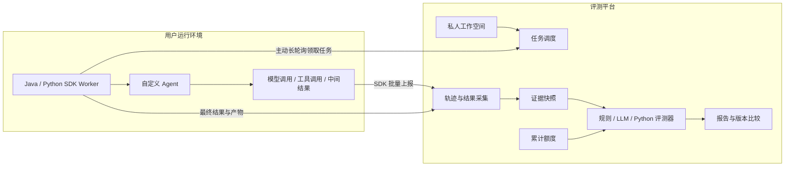

<div align="center">

# AgentEval Platform

### Connect your agents. Inspect their work. Measure what matters.

面向自定义 Agent 的评测平台，连接任务、执行轨迹与质量证据。

<p>
  
  
  
  
</p>

<p>
  <a href="#overview">项目介绍</a> ·
  <a href="#architecture">架构</a> ·
  <a href="#sdk-preview">SDK 设计预览</a> ·
  <a href="#documentation">设计文档</a> ·
  <a href="#roadmap">路线图</a>
</p>

</div>

> [!IMPORTANT]
> 项目正在开发：已实现共享协议和后端身份模块，完整评测平台、SDK及部署包尚未交付。下文整体能力为首版规划，SDK代码片段为接口示意，不代表已发布 API。当前可验证内容见[后端运行说明](docs/development/backend.md)和[实施进度](docs/development/progress.md)。

<a id="overview"></a>
## Overview

AgentEval Platform 旨在帮助开发者回答两个问题：**Agent 是否完成了任务，以及它是怎样完成的。**

你保留自己的 Agent 实现和运行环境，在私人工作空间中维护任务集与评分标准，通过 Java 或 Python SDK 接入。评测从平台发起，SDK Worker 主动领取任务，记录模型调用、工具调用、中间结果和最终输出。平台将这些证据交给规则、模型评审或自定义 Python 代码，生成可追溯的评测结果。

它适用于自定义 Agent 的质量回归、版本比较和失败分析。接入不要求使用特定 Agent 框架，也不要求开放入站 HTTP 端口。

### Designed around evidence

- **Your agent, your runtime.** Agent 在你自己的环境中执行，SDK 负责任务接入和轨迹上报。
- **Private by default.** 每位用户拥有独立工作空间，管理自己的 Agent、任务集、评测器和实验。
- **Evaluate outcomes and behavior.** 分开评估任务结果、执行过程和效率，定位具体失败步骤。
- **Extend the criteria.** 使用基础模板起步，再配置业务规则、编写评分提示词或添加 Python 评测函数。
- **Keep experiments traceable.** 固定任务、评测器和证据版本，重评保留历史结果。
- **Control judge usage.** 平台提供评审模型，按用户累计额度预留、结算并记录调用消耗。

<a id="architecture"></a>
## Architecture



**任务下发与轨迹上报是两条链路。** 平台统一关联一次任务尝试，Worker 在用户侧执行。内部步骤通过显式埋点或后续框架集成采集；只注册 Agent 入口，无法自动观察任意内部调用。

轨迹采集、存储、查询、展示和评测均由项目自建，不依赖 Langfuse 或 LangSmith。

## Evaluation methods

| 方式 | 适用内容 | 示例 |
| --- | --- | --- |
| Rule-based | 可明确表达的事实和约束 | JSON Schema、参数检查、必要步骤、调用次数 |
| LLM-as-judge | 开放性内容和语义判断 | 信息完整性、证据支持、工具结果使用是否合理 |
| Custom Python | 特定业务计算与自定义指标 | 根据订单折扣、优惠券和运费计算应退金额 |

三类评测器使用统一的结果结构：状态、分数、通过结论、解释和证据引用。Python 代码在平台的强化隔离环境执行，默认无网络访问。

> [!NOTE]
> “任务失败”“证据不足”和“评分器异常”是不同状态。用户上报的执行记录也不等同于独立环境验证；平台会标明证据来源和可评估范围。

<a id="sdk-preview"></a>
## SDK design preview

SDK 计划提供两部分能力：**Worker 接入**和**执行轨迹采集**。下面展示预期使用方式，包名、方法名及参数尚未冻结。

### Python

```python
# 接口设计示意，当前不可安装或运行。
from agent_eval import EvaluationWorker, observe

worker = EvaluationWorker.from_env()

@observe(kind="tool")
def query_order(order_id: str):
    return order_service.query(order_id)

@worker.agent("customer-service")
def evaluate_agent(task):
    # 复用现有 Agent；内部调用仍需对应的埋点或集成。
    return my_agent.run(task.input)

worker.start()
```

### Java

```java
// 接口设计示意，当前没有可下载的 Maven 构件。
try (var worker = EvaluationWorker.fromEnvironment()) {
    worker.registerAgent("customer-service", context ->
        telemetry.tool("query_order", () ->
            orderService.query(context.input())
        )
    );
    worker.startAndAwait();
}
```

两套 SDK 共用事件协议、运行标识和契约用例；Java 提供显式包装及可选注解集成，Python 提供装饰器和上下文管理器。

## Technology

| 层次 | 已选技术 |
| --- | --- |
| Platform | Java 21 · Spring Boot 3 · Maven |
| Web | React · TypeScript · Vite |
| Data | PostgreSQL · Redis · S3-compatible storage |
| Agent integration | Java SDK · Python SDK · HTTPS long polling |
| Custom evaluators | Python · 独立强化隔离 Runner |
| Deployment | Linux · Docker Compose |
| Engineering | TDD · 共享协议契约 · 租户与额度并发测试 |

Docker Compose 组织服务，Python 代码的安全执行需要额外的强化沙箱边界。组件补丁版本和发布包坐标将在实施时核对并锁定。

<a id="documentation"></a>
## Documentation

从[完整设计规格](docs/superpowers/specs/2026-10-25-agent-evaluation-platform-design.md)开始，了解：

- 第一版范围、已确认需求及待确认默认方案。
- 私人空间、任务集、评测器、套件与实验版本。
- Worker 注册、长轮询、租约、心跳和取消。
- 双 SDK 职责、轨迹事件、证据完整性和附件存储。
- 规则、LLM 与 Python 评测接口及聚合逻辑。
- 累计额度、调用预留、结算、异常对账和安全边界。
- 数据模型、测试策略和端到端验收场景。

参阅[分阶段实施计划](docs/superpowers/plans/2026-10-25-agent-evaluation-platform.md)：20 项 TDD 任务，覆盖文件布局、共享接口、测试命令和阶段验收。实现状态与本地验证记录见[实施进度](docs/development/progress.md)。

完整平台的SDK安装和部署指南尚未发布；已实现后端的构建与启动方式见[后端运行说明](docs/development/backend.md)。

<a id="roadmap"></a>
## Roadmap

- [x] 明确产品范围、技术栈和 SDK Worker 接入模式。
- [x] 编写设计规格并完成独立可实施性审阅。
- [x] 编写分阶段实施计划，明确接口、测试与验收条件。
- [x] 确认实施计划，采用当前会话逐项TDD实现。
- [x] 实现共享协议、私人工作空间与后端身份基础。
- [ ] 实现私人工作空间、版本化任务与持久化调度。
- [ ] 打通 Java/Python SDK 和自建轨迹采集。
- [ ] 实现规则、LLM、Python 三类评测器。
- [ ] 完成额度账本、报告、证据定位和版本比较。
- [ ] 发布演示 Agent、基础任务集与部署指南。

## Development

项目采用测试驱动开发。行为测试先于产品代码，重点验证跨空间隔离、双 SDK 协议一致性、重复消息、失联恢复、Python 隔离及并发额度结算。

在引入新能力前，先检查它是否符合设计规格；协议或评分语义的变化需要保留版本与兼容性说明。

---

<div align="center">
  <sub>Measure outcomes. Understand the execution. Improve with evidence.</sub>
</div>
