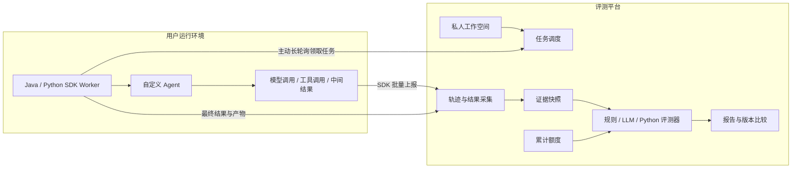

<div align="center">

# AgentEval Platform

### Connect your agents. Inspect their work. Measure what matters.

面向自定义 Agent 的评测平台，连接任务、执行轨迹与质量证据。

<p>
  
  
  
  
</p>

<p>
  <a href="#overview">项目介绍</a> ·
  <a href="#architecture">架构</a> ·
  <a href="#sdk-preview">SDK 接入</a> ·
  <a href="#documentation">设计文档</a> ·
  <a href="#roadmap">路线图</a>
</p>

</div>

> [!IMPORTANT]
> 项目正在开发：已实现双语言SDK、自建轨迹/证据、规则与LLM评分、累计额度/模型对账、混合调度，以及私人管理工作台、报告/对比、人工复核和独立重评/草稿试运行。Python Runner已实现，强化隔离尚待Linux/runsc节点验收，默认关闭。删除清理、资源上限和完整部署包仍在实施。可复现[双SDK评分闭环](docs/development/reporting.md)，使用[Web工作台](web/README.md)，更多能力见[实施进度](docs/development/progress.md)。

<a id="overview"></a>
## Overview

AgentEval Platform 旨在帮助开发者回答两个问题：**Agent 是否完成了任务，以及它是怎样完成的。**

你保留自己的 Agent 实现和运行环境，在私人工作空间中维护任务集与评分标准，通过 Java 或 Python SDK 接入。评测从平台发起，SDK Worker 主动领取任务，记录模型调用、工具调用、中间结果和最终输出。平台将这些证据交给规则、模型评审或自定义 Python 代码，生成可追溯的评测结果。

它适用于自定义 Agent 的质量回归、版本比较和失败分析。接入不要求使用特定 Agent 框架，也不要求开放入站 HTTP 端口。

### Designed around evidence

- **Your agent, your runtime.** Agent 在你自己的环境中执行，SDK 负责任务接入和轨迹上报。
- **Private by default.** 每位用户拥有独立工作空间，管理自己的 Agent、任务集、评测器和实验。
- **Evaluate outcomes and behavior.** 分开评估任务结果、执行过程和效率，定位具体失败步骤。
- **Extend the criteria.** 使用基础模板起步，再配置业务规则、编写评分提示词或添加 Python 评测函数。
- **Keep experiments traceable.** 固定任务、评测器和证据版本，重评保留历史结果。
- **Control judge usage.** 平台提供评审模型，按用户累计额度预留、结算并记录调用消耗。

<a id="architecture"></a>
## Architecture



**任务下发与轨迹上报是两条链路。** 平台统一关联一次任务尝试，Worker 在用户侧执行。内部步骤通过显式埋点或后续框架集成采集；只注册 Agent 入口，无法自动观察任意内部调用。

轨迹采集、存储、查询、展示和评测均由项目自建，不依赖 Langfuse 或 LangSmith。

## Evaluation methods

| 方式 | 适用内容 | 示例 | 当前状态 |
| --- | --- | --- | --- |
| Rule-based | 可明确表达的事实和约束 | Schema、参数、显式依赖、调用次数 | 可执行并查询报告 |
| LLM-as-judge | 开放性内容和语义判断 | 信息完整性、证据支持、工具结果使用是否合理 | 已提供配置范式，执行待接入 |
| Custom Python | 特定业务计算与自定义指标 | 根据折扣、优惠券和运费计算应退金额 | 已提供配置范式，隔离执行待接入 |

三类评测器使用统一的结果结构：状态、分数、通过结论、解释和证据引用。Python 代码在平台的强化隔离环境执行，默认无网络访问。

> [!NOTE]
> “任务失败”“证据不足”和“评分器异常”是不同状态。用户上报的执行记录也不等同于独立环境验证；平台会标明证据来源和可评估范围。

<a id="sdk-preview"></a>
## SDK integration

SDK提供 **Worker 接入**和**执行轨迹采集**。双语言包可从源码构建安装，尚未发布到公共制品仓库。

### Python

```python
# python -m pip install ./sdks/python
from threading import Event
from agent_eval import AgentResult, EvaluationWorker, observe

worker = EvaluationWorker.from_env()

@observe(kind="tool")
def query_order(order_id: str):
    return {"amount": 100, "status": "paid"}  # 替换为自己的工具实现

def evaluate_agent(task):
    return AgentResult(query_order(task.input["order_id"]))

worker.register_agent("YOUR_AGENT_UUID", evaluate_agent)
try:
    worker.start()
    Event().wait()
finally:
    worker.stop()
```

### Java

```java
// 先从源码安装 io.agenteval:agent-eval-sdk:0.1.0。
try (var worker = EvaluationWorker.fromEnvironment()) {
    worker.registerAgent("YOUR_AGENT_UUID", context ->
        AgentResult.of(Telemetry.tool("query_order", () ->
            Map.of("amount", 100, "status", "paid")
        ))
    );
    worker.startAndAwait();
}
```

两套SDK共用事件协议、运行标识和契约用例；Java提供显式包装和异步上下文传递，Python提供装饰器和上下文管理器。当前不包含Java注解集成模块。

## Technology

| 层次 | 已选技术 |
| --- | --- |
| Platform | Java 21 · Spring Boot 3 · Maven |
| Web | React · TypeScript · Vite |
| Data | PostgreSQL · Redis · S3-compatible storage |
| Agent integration | Java SDK · Python SDK · HTTPS long polling |
| Custom evaluators | Python · 独立强化隔离 Runner |
| Deployment | Linux · Docker Compose |
| Engineering | TDD · 共享协议契约 · 租户与额度并发测试 |

Docker Compose 组织服务，Python 代码的安全执行需要额外的强化沙箱边界。组件补丁版本和发布包坐标将在实施时核对并锁定。

<a id="documentation"></a>
## Documentation

从[完整设计规格](docs/superpowers/specs/2026-10-25-agent-evaluation-platform-design.md)开始，了解：

- 第一版范围、已确认需求及待确认默认方案。
- 私人空间、任务集、评测器、套件与实验版本。
- Worker 注册、长轮询、租约、心跳和取消。
- 双 SDK 职责、轨迹事件、证据完整性和附件存储。
- 规则、LLM 与 Python 评测接口及聚合逻辑。
- 累计额度、调用预留、结算、异常对账和安全边界。
- 数据模型、测试策略和端到端验收场景。

参阅[分阶段实施计划](docs/superpowers/plans/2026-10-25-agent-evaluation-platform.md)：20 项 TDD 任务，覆盖文件布局、共享接口、测试命令和阶段验收。实现状态与本地验证记录见[实施进度](docs/development/progress.md)。

接入、缓存和关闭行为见[Python指南](sdks/python/README.md)及[Java指南](sdks/java/README.md)；后端构建与启动见[运行说明](docs/development/backend.md)。完整平台部署指南将在部署验收后提供。

<a id="roadmap"></a>
## Roadmap

- [x] 明确产品范围、技术栈和 SDK Worker 接入模式。
- [x] 编写设计规格并完成独立可实施性审阅。
- [x] 编写分阶段实施计划，明确接口、测试与验收条件。
- [x] 确认实施计划，采用当前会话逐项TDD实现。
- [x] 实现共享协议、私人工作空间与后端身份基础。
- [x] 实现后端私人工作空间、版本化任务与持久化调度。
- [x] 打通 Java/Python SDK 和自建轨迹采集。
- [ ] 实现规则、LLM、Python 三类评测器。
- [x] 完成额度账本、报告、证据定位和版本比较。
- [x] 实现实验删除、资源预算、审计记录和私人工作台。
- [ ] 发布演示 Agent、基础任务集与部署指南。

## Development

项目采用测试驱动开发。行为测试先于产品代码，重点验证跨空间隔离、双 SDK 协议一致性、重复消息、失联恢复、Python 隔离及并发额度结算。

在引入新能力前，先检查它是否符合设计规格；协议或评分语义的变化需要保留版本与兼容性说明。

---

<div align="center">
  <sub>Measure outcomes. Understand the execution. Improve with evidence.</sub>
</div>
