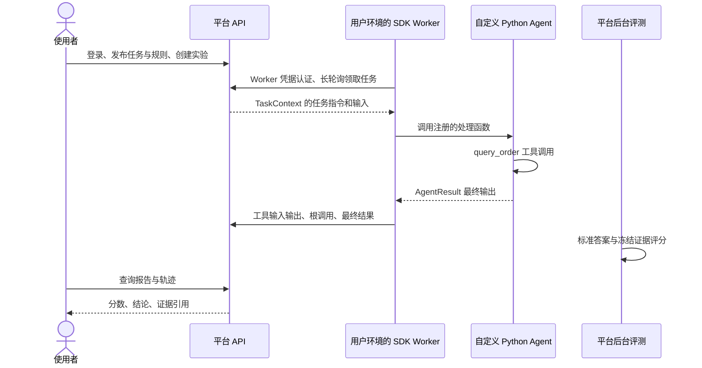

# 使用示例：从 Python Agent 到可追溯的评测报告

本教程来自一次已跑通的完整使用流程。你将用同一组订单任务评测两个 Agent，看到“工具调用正确，但最终答案错误”的差异，并定位错误发生在哪一步。

示例代码位于 [examples/python-evaluation-demo](../../examples/python-evaluation-demo/README.md)。它是独立的用户 Agent 项目，通过正式 PyPI 的 `veyraeval-sdk==0.1.0` 接入平台；平台端无需知道你的 Agent 内部实现。

## 1. 准备自己的平台账号

需要：

- Python 3.11 或更高版本。
- 可访问的 VeyraEval 平台及本人账号，首次登录已完成修改密码。
- 平台 API、后台 Worker 和存储等基础服务正常运行；工作空间仍有执行次数与存储预算。
- 本机开发 HTTPS 使用部署者提供的公开 CA 证书；公共 CA 证书的平台无需额外配置。

如果你负责部署，先按 [快速开始](quickstart.md) 启动平台。普通使用者只需要平台地址和自己的账号，不需要管理员权限或部署配置文件。

本例使用模拟订单和规则引擎，不调用大模型，不消耗模型 credits，也不需要自定义 Python 评测的 Linux/runsc 节点。

## 2. 安装并检查本地 Agent

下载仓库或复制示例目录，进入 `examples/python-evaluation-demo`：

```bash
python -m venv .venv
```

macOS / Linux：

```bash
source .venv/bin/activate
```

Windows PowerShell：

```powershell
.\.venv\Scripts\Activate.ps1
```

如果当前终端禁止执行激活脚本，无需修改系统策略；后续用 `.\.venv\Scripts\python.exe` 替代 `python` 即可。

```bash
python -m pip install -e .
python -m unittest discover -s tests -v
python -m order_agent.cli local
python -m order_agent.cli local --variant buggy
```

本地运行分别输出：

```json
{"amount": 100, "status": "paid"}
```

```json
{"amount": 1.0, "status": "paid"}
```

这里只检查业务输出，还没有连接平台或获得平台评分。

## 3. Agent 侧怎样接入 SDK

[agent.py](../../examples/python-evaluation-demo/src/order_agent/agent.py) 中的关键接口是：

```python
from agent_eval import AgentResult, TaskContext, observe

@observe("tool", name="query_order")
def query_order(order_id: str):
    # 示例使用本地订单表；可以换成自己的数据库或业务 API。
    return {"amount": 100, "status": "paid"}

def handler(context: TaskContext) -> AgentResult:
    return AgentResult(query_order(context.input["order_id"]))
```

上面只展示接口形式。完整实现支持 A、B、Z 三种订单以及取消检查和两个版本，见源码。

SDK 自动记录 `agent.run` 根 Span；`@observe` 记录工具参数、工具结果和父子关系。未打点的内部逻辑不会自动出现。这个示例没有调用模型，所以没有 model Span；接入真实模型时可使用 `@observe("model", name="模型调用名")`，并检查采集数据中的敏感信息。

`demo.py` 负责创建示例资源并把处理函数注册到 SDK Worker。正式接入可由用户在工作台管理资源，Worker 使用 `EvaluationWorker.from_env().register_agent(agent_id, handler)` 长期运行。更多配置见 [Python SDK 接入](python-sdk.md)。

## 4. 连接平台并执行两个实验

使用自己的平台地址和登录邮箱运行：

```bash
python -m order_agent.cli demo --url https://your-platform.example --email user@example.com
```

如果平台在本机、使用仓库部署生成的开发证书，且当前目录仍为仓库中的示例目录：

```bash
python -m order_agent.cli demo --url https://localhost:8443 --email user@example.com --ca ../../.tools/local/tls/server.crt
```

路径因部署位置而异；复制示例目录后请调整。终端会提示输入密码，输入不回显。密码不保存在项目中，不需要放入环境变量或聊天消息。普通用户与管理员都通过相同的私人工作空间接口运行。

程序将自动完成：

1. 用 Session/CSRF 登录，创建并发布任务集、三个规则评测器和套件。
2. 创建 `correct` 和 `buggy` 两个示范 Agent，签发仅能接入这两个 Agent 的临时 Worker 凭据。
3. 在本机启动两个 SDK Worker，分别为两个 Agent 创建实验；每个实验包含相同的三个任务。
4. SDK 主动长轮询领取任务，运行本地 Agent，上报工具轨迹与最终输出。
5. 平台收集并冻结证据，由后台规则引擎评分。程序等待完整评分，输出报告链接并下载证据。
6. 停止 Worker 并撤销临时凭据；私人目录和实验记录保留，便于继续查看。



用户 Agent 在自己的环境执行；平台后台执行评分。`TaskContext` 不含平台的标准答案。示例的 `catalog.py` 只是自动初始化配置，Worker 处理函数不会读取其中的参考答案。

## 5. 平台如何判定质量

任务集包含三个用例：

| 输入 | 标准答案 |
| --- | --- |
| `order_id=A` | `{"amount":100,"status":"paid"}` |
| `order_id=B` | `{"amount":250,"status":"shipped"}` |
| `order_id=Z` | `{"status":"not_found"}` |

三个评测器均为平台规则引擎执行：

| 指标 | 配置含义 | 维度 |
| --- | --- | --- |
| `answer_exact` | `/output` 与平台 `/expected` 完整比较 | outcome |
| `tool_called` | 工具集合恰好为 `query_order`；不限制这个工具调用次数 | process |
| `tool_args` | 所有 `query_order` 调用的第一个参数都等于 `/task_input/order_id` | process |

例如答案规则的 config 是：

```json
{"operator":"eq","selector":"/output","expected_selector":"/expected"}
```

每个指标得 0 或 1 分，阈值为 1，三个指标都必过。一个任务仅在三个指标都通过时判定 PASS。过程维度是两个过程指标的等权平均；结果维度是答案指标的平均分，平台分别展示这两个维度。

缺失证据或评测器异常会保留 `INSUFFICIENT_EVIDENCE` / `ERROR` 等状态，不能直接当成 Agent 得 0 分。应同时看评分覆盖率和未确定结果数。

## 6. 一次真实运行的结果

下面是此示例在 2026-10-27 的一次实际运行结果。公开示例仅保留模拟业务数据与汇总结果，不包含运行者账号、凭据、本机路径、工作空间 ID 或私人报告地址。你运行后会获得自己账号可访问的新报告。

| Agent | PASS | FAIL | 未确定 | 结果维度分数 | 过程维度分数 |
| --- | --- | --- | --- | --- | --- |
| correct | 3/3 | 0 | 0 | 1.000000 | 1.000000 |
| buggy | 1/3 | 2 | 0 | 0.333333 | 1.000000 |

实际完成了 6 个任务、18 项规则评分；所有指标状态为 `SCORED`，评分覆盖率为 100%。本轮 SDK Worker 临时凭据运行结束已撤销。

`buggy` 故意把查到的金额除以 100。查看它的用例 A 轨迹：

```text
agent.run
  输入：{"order_id":"A"}
  └─ query_order（tool）
       输入：{"args":["A"],"kwargs":{}}
       输出：{"amount":100,"status":"paid"}
  最终输出：{"amount":1,"status":"paid"}
```

工具拿到了正确数据，Agent 后续处理导致最终答案错误。因此工具集合、参数指标通过，答案指标失败。只看过程分会漏掉这个问题；只看答案分则无法定位到出错环节。

这组规则验证的是本示例的确定性要求，不代表覆盖所有 Agent 能力。自然语言质量可追加 LLM Judge，复杂业务计算可追加自定义 Python 指标；后者需要合格隔离节点，参见 [自定义评测器](custom-evaluators.md)。

## 7. 在工作台及本地查看证据

终端会打印两个本人的报告地址。登录同一平台账号后打开它们，在报告中查看各任务的执行状态、指标分数、通过结论与证据引用，并展开轨迹查看工具输入输出。在“任务集 / 评测器 / 套件 / Agent”中可以找到本轮创建的私人资源。

本机也会保存：

```text
.local/runs/本轮ID/
├── manifest.json          # 资源与实验 ID、完成状态、临时凭据撤销结果
├── correct/
│   ├── report.json        # 平台汇总报告
│   ├── trials.json        # 逐用例评分及证据引用
│   ├── trace-0.json       # 用例 A 轨迹；另有 trace-1/2.json
│   └── spool.sqlite       # SDK 持久化队列
└── buggy/                 # 同样结构的错误版本证据
```

`.local/` 已被示例忽略规则排除；不要把自己的证据目录或凭据提交到公开仓库。`manifest.json` 不保存密码或 Worker secret；它保留 credential_id，便于在撤销未确认时手动核对。

重复执行 `demo` 会创建新资源。只想查询已经执行过的实验时使用：

```bash
python -m order_agent.cli report YOUR_EXPERIMENT_UUID --url https://your-platform.example --email user@example.com
```

使用开发 HTTPS 时同样添加 `--ca`。该命令只读取报告，不创建新任务或重放业务执行。

## 8. 常见问题

| 现象 | 检查方式 |
| --- | --- |
| TLS 验证失败 | 确认平台地址、开发证书路径与有效期；公共 CA 部署通常无需 `--ca`。 |
| 登录被拒绝 | 确认本人的账号密码，先在网页完成首次改密；不要使用部署初始密码绕过改密。 |
| 任务没有开始 | 确认本机 SDK Worker 可访问平台、Agent 版本匹配、执行与存储预算足够。 |
| 评分暂未出现 | 默认有证据收集宽限期和后台处理时间；查看平台逐用例状态，可调整 `--timeout`。 |
| 命令超时或网络中断 | 查看 `manifest.json` 和平台已有实验；不要盲目重跑不确定的业务执行。 |
| 临时凭据撤销未确认 | 在平台接入凭据中按 manifest 的 credential_id 检查并撤销。 |

把 `agent.py` 换成自己的处理函数，再按业务调整任务集和评分规则，就可以沿用这条链路进行质量回归与失败分析。
