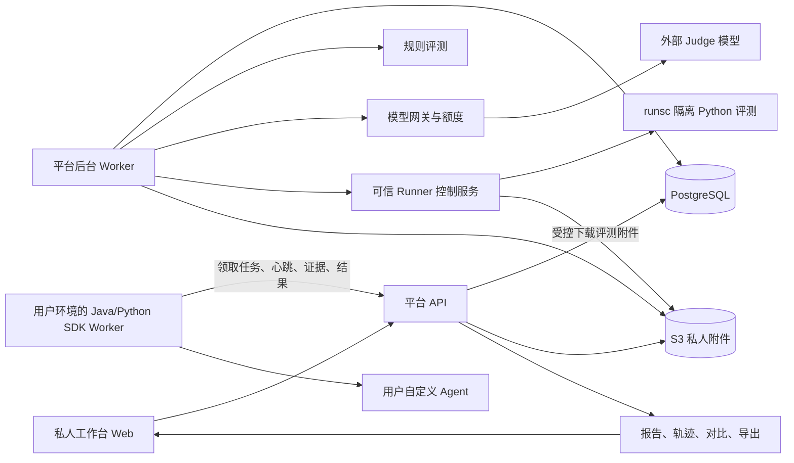
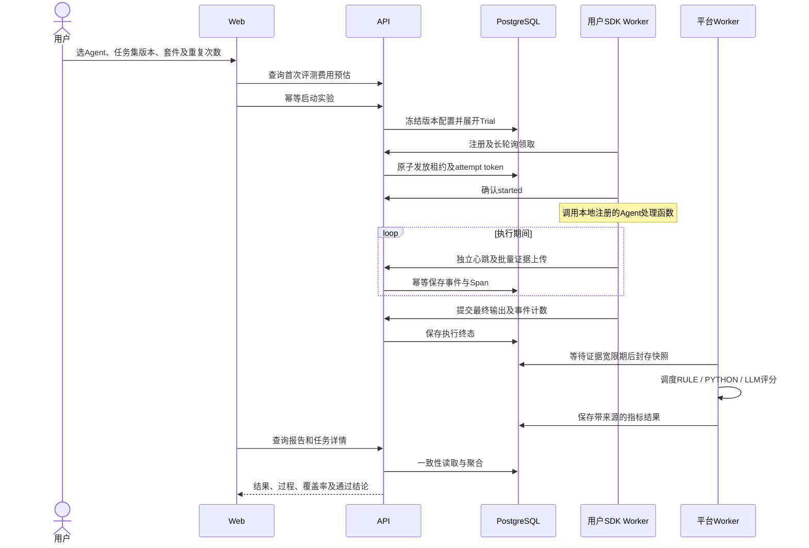
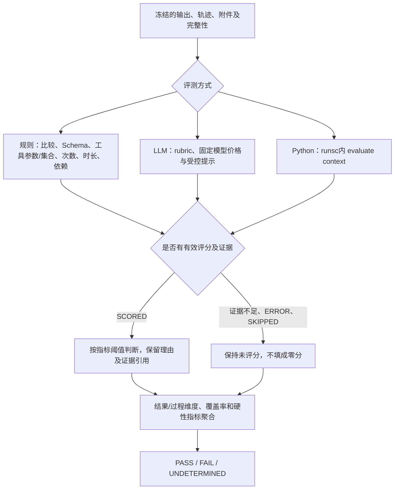

# VeyraEval Platform：项目结构与代码阅读指南

本文根据当前源码整理，描述系统现在如何工作，不记录私人设计讨论。适合第一次接手仓库的开发者：先理解运行角色，再跟一次实验，最后按文件索引进入实现。

工作台当前以“任务集”和“评分规则集”组织日常使用：任务与规则通过表单编辑，评分规则集整体发布。内部 EVALUATOR/SUITE 仍保存规则与集合的固定版本，确保历史实验可追溯；详见[工作台使用指南](guides/tasks-and-rule-sets.md)。

## 1. 一句话理解项目

这是给自定义Agent评测用的平台。用户在私人工作空间维护任务集与评分体系，在平台发起实验；Java/Python SDK在用户自己的环境领取任务、运行Agent并上报过程和结果；平台冻结证据，执行规则、LLM Judge或强化隔离的Python评测，生成可追溯报告。

这里有两个不同的Worker：**SDK Worker运行用户Agent，平台Worker处理评分与后台维护**。Runner则负责不可信Python评测代码，不运行整个用户Agent。

| 角色 | 技术/位置 | 负责什么 |
| --- | --- | --- |
| Web | React、TypeScript、Vite；`web/` | 登录、私有目录、实验、报告、额度和管理界面。不是Next.js。 |
| API | Java21、Spring Boot3；`platform/api/` | 鉴权、HTTP入口、工作空间权限和同步用例。 |
| 领域与适配层 | `platform/core/`、`platform/infrastructure/` | 领域语义、事务、JDBC/S3/模型/Runner适配。 |
| 平台Worker | `platform/worker/` | 证据封存、评分、过期维护、未知模型恢复和删除清理。 |
| SDK Worker | 用户Agent所在环境；`sdks/` | 长轮询、租约、协作取消、调用处理函数、持久上报证据。 |
| Runner | 专用Linux/runsc节点；`runner/` | 有界运行用户定义的Python评测函数。 |
| PostgreSQL | 部署backend网络 | 账号、版本、任务/租约、证据、评分、费用和审计的权威数据。 |
| S3/RustFS | 私人对象存储 | 附件、封存对象和短时签名下载。 |
| Redis | Compose中预留 | 当前业务源码没有用它实现任务队列；可靠调度以PostgreSQL为准。 |

## 2. 系统连接图



箭头表示调用/数据访问方向，不意味着浏览器直接读取数据库。浏览器使用Session/CSRF，SDK使用受限Worker凭证，平台到Runner使用内部认证，用户代码不获得平台凭证或Docker socket。

## 3. 一次实验怎样跑完



关键代码路径：`ExperimentController → ExperimentService → JdbcExperimentRepository`创建实验；`WorkerController → LeaseService`处理执行租约；SDK `EvaluationWorker/worker.py`运行处理函数；`TelemetryController/ArtifactController`收证据；`JdbcEvidenceRepository`封存；`EvaluationOrchestrator`评分；`ReportService/ComparisonService`生成可见报告。

### 3.1 实验、Trial、Span和评分轮次有什么区别

| 概念 | 例子/职责 | 主要代码 |
| --- | --- | --- |
| 发布版本 | 某一版订单任务集、评测器和套件 | `CatalogService`、`PublishedVersion`。修改草稿不改旧版本。 |
| Experiment | 一次“Agent v1用任务集v2、套件v3各跑3次”的实验 | `ExperimentService`冻结配置，记录预估和可选重跑来源。 |
| Trial | 一个案例的一次尝试 | `TrialRecord`、租约和SDK TaskContext。 |
| TraceEvent / Span | Agent根调用及内部工具/模型调用的开始、结束、输入输出、时长 | 两套SDK Telemetry、事件仓储及Span投影。 |
| EvidenceSnapshot | 在固定时点封存的评测事实和完整性 | `EvidenceService`、`JdbcEvidenceRepository`。不是随到随改的日志视图。 |
| EvaluationRun / job | 基于某快照及套件的评分轮次/其中一个指标 | 初评、显式重评、草稿试运行相互保留来源。 |
| CriterionResult | 某指标的分数、状态、理由和证据引用 | `CriterionResult`、三类Evaluator。 |

### 3.2 中间轨迹怎样变成评分



执行成功不等于质量通过；完整采集不等于答案正确；缺失轨迹不能证明“没有调用禁止工具”。例如exact工具集合成功需要完整证据。LLM调用先预留累计整数credits，再按实际用量结算；发送状态不确定时等待对账，不能盲目重发。自定义Python只返回受限评分结构，`passed`由平台阈值判断。

### 3.3 两套SDK和Runner的边界

- Java SDK公开入口是`EvaluationWorker`、`Telemetry`、`AgentResult`；Python公开入口是`EvaluationWorker`、`observe/span`、`AgentResult`。
- SDK的SQLite spool先保存事件再上传；重复上传保持相同ID。执行标记防止重复调用处理函数，崩溃后不自动重放未知业务副作用。
- SDK只看得到你接入/打点的模型、工具与中间结果，不自动获得所有第三方Agent内部状态，也不采集模型隐藏思维链。
- Runner的SQLite registry保存评测执行身份与缓存；代码在runsc guest执行，可信控制服务只管理Docker/输入/结果。
- 用户real UID任务/线程默认硬限制32，包含入口及读取进程；宿主gVisor运行时另有256 PID预算，内存/CPU/并发也受限。详见[Runner说明](development/python-runner.md)。

### 3.4 删除及恢复不是简单删一行

删除先进入DELETING并阻断私人访问，再等待宽限期、清理S3对象及对应Runner私有缓存/遗留输入，收到确认才进入DELETED。墓碑阻挡迟到写入；费用和最小UUID审计可保留。备份恢复要求停止写入，并恢复到空目标。详见[生命周期](development/lifecycle-resources.md)和[运维指南](guides/operations.md)。

## 4. 推荐阅读顺序

1. 先看[快速开始](guides/quickstart.md)及`examples/`，理解用户处理函数的输入和返回。
2. 看`contracts/schemas`及`platform/protocol`，理解SDK与平台交换的消息。
3. 跟`ExperimentController/ExperimentService`、`WorkerController/LeaseService`及SDK Worker，走通执行链路。
4. 看`EvidenceService`、`EvaluationOrchestrator`、三种Evaluator和`EvaluationAggregator`，理解评分依据。
5. 看`ModelGateway`、`QuotaService`、`ReportService`与数据库适配器，理解费用和报告。
6. 需要改功能时，对照对应`src/test`和`e2e`场景；涉及隔离则必须在合格Linux节点验收。

## 5. 构建与验证入口

| 目的 | 命令/位置 | 实际验证什么 |
| --- | --- | --- |
| Java服务/SDK | `./mvnw verify` | 协议、领域、数据库、HTTP、后台Worker、Java SDK及示例构建。 |
| Python SDK | `python -m pytest sdks/python/tests -q` | 协议、打点、队列、传输和执行收尾。 |
| 前端 | 在web中运行`npm test -- --run`、`npm run build` | 交互回归、TypeScript检查和生产构建。 |
| Runner控制层 | `python -m pytest runner/tests -m 'not integration' -q` | 可信控制/协议/幂等/删除；不证明真实隔离。 |
| 真实隔离 | 合格Linux/runsc执行`runner/tests`，以及CI中的100次边界检查 | 内存/超时/PID/网络/文件/秘密隔离及私有结果清理。 |
| 整个平台 | `e2e/`及Linux sandbox acceptance | HTTPS、双SDK三类评分、浏览器、恢复、容量和未知状态。 |
| SDK分发 | [发布指南](guides/sdk-publishing.md)、[Java签名发布](guides/maven-central.md) | Python已发布PyPI、Java已发布Maven Central；均已通过独立环境安装/编译验证。 |

规则：新增行为先写失败测试，修复后运行有意义的回归；不能把控制层通过写成runsc隔离通过。当前Git规则见[Agent.md](../Agent.md)：每次push必须先得到用户本次同意，commit说明使用中文。

## 6. 完整目录树

下面只列入Git可分发源码/配置/测试/文档。排除`target/`、`node_modules/`、`.tools/`、本地spool、环境密钥和已停止跟踪的私人过程文档；并非把这些目录当作缺失的业务文件。

<details>
<summary>展开完整目录树：607个文件</summary>

```text
veyraeval/
├── .github/
│   └── workflows/
│       ├── java-sdk-release.yml
│       ├── python-sdk-release.yml
│       ├── runner-isolation.yml
│       ├── sandbox-e2e.yml
│       ├── sdk-distributions.yml
│       └── verify.yml
├── .mvn/
│   ├── wrapper/
│   │   └── maven-wrapper.properties
│   ├── maven.config
│   └── settings.xml
├── contracts/
│   ├── fixtures/
│   │   └── v1/
│   │       ├── calibration/
│   │       │   ├── content-coverage.json
│   │       │   ├── evidence-support.json
│   │       │   └── tool-result-use.json
│   │       ├── evaluation/
│   │       │   ├── order-fail.json
│   │       │   ├── order-insufficient.json
│   │       │   └── order-pass.json
│   │       ├── bad-artifact-path.json
│   │       ├── bad-artifact-size.json
│   │       ├── bad-completion-state.json
│   │       ├── bad-kind.json
│   │       ├── bad-large-score.json
│   │       ├── bad-long-wait.json
│   │       ├── bad-missing-score.json
│   │       ├── bad-negative-score.json
│   │       ├── bad-register-artifact-size.json
│   │       ├── bad-register-concurrency.json
│   │       ├── bad-register-protocol.json
│   │       ├── bad-secret-task.json
│   │       ├── bad-sequence.json
│   │       ├── bad-source.json
│   │       ├── bad-unscored-score.json
│   │       ├── bad-uuid.json
│   │       ├── bad-version.json
│   │       ├── bad-zero-trace.json
│   │       ├── manifest.json
│   │       ├── valid-artifact-ref.json
│   │       ├── valid-claim-request.json
│   │       ├── valid-completion-request.json
│   │       ├── valid-criterion-result.json
│   │       ├── valid-evaluation-context.json
│   │       ├── valid-insufficient.json
│   │       ├── valid-lease-grant.json
│   │       ├── valid-register-artifact.json
│   │       ├── valid-register-worker.json
│   │       ├── valid-trace-event.json
│   │       └── valid-trial-context.json
│   ├── openapi/
│   │   └── platform-v1.yaml
│   └── schemas/
│       ├── artifact-ref.json
│       ├── claim-request.json
│       ├── completion-request.json
│       ├── criterion-result.json
│       ├── evaluation-context.json
│       ├── lease-grant.json
│       ├── register-artifact-request.json
│       ├── register-worker-request.json
│       ├── trace-event.json
│       └── trial-context.json
├── deploy/
│   ├── ops/
│   │   ├── Dockerfile
│   │   ├── judge_stub.py
│   │   ├── requirements.lock
│   │   └── storage.py
│   ├── .env.example
│   ├── Dockerfile.platform
│   ├── Dockerfile.runner
│   ├── Dockerfile.web
│   ├── compose.sandbox.yaml
│   ├── compose.yaml
│   └── nginx.conf
├── docs/
│   ├── development/
│   │   ├── acceptance.md
│   │   ├── backend.md
│   │   ├── dependencies.md
│   │   ├── evidence.md
│   │   ├── lifecycle-resources.md
│   │   ├── llm-evaluation.md
│   │   ├── mixed-evaluation.md
│   │   ├── model-gateway.md
│   │   ├── phase-b-demo-result.json
│   │   ├── python-runner.md
│   │   ├── quota.md
│   │   ├── report-comparison.md
│   │   ├── reporting.md
│   │   ├── rules.md
│   │   ├── runner-resource-incident.md
│   │   └── worker-protocol.md
│   ├── guides/
│   │   ├── custom-evaluators.md
│   │   ├── java-sdk.md
│   │   ├── llm-models.md
│   │   ├── maven-central.md
│   │   ├── operations.md
│   │   ├── python-evaluation-walkthrough.md
│   │   ├── python-sdk.md
│   │   ├── quickstart.md
│   │   ├── sdk-publishing.md
│   │   └── tasks-and-rule-sets.md
│   └── project-guide.md
├── e2e/
│   ├── conftest.py
│   ├── test_browser.py
│   ├── test_java_worker.py
│   ├── test_operations.py
│   ├── test_python_worker.py
│   └── test_restart_and_quota.py
├── examples/
│   ├── java-order-agent/
│   │   ├── src/
│   │   │   └── main/
│   │   │       └── java/
│   │   │           └── io/
│   │   │               └── agenteval/
│   │   │                   └── examples/
│   │   │                       └── OrderAgent.java
│   │   └── pom.xml
│   ├── python-evaluation-demo/
│   │   ├── src/
│   │   │   └── order_agent/
│   │   │       ├── __init__.py
│   │   │       ├── agent.py
│   │   │       ├── catalog.py
│   │   │       ├── cli.py
│   │   │       ├── demo.py
│   │   │       └── platform.py
│   │   ├── tests/
│   │   │   ├── test_agent.py
│   │   │   ├── test_evidence.py
│   │   │   └── test_platform.py
│   │   ├── .gitignore
│   │   ├── README.md
│   │   └── pyproject.toml
│   └── python-order-agent/
│       └── main.py
├── platform/
│   ├── api/
│   │   ├── src/
│   │   │   ├── main/
│   │   │   │   ├── java/
│   │   │   │   │   └── io/
│   │   │   │   │       └── agenteval/
│   │   │   │   │           ├── admin/
│   │   │   │   │           │   ├── AccountAdminController.java
│   │   │   │   │           │   ├── ModelAdminController.java
│   │   │   │   │           │   └── QuotaAdminController.java
│   │   │   │   │           ├── administration/
│   │   │   │   │           │   ├── AdministrationController.java
│   │   │   │   │           │   ├── EvidenceReadAdmissionFilter.java
│   │   │   │   │           │   └── WorkspaceListingsController.java
│   │   │   │   │           ├── api/
│   │   │   │   │           │   ├── AdminBootstrap.java
│   │   │   │   │           │   ├── ApiExceptionHandler.java
│   │   │   │   │           │   └── PlatformApiApplication.java
│   │   │   │   │           ├── catalog/
│   │   │   │   │           │   ├── CatalogConfiguration.java
│   │   │   │   │           │   └── CatalogController.java
│   │   │   │   │           ├── evaluation/
│   │   │   │   │           │   ├── EvaluationRunController.java
│   │   │   │   │           │   ├── HumanReviewConfiguration.java
│   │   │   │   │           │   ├── HumanReviewController.java
│   │   │   │   │           │   ├── JudgeTemplateConfiguration.java
│   │   │   │   │           │   ├── JudgeTemplateController.java
│   │   │   │   │           │   ├── ReevaluationConfiguration.java
│   │   │   │   │           │   └── ReevaluationController.java
│   │   │   │   │           ├── experiments/
│   │   │   │   │           │   ├── ExperimentConfiguration.java
│   │   │   │   │           │   └── ExperimentController.java
│   │   │   │   │           ├── identity/
│   │   │   │   │           │   └── IdentityController.java
│   │   │   │   │           ├── model/
│   │   │   │   │           │   ├── ModelController.java
│   │   │   │   │           │   └── ModelViews.java
│   │   │   │   │           ├── quota/
│   │   │   │   │           │   └── QuotaController.java
│   │   │   │   │           ├── reporting/
│   │   │   │   │           │   ├── ReportComparisonController.java
│   │   │   │   │           │   ├── ReportConfiguration.java
│   │   │   │   │           │   └── ReportController.java
│   │   │   │   │           ├── security/
│   │   │   │   │           │   ├── ApiProblems.java
│   │   │   │   │           │   ├── BrowserSecurityConfig.java
│   │   │   │   │           │   ├── CurrentActor.java
│   │   │   │   │           │   ├── PasswordChangeFilter.java
│   │   │   │   │           │   ├── WorkerAuthenticationFilter.java
│   │   │   │   │           │   └── WorkerSecurityConfig.java
│   │   │   │   │           ├── telemetry/
│   │   │   │   │           │   ├── ArtifactController.java
│   │   │   │   │           │   ├── TelemetryController.java
│   │   │   │   │           │   ├── TraceInputLimitException.java
│   │   │   │   │           │   └── TraceRequestLimitFilter.java
│   │   │   │   │           └── workers/
│   │   │   │   │               ├── CredentialController.java
│   │   │   │   │               ├── WorkerConfiguration.java
│   │   │   │   │               ├── WorkerController.java
│   │   │   │   │               └── WorkerLongPoll.java
│   │   │   │   └── resources/
│   │   │   │       ├── templates/
│   │   │   │       │   ├── judges/
│   │   │   │       │   │   ├── content-coverage.json
│   │   │   │       │   │   ├── evidence-support.json
│   │   │   │       │   │   └── tool-result-use.json
│   │   │   │       │   └── starter.json
│   │   │   │       └── application.yaml
│   │   │   └── test/
│   │   │       └── java/
│   │   │           └── io/
│   │   │               └── agenteval/
│   │   │                   ├── administration/
│   │   │                   │   ├── AdministrationApiIT.java
│   │   │                   │   └── EvidenceReadAdmissionFilterTest.java
│   │   │                   ├── catalog/
│   │   │                   │   └── CatalogVersionIT.java
│   │   │                   ├── identity/
│   │   │                   │   └── PrivateWorkspaceIT.java
│   │   │                   ├── model/
│   │   │                   │   └── ModelAdminApiIT.java
│   │   │                   ├── quota/
│   │   │                   │   └── QuotaApiIT.java
│   │   │                   ├── reporting/
│   │   │                   │   └── ReportApiIT.java
│   │   │                   ├── telemetry/
│   │   │                   │   ├── TraceIngestionIT.java
│   │   │                   │   └── TraceRequestLimitFilterTest.java
│   │   │                   └── workers/
│   │   │                       └── WorkerLeaseIT.java
│   │   └── pom.xml
│   ├── core/
│   │   ├── src/
│   │   │   ├── main/
│   │   │   │   ├── java/
│   │   │   │   │   └── io/
│   │   │   │   │       └── agenteval/
│   │   │   │   │           ├── administration/
│   │   │   │   │           │   ├── AuditAction.java
│   │   │   │   │           │   ├── AuditEvent.java
│   │   │   │   │           │   ├── AuditService.java
│   │   │   │   │           │   ├── ResourceLimitService.java
│   │   │   │   │           │   ├── ResourceLimits.java
│   │   │   │   │           │   ├── ResourceReadLimitException.java
│   │   │   │   │           │   ├── ResourceUsage.java
│   │   │   │   │           │   └── WorkspaceListings.java
│   │   │   │   │           ├── agents/
│   │   │   │   │           │   ├── AgentRecord.java
│   │   │   │   │           │   ├── AgentRepository.java
│   │   │   │   │           │   └── AgentService.java
│   │   │   │   │           ├── catalog/
│   │   │   │   │           │   ├── CanonicalJson.java
│   │   │   │   │           │   ├── CatalogConflictException.java
│   │   │   │   │           │   ├── CatalogRepository.java
│   │   │   │   │           │   ├── CatalogResource.java
│   │   │   │   │           │   ├── CatalogService.java
│   │   │   │   │           │   ├── DatasetImportException.java
│   │   │   │   │           │   ├── DatasetService.java
│   │   │   │   │           │   ├── EvaluatorCatalogService.java
│   │   │   │   │           │   ├── PublishedVersion.java
│   │   │   │   │           │   ├── PublishedVersionSummary.java
│   │   │   │   │           │   ├── ResourceKind.java
│   │   │   │   │           │   ├── SuiteService.java
│   │   │   │   │           │   └── TemplateService.java
│   │   │   │   │           ├── evaluation/
│   │   │   │   │           │   ├── BoundedJsonSchema.java
│   │   │   │   │           │   ├── EvaluationAggregator.java
│   │   │   │   │           │   ├── EvaluationDeferredException.java
│   │   │   │   │           │   ├── EvaluationEntry.java
│   │   │   │   │           │   ├── EvaluationOrchestrator.java
│   │   │   │   │           │   ├── EvaluationRepository.java
│   │   │   │   │           │   ├── EvaluationRunRepository.java
│   │   │   │   │           │   ├── EvaluationRunService.java
│   │   │   │   │           │   ├── EvaluationRunView.java
│   │   │   │   │           │   ├── Evaluator.java
│   │   │   │   │           │   ├── EvaluatorDefinition.java
│   │   │   │   │           │   ├── EvaluatorJob.java
│   │   │   │   │           │   ├── EvaluatorPreviewRepository.java
│   │   │   │   │           │   ├── EvaluatorPreviewService.java
│   │   │   │   │           │   ├── EvidenceReferenceValidator.java
│   │   │   │   │           │   ├── HumanReview.java
│   │   │   │   │           │   ├── HumanReviewRepository.java
│   │   │   │   │           │   ├── HumanReviewService.java
│   │   │   │   │           │   ├── JudgePromptBuilder.java
│   │   │   │   │           │   ├── JudgeTemplateService.java
│   │   │   │   │           │   ├── LlmEvaluator.java
│   │   │   │   │           │   ├── PythonEvaluator.java
│   │   │   │   │           │   ├── ReevaluationRepository.java
│   │   │   │   │           │   ├── ReevaluationService.java
│   │   │   │   │           │   ├── RuleEvaluator.java
│   │   │   │   │           │   ├── RuleSelector.java
│   │   │   │   │           │   └── SandboxClient.java
│   │   │   │   │           ├── experiments/
│   │   │   │   │           │   ├── AttemptContext.java
│   │   │   │   │           │   ├── AttemptRejectedException.java
│   │   │   │   │           │   ├── ExperimentDeletionRepository.java
│   │   │   │   │           │   ├── ExperimentDeletionService.java
│   │   │   │   │           │   ├── ExperimentDeletionStatus.java
│   │   │   │   │           │   ├── ExperimentRecord.java
│   │   │   │   │           │   ├── ExperimentRepository.java
│   │   │   │   │           │   ├── ExperimentService.java
│   │   │   │   │           │   ├── HeartbeatReply.java
│   │   │   │   │           │   ├── LeaseRepository.java
│   │   │   │   │           │   ├── LeaseService.java
│   │   │   │   │           │   ├── RunnerEvidenceCleaner.java
│   │   │   │   │           │   ├── StartExperimentCommand.java
│   │   │   │   │           │   ├── TrialRecord.java
│   │   │   │   │           │   └── TrialStateMachine.java
│   │   │   │   │           ├── identity/
│   │   │   │   │           │   ├── AccountAdminService.java
│   │   │   │   │           │   ├── AccountSummary.java
│   │   │   │   │           │   ├── IdentityRepository.java
│   │   │   │   │           │   ├── IdentityService.java
│   │   │   │   │           │   ├── ScopeViolationException.java
│   │   │   │   │           │   ├── UserAccount.java
│   │   │   │   │           │   ├── WorkspaceActor.java
│   │   │   │   │           │   └── WorkspaceScope.java
│   │   │   │   │           ├── model/
│   │   │   │   │           │   ├── JudgeProvider.java
│   │   │   │   │           │   ├── JudgeRequest.java
│   │   │   │   │           │   ├── JudgeResponse.java
│   │   │   │   │           │   ├── ModelCallConflictException.java
│   │   │   │   │           │   ├── ModelCallRepository.java
│   │   │   │   │           │   ├── ModelCallStateMachine.java
│   │   │   │   │           │   ├── ModelCallSummary.java
│   │   │   │   │           │   ├── ModelConnection.java
│   │   │   │   │           │   ├── ModelConnectionDefaults.java
│   │   │   │   │           │   ├── ModelDispatch.java
│   │   │   │   │           │   ├── ModelGateway.java
│   │   │   │   │           │   ├── ModelProfile.java
│   │   │   │   │           │   ├── ModelProfileCommand.java
│   │   │   │   │           │   ├── ModelProfileRepository.java
│   │   │   │   │           │   ├── ModelProfileService.java
│   │   │   │   │           │   ├── ModelUnavailableException.java
│   │   │   │   │           │   ├── PriceVersion.java
│   │   │   │   │           │   └── ProviderResponse.java
│   │   │   │   │           ├── quota/
│   │   │   │   │           │   ├── CnyAmount.java
│   │   │   │   │           │   ├── InsufficientQuotaException.java
│   │   │   │   │           │   ├── QuotaConflictException.java
│   │   │   │   │           │   ├── QuotaEntry.java
│   │   │   │   │           │   ├── QuotaLedgerPage.java
│   │   │   │   │           │   ├── QuotaRepository.java
│   │   │   │   │           │   ├── QuotaService.java
│   │   │   │   │           │   ├── QuotaWallet.java
│   │   │   │   │           │   └── Reservation.java
│   │   │   │   │           ├── reporting/
│   │   │   │   │           │   ├── ComparisonQueries.java
│   │   │   │   │           │   ├── ComparisonReport.java
│   │   │   │   │           │   ├── ComparisonService.java
│   │   │   │   │           │   ├── ExperimentReport.java
│   │   │   │   │           │   ├── ReportData.java
│   │   │   │   │           │   ├── ReportExportLimitException.java
│   │   │   │   │           │   ├── ReportExporter.java
│   │   │   │   │           │   ├── ReportProvenance.java
│   │   │   │   │           │   ├── ReportRepository.java
│   │   │   │   │           │   ├── ReportService.java
│   │   │   │   │           │   └── TrialReport.java
│   │   │   │   │           ├── telemetry/
│   │   │   │   │           │   ├── ArtifactRecord.java
│   │   │   │   │           │   ├── ArtifactRepository.java
│   │   │   │   │           │   ├── ArtifactService.java
│   │   │   │   │           │   ├── ArtifactStore.java
│   │   │   │   │           │   ├── BatchAck.java
│   │   │   │   │           │   ├── EvidencePendingException.java
│   │   │   │   │           │   ├── EvidenceRepository.java
│   │   │   │   │           │   ├── EvidenceService.java
│   │   │   │   │           │   ├── EvidenceSnapshot.java
│   │   │   │   │           │   ├── SpanProjector.java
│   │   │   │   │           │   ├── SpanView.java
│   │   │   │   │           │   ├── StorageUnavailableException.java
│   │   │   │   │           │   ├── TelemetryConflictException.java
│   │   │   │   │           │   ├── TelemetryLimitException.java
│   │   │   │   │           │   ├── TelemetryRepository.java
│   │   │   │   │           │   ├── TelemetryService.java
│   │   │   │   │           │   └── TracePage.java
│   │   │   │   │           └── workers/
│   │   │   │   │               ├── CapacityExceededException.java
│   │   │   │   │               ├── CredentialRepository.java
│   │   │   │   │               ├── CredentialSummary.java
│   │   │   │   │               ├── InvalidWorkerCredentialException.java
│   │   │   │   │               ├── IssuedCredential.java
│   │   │   │   │               ├── TokenSecrets.java
│   │   │   │   │               ├── WorkerCredentialService.java
│   │   │   │   │               ├── WorkerPrincipal.java
│   │   │   │   │               └── WorkerRegistry.java
│   │   │   │   └── resources/
│   │   │   │       └── judges/
│   │   │   │           └── result-schema.json
│   │   │   └── test/
│   │   │       └── java/
│   │   │           └── io/
│   │   │               └── agenteval/
│   │   │                   ├── catalog/
│   │   │                   │   └── TaskPayloadLimitTest.java
│   │   │                   ├── evaluation/
│   │   │                   │   ├── EvaluationAggregatorTest.java
│   │   │                   │   ├── HumanReviewValidationTest.java
│   │   │                   │   ├── LlmEvaluatorTest.java
│   │   │                   │   └── RuleEvaluatorTest.java
│   │   │                   ├── model/
│   │   │                   │   └── ModelConnectionDefaultsTest.java
│   │   │                   └── quota/
│   │   │                       └── CnyAmountTest.java
│   │   └── pom.xml
│   ├── infrastructure/
│   │   ├── src/
│   │   │   ├── main/
│   │   │   │   ├── java/
│   │   │   │   │   └── io/
│   │   │   │   │       └── agenteval/
│   │   │   │   │           ├── administration/
│   │   │   │   │           │   ├── AdministrationConfiguration.java
│   │   │   │   │           │   ├── JdbcAuditRepository.java
│   │   │   │   │           │   ├── JdbcAuditWriter.java
│   │   │   │   │           │   ├── JdbcReadBudget.java
│   │   │   │   │           │   ├── JdbcResourceAdmission.java
│   │   │   │   │           │   ├── JdbcResourceLimitRepository.java
│   │   │   │   │           │   └── JdbcWorkspaceListings.java
│   │   │   │   │           ├── agents/
│   │   │   │   │           │   └── JdbcAgentRepository.java
│   │   │   │   │           ├── catalog/
│   │   │   │   │           │   ├── EphemeralCatalogCleaner.java
│   │   │   │   │           │   └── JdbcCatalogRepository.java
│   │   │   │   │           ├── evaluation/
│   │   │   │   │           │   ├── EvaluationEngineConfiguration.java
│   │   │   │   │           │   ├── JdbcEvaluationRepository.java
│   │   │   │   │           │   ├── JdbcEvaluationRunRepository.java
│   │   │   │   │           │   ├── JdbcEvaluatorPreviewRepository.java
│   │   │   │   │           │   ├── JdbcHumanReviewRepository.java
│   │   │   │   │           │   └── JdbcReevaluationRepository.java
│   │   │   │   │           ├── experiments/
│   │   │   │   │           │   ├── JdbcExperimentDeletionRepository.java
│   │   │   │   │           │   ├── JdbcExperimentRepository.java
│   │   │   │   │           │   ├── JdbcLeaseRepository.java
│   │   │   │   │           │   ├── LeaseSweeper.java
│   │   │   │   │           │   └── QueuedTrialExpiry.java
│   │   │   │   │           ├── http/
│   │   │   │   │           │   └── LimitedBodySubscriber.java
│   │   │   │   │           ├── identity/
│   │   │   │   │           │   └── JdbcIdentityRepository.java
│   │   │   │   │           ├── infrastructure/
│   │   │   │   │           │   └── evaluation/
│   │   │   │   │           │       ├── JdbcRunnerDispatchRegistry.java
│   │   │   │   │           │       └── RunnerSandboxClient.java
│   │   │   │   │           ├── model/
│   │   │   │   │           │   ├── EncryptedModelProfileRepository.java
│   │   │   │   │           │   ├── JdbcModelCallRepository.java
│   │   │   │   │           │   ├── ModelInfrastructureConfiguration.java
│   │   │   │   │           │   ├── ModelKeyRotation.java
│   │   │   │   │           │   ├── ModelSecretBox.java
│   │   │   │   │           │   └── OpenAiCompatibleJudgeClient.java
│   │   │   │   │           ├── operations/
│   │   │   │   │           │   └── DeploymentOperations.java
│   │   │   │   │           ├── quota/
│   │   │   │   │           │   ├── CnyQuotaService.java
│   │   │   │   │           │   ├── JdbcQuotaRepository.java
│   │   │   │   │           │   └── QuotaConfiguration.java
│   │   │   │   │           ├── reporting/
│   │   │   │   │           │   └── JdbcReportQueries.java
│   │   │   │   │           ├── storage/
│   │   │   │   │           │   └── S3ArtifactStore.java
│   │   │   │   │           ├── telemetry/
│   │   │   │   │           │   ├── ArtifactStorageConfiguration.java
│   │   │   │   │           │   ├── JdbcArtifactRepository.java
│   │   │   │   │           │   ├── JdbcEvidenceRepository.java
│   │   │   │   │           │   ├── JdbcTelemetryRepository.java
│   │   │   │   │           │   └── TelemetryConfiguration.java
│   │   │   │   │           └── workers/
│   │   │   │   │               └── JdbcWorkerRepository.java
│   │   │   │   └── resources/
│   │   │   │       └── db/
│   │   │   │           └── migration/
│   │   │   │               ├── V001__identity.sql
│   │   │   │               ├── V002__versioned_catalog.sql
│   │   │   │               ├── V003__experiments_and_jobs.sql
│   │   │   │               ├── V004__workers_and_leases.sql
│   │   │   │               ├── V005__trace_events_and_spans.sql
│   │   │   │               ├── V006__artifacts_and_evidence.sql
│   │   │   │               ├── V007__evaluation_results.sql
│   │   │   │               ├── V008__quota_ledger.sql
│   │   │   │               ├── V009__model_calls_and_prices.sql
│   │   │   │               ├── V010__human_reviews.sql
│   │   │   │               ├── V011__mixed_evaluation_scheduling.sql
│   │   │   │               ├── V012__explicit_evaluation_runs.sql
│   │   │   │               ├── V013__draft_evaluator_previews.sql
│   │   │   │               ├── V014__experiment_deletion.sql
│   │   │   │               ├── V015__workspace_resource_limits.sql
│   │   │   │               ├── V016__append_only_audit.sql
│   │   │   │               ├── V017__evidence_byte_budget.sql
│   │   │   │               ├── V018__preview_resource_ownership.sql
│   │   │   │               ├── V019__immutable_experiment_configuration.sql
│   │   │   │               ├── V020__runner_evidence_cleanup.sql
│   │   │   │               ├── V021__evidence_retry_fairness.sql
│   │   │   │               ├── V022__private_models_and_cny_wallets.sql
│   │   │   │               └── V023__single_cny_billing.sql
│   │   │   └── test/
│   │   │       └── java/
│   │   │           └── io/
│   │   │               └── agenteval/
│   │   │                   ├── administration/
│   │   │                   │   ├── AuditIT.java
│   │   │                   │   ├── OperationsIT.java
│   │   │                   │   └── ResourceLimitIT.java
│   │   │                   ├── evaluation/
│   │   │                   │   ├── HumanReviewIT.java
│   │   │                   │   ├── MixedEvaluationIT.java
│   │   │                   │   └── RuleEvaluationFlowIT.java
│   │   │                   ├── experiments/
│   │   │                   │   ├── DeletionRaceIT.java
│   │   │                   │   └── ExperimentSnapshotIT.java
│   │   │                   ├── infrastructure/
│   │   │                   │   └── evaluation/
│   │   │                   │       └── RunnerSandboxClientTest.java
│   │   │                   ├── model/
│   │   │                   │   ├── ModelGatewayIT.java
│   │   │                   │   ├── ModelKeyRotationIT.java
│   │   │                   │   └── ModelSecretBoxTest.java
│   │   │                   ├── quota/
│   │   │                   │   └── QuotaConcurrencyIT.java
│   │   │                   ├── reporting/
│   │   │                   │   └── ReportComparisonIT.java
│   │   │                   └── telemetry/
│   │   │                       ├── ArtifactStorageIT.java
│   │   │                       ├── EvidenceFairnessIT.java
│   │   │                       └── EvidenceSnapshotIT.java
│   │   └── pom.xml
│   ├── protocol/
│   │   ├── src/
│   │   │   ├── main/
│   │   │   │   └── java/
│   │   │   │       └── io/
│   │   │   │           └── agenteval/
│   │   │   │               └── protocol/
│   │   │   │                   ├── ArtifactRef.java
│   │   │   │                   ├── ArtifactUploadGrant.java
│   │   │   │                   ├── CaptureMetadata.java
│   │   │   │                   ├── Checks.java
│   │   │   │                   ├── ClaimRequest.java
│   │   │   │                   ├── CompletionRequest.java
│   │   │   │                   ├── CriterionResult.java
│   │   │   │                   ├── CriterionStatus.java
│   │   │   │                   ├── EvaluationContext.java
│   │   │   │                   ├── EventType.java
│   │   │   │                   ├── EvidenceCompleteness.java
│   │   │   │                   ├── LeaseGrant.java
│   │   │   │                   ├── ProtocolCodec.java
│   │   │   │                   ├── RegisterArtifactRequest.java
│   │   │   │                   ├── RegisterWorkerRequest.java
│   │   │   │                   ├── SpanKind.java
│   │   │   │                   ├── TraceEvent.java
│   │   │   │                   ├── TrialContextPayload.java
│   │   │   │                   ├── TrialExecutionStatus.java
│   │   │   │                   └── WorkerRegistration.java
│   │   │   └── test/
│   │   │       └── java/
│   │   │           └── io/
│   │   │               └── agenteval/
│   │   │                   └── protocol/
│   │   │                       ├── ProtocolContractTest.java
│   │   │                       ├── SharedSchemaTest.java
│   │   │                       └── WorkerMessageTest.java
│   │   └── pom.xml
│   └── worker/
│       ├── src/
│       │   ├── main/
│       │   │   ├── java/
│       │   │   │   └── io/
│       │   │   │       └── agenteval/
│       │   │   │           └── worker/
│       │   │   │               ├── CleanupJobRunner.java
│       │   │   │               ├── EvaluationJobRunner.java
│       │   │   │               ├── MaintenanceJobs.java
│       │   │   │               ├── ModelCallRecovery.java
│       │   │   │               └── PlatformWorkerApplication.java
│       │   │   └── resources/
│       │   │       └── application.yaml
│       │   └── test/
│       │       └── java/
│       │           └── io/
│       │               └── agenteval/
│       │                   └── worker/
│       │                       └── WorkerStartupIT.java
│       └── pom.xml
├── runner/
│   ├── agent_eval_runner/
│   │   ├── schemas/
│   │   │   ├── artifact-ref.json
│   │   │   ├── claim-request.json
│   │   │   ├── completion-request.json
│   │   │   ├── criterion-result.json
│   │   │   ├── evaluation-context.json
│   │   │   ├── lease-grant.json
│   │   │   ├── register-artifact-request.json
│   │   │   ├── register-worker-request.json
│   │   │   ├── trace-event.json
│   │   │   └── trial-context.json
│   │   ├── __init__.py
│   │   ├── api.py
│   │   ├── docker.py
│   │   ├── executor.py
│   │   ├── registry.py
│   │   ├── service_lock.py
│   │   └── validation.py
│   ├── sandbox/
│   │   ├── Dockerfile
│   │   ├── entrypoint.py
│   │   └── read_result.py
│   ├── tests/
│   │   ├── integration/
│   │   │   └── test_isolation.py
│   │   ├── helpers.py
│   │   ├── test_api.py
│   │   ├── test_docker_control.py
│   │   ├── test_executor.py
│   │   ├── test_registry.py
│   │   ├── test_result_protocol.py
│   │   └── test_schema_parity.py
│   ├── pyproject.toml
│   └── requirements-test.lock
├── scripts/
│   ├── tests/
│   │   ├── test_local_platform.py
│   │   └── test_stage_maven_bundle.py
│   ├── build-openapi.mjs
│   ├── build-release.sh
│   ├── ci-install-runsc.sh
│   ├── configure_deployment.py
│   ├── local-platform.ps1
│   ├── manage_backup.py
│   ├── stage_maven_bundle.py
│   ├── verify_java_sdk_distribution.py
│   ├── verify_maven_bundle.py
│   ├── verify_phase_b.py
│   ├── verify_project_guide.py
│   └── verify_sdk_wheel.py
├── sdks/
│   ├── java/
│   │   ├── src/
│   │   │   ├── main/
│   │   │   │   └── java/
│   │   │   │       └── io/
│   │   │   │           └── agenteval/
│   │   │   │               └── sdk/
│   │   │   │                   ├── AgentResult.java
│   │   │   │                   ├── BoundedBodySubscriber.java
│   │   │   │                   ├── CancellationToken.java
│   │   │   │                   ├── EvaluationWorker.java
│   │   │   │                   ├── FileSpool.java
│   │   │   │                   ├── HttpWorkerTransport.java
│   │   │   │                   ├── JsonSupport.java
│   │   │   │                   ├── SpanScope.java
│   │   │   │                   ├── TaskContext.java
│   │   │   │                   ├── Telemetry.java
│   │   │   │                   ├── TransportException.java
│   │   │   │                   ├── WorkerRejectedException.java
│   │   │   │                   └── WorkerTransport.java
│   │   │   └── test/
│   │   │       └── java/
│   │   │           └── io/
│   │   │               └── agenteval/
│   │   │                   └── sdk/
│   │   │                       ├── ArtifactCaptureTest.java
│   │   │                       ├── AsyncContextTest.java
│   │   │                       ├── HttpTransportTest.java
│   │   │                       ├── SpoolRecoveryTest.java
│   │   │                       └── WorkerContractTest.java
│   │   ├── README.md
│   │   └── pom.xml
│   └── python/
│       ├── scripts/
│       │   └── sync_contracts.py
│       ├── src/
│       │   └── agent_eval/
│       │       ├── schemas/
│       │       │   ├── artifact-ref.json
│       │       │   ├── claim-request.json
│       │       │   ├── completion-request.json
│       │       │   ├── criterion-result.json
│       │       │   ├── evaluation-context.json
│       │       │   ├── lease-grant.json
│       │       │   ├── register-artifact-request.json
│       │       │   ├── register-worker-request.json
│       │       │   ├── trace-event.json
│       │       │   └── trial-context.json
│       │       ├── __init__.py
│       │       ├── context.py
│       │       ├── contracts.py
│       │       ├── spool.py
│       │       ├── telemetry.py
│       │       ├── transport.py
│       │       └── worker.py
│       ├── tests/
│       │   ├── test_contracts.py
│       │   ├── test_spool.py
│       │   ├── test_telemetry.py
│       │   ├── test_transport.py
│       │   └── test_worker.py
│       ├── LICENSE
│       ├── README.md
│       ├── pyproject.toml
│       └── requirements-test.lock
├── web/
│   ├── e2e/
│   │   ├── private-workspace.spec.ts
│   │   ├── report.spec.ts
│   │   └── workspace-evaluation.spec.ts
│   ├── src/
│   │   ├── api/
│   │   │   ├── client.ts
│   │   │   ├── schema.ts
│   │   │   └── types.ts
│   │   ├── components/
│   │   │   └── ui.tsx
│   │   ├── features/
│   │   │   ├── admin/
│   │   │   │   ├── AdminPage.test.tsx
│   │   │   │   ├── AdminPage.tsx
│   │   │   │   ├── ModelTestResult.test.tsx
│   │   │   │   ├── ModelTestResult.tsx
│   │   │   │   └── ResourceAdminPanel.tsx
│   │   │   ├── administration/
│   │   │   │   ├── AuditPage.tsx
│   │   │   │   ├── DeletionStatusPage.tsx
│   │   │   │   ├── ResourceUsagePanel.test.tsx
│   │   │   │   └── ResourceUsagePanel.tsx
│   │   │   ├── agents/
│   │   │   │   ├── AgentsPage.tsx
│   │   │   │   ├── CredentialPanel.test.tsx
│   │   │   │   └── CredentialPanel.tsx
│   │   │   ├── auth/
│   │   │   │   ├── AuthPages.tsx
│   │   │   │   ├── AuthProvider.tsx
│   │   │   │   └── LoginFlow.test.tsx
│   │   │   ├── catalog/
│   │   │   │   ├── CatalogEditor.test.tsx
│   │   │   │   ├── CatalogEditor.tsx
│   │   │   │   ├── CatalogPage.test.tsx
│   │   │   │   ├── CatalogPage.tsx
│   │   │   │   ├── DatasetFields.tsx
│   │   │   │   ├── PreviewPanel.test.tsx
│   │   │   │   ├── PreviewPanel.tsx
│   │   │   │   ├── RuleSetFields.tsx
│   │   │   │   ├── ValueFields.test.tsx
│   │   │   │   ├── ValueFields.tsx
│   │   │   │   ├── pagination.test.ts
│   │   │   │   ├── pagination.ts
│   │   │   │   ├── queries.ts
│   │   │   │   └── validation.ts
│   │   │   ├── experiments/
│   │   │   │   ├── DeletionControl.test.tsx
│   │   │   │   ├── DeletionControl.tsx
│   │   │   │   ├── ExperimentsPage.test.tsx
│   │   │   │   ├── ExperimentsPage.tsx
│   │   │   │   ├── estimate.tsx
│   │   │   │   └── presentation.ts
│   │   │   ├── models/
│   │   │   │   ├── ModelConnectionForm.test.tsx
│   │   │   │   ├── ModelConnectionForm.tsx
│   │   │   │   ├── MyModelsPage.tsx
│   │   │   │   ├── QuotaPage.tsx
│   │   │   │   ├── credits.test.ts
│   │   │   │   ├── credits.ts
│   │   │   │   ├── money.test.ts
│   │   │   │   └── money.ts
│   │   │   └── reports/
│   │   │       ├── ComparisonView.tsx
│   │   │       ├── ExperimentReport.test.tsx
│   │   │       ├── ExperimentReport.tsx
│   │   │       ├── HumanReviewPanel.tsx
│   │   │       ├── TraceTree.test.tsx
│   │   │       ├── TraceTree.tsx
│   │   │       └── TrialEvidence.tsx
│   │   ├── test/
│   │   │   └── setup.ts
│   │   ├── App.tsx
│   │   ├── main.tsx
│   │   ├── styles.css
│   │   └── tokens.css
│   ├── README.md
│   ├── index.html
│   ├── package-lock.json
│   ├── package.json
│   ├── playwright.config.ts
│   ├── tsconfig.json
│   └── vite.config.ts
├── .dockerignore
├── .gitignore
├── AGENTS.md
├── Agent.md
├── LICENSE
├── README.md
├── mvnw
├── mvnw.cmd
├── pom.xml
├── start.cmd
├── status.cmd
└── stop.cmd
```

</details>

## 7. 每个目录的职责

路径中的`io/agenteval`是Java包命名空间，不是额外应用。下面仍逐一列出各级目录，便于对照IDE。

| 目录 | 功能 |
| --- | --- |
| `.github/` | GitHub自动化根目录。 |
| `.github/workflows/` | 普通验证、强化沙箱/端到端验收、手工SDK产物构建和独立的Python/Java手动发布工作流。 |
| `.mvn/` | Maven项目构建约定根目录。 |
| `.mvn/wrapper/` | 固定Maven版本的wrapper配置。 |
| `contracts/` | 规范契约和共享样例根目录。 |
| `contracts/fixtures/` | 跨语言共享有效/无效输入及评分校准样例。 |
| `contracts/fixtures/v1/` | 跨语言共享有效/无效输入及评分校准样例。 |
| `contracts/fixtures/v1/calibration/` | 跨语言共享有效/无效输入及评分校准样例。 |
| `contracts/fixtures/v1/evaluation/` | 跨语言共享有效/无效输入及评分校准样例。 |
| `contracts/openapi/` | 由scripts/build-openapi.mjs生成的HTTP接口规范。 |
| `contracts/schemas/` | 规范JSON Schema源文件。 |
| `deploy/` | 部署/运维镜像及服务编排根目录。 |
| `deploy/ops/` | S3运维工具及只用于验收的Judge stub。 |
| `docs/` | 公开技术与使用说明根目录。 |
| `docs/development/` | 当前实现的技术说明、接口边界、验证与运行时说明；私人过程资料不分发。 |
| `docs/guides/` | 使用者/部署者指南：启动、SDK接入、评测器、发布和运维。 |
| `e2e/` | 完整系统验收根目录。 |
| `examples/` | 两语言可运行示例根目录。 |
| `examples/java-order-agent/` | Java订单Agent演示源码及构建。 |
| `examples/java-order-agent/src/` | Java订单Agent演示源码及构建。 |
| `examples/java-order-agent/src/main/` | Java订单Agent演示源码及构建。 |
| `examples/java-order-agent/src/main/java/` | Java订单Agent演示源码及构建。 |
| `examples/java-order-agent/src/main/java/io/` | Java订单Agent演示源码及构建。 |
| `examples/java-order-agent/src/main/java/io/agenteval/` | Java订单Agent演示源码及构建。 |
| `examples/java-order-agent/src/main/java/io/agenteval/examples/` | Java订单Agent演示源码及构建。 |
| `examples/python-evaluation-demo/` | 独立的完整Python评测示例，使用已发布SDK比较正误Agent并下载证据。 |
| `examples/python-evaluation-demo/src/` | 完整评测示例的Python应用源码。 |
| `examples/python-evaluation-demo/src/order_agent/` | Agent业务、控制面API、任务与规则初始化、Worker及报告编排。 |
| `examples/python-evaluation-demo/tests/` | Agent行为、Session/CSRF、SDK证据与完整评分等待测试。 |
| `examples/python-order-agent/` | Python订单Agent演示源码及构建。 |
| `platform/` | platform的源码/配置层级。 |
| `platform/api/` | HTTP API应用根目录。 |
| `platform/api/src/` | HTTP API应用源码根目录。 |
| `platform/api/src/main/` | HTTP API应用生产源码和资源根。 |
| `platform/api/src/main/java/` | HTTP API应用Java源码/命名空间路径。 |
| `platform/api/src/main/java/io/` | HTTP API应用Java源码/命名空间路径。 |
| `platform/api/src/main/java/io/agenteval/` | HTTP API应用Java源码/命名空间路径。 |
| `platform/api/src/main/java/io/agenteval/admin/` | HTTP API应用源码包：管理员账号、模型与额度管理。 |
| `platform/api/src/main/java/io/agenteval/administration/` | HTTP API应用源码包：资源预算、删除状态、审计和工作空间轻量列表。 |
| `platform/api/src/main/java/io/agenteval/api/` | HTTP API应用源码包：HTTP应用启动、异常响应与管理员初始化。 |
| `platform/api/src/main/java/io/agenteval/catalog/` | HTTP API应用源码包：任务集/评测器/套件草稿、发布版本与平台模板。 |
| `platform/api/src/main/java/io/agenteval/evaluation/` | HTTP API应用源码包：规则、LLM、Python评分、重评、试运行和人工复核。 |
| `platform/api/src/main/java/io/agenteval/experiments/` | HTTP API应用源码包：实验快照、任务状态、租约与删除生命周期。 |
| `platform/api/src/main/java/io/agenteval/identity/` | HTTP API应用源码包：账号、密码和私人工作空间隔离。 |
| `platform/api/src/main/java/io/agenteval/model/` | HTTP API应用源码包：平台模型配置、密钥、调用计费和不确定状态。 |
| `platform/api/src/main/java/io/agenteval/quota/` | HTTP API应用源码包：累计credits、预留、结算和追加流水。 |
| `platform/api/src/main/java/io/agenteval/reporting/` | HTTP API应用源码包：报告、评分聚合、可比性和导出。 |
| `platform/api/src/main/java/io/agenteval/security/` | HTTP API应用源码包：浏览器Session/CSRF和SDK Worker认证。 |
| `platform/api/src/main/java/io/agenteval/telemetry/` | HTTP API应用源码包：轨迹、Span、附件与不可变证据。 |
| `platform/api/src/main/java/io/agenteval/workers/` | HTTP API应用源码包：Worker身份、凭证和容量准入。 |
| `platform/api/src/main/resources/` | HTTP API应用随应用/包打包的运行资源。 |
| `platform/api/src/main/resources/templates/` | 可复制的平台示例任务和Judge模板资源。 |
| `platform/api/src/main/resources/templates/judges/` | 内置Judge rubric模板。 |
| `platform/api/src/test/` | HTTP API应用测试命名空间。 |
| `platform/api/src/test/java/` | HTTP API应用测试命名空间。 |
| `platform/api/src/test/java/io/` | HTTP API应用测试命名空间。 |
| `platform/api/src/test/java/io/agenteval/` | HTTP API应用测试命名空间。 |
| `platform/api/src/test/java/io/agenteval/administration/` | HTTP API应用测试命名空间：资源预算、删除状态、审计和工作空间轻量列表。 |
| `platform/api/src/test/java/io/agenteval/catalog/` | HTTP API应用测试命名空间：任务集/评测器/套件草稿、发布版本与平台模板。 |
| `platform/api/src/test/java/io/agenteval/identity/` | HTTP API应用测试命名空间：账号、密码和私人工作空间隔离。 |
| `platform/api/src/test/java/io/agenteval/model/` | HTTP API应用测试命名空间：平台模型配置、密钥、调用计费和不确定状态。 |
| `platform/api/src/test/java/io/agenteval/quota/` | HTTP API应用测试命名空间：累计credits、预留、结算和追加流水。 |
| `platform/api/src/test/java/io/agenteval/reporting/` | HTTP API应用测试命名空间：报告、评分聚合、可比性和导出。 |
| `platform/api/src/test/java/io/agenteval/telemetry/` | HTTP API应用测试命名空间：轨迹、Span、附件与不可变证据。 |
| `platform/api/src/test/java/io/agenteval/workers/` | HTTP API应用测试命名空间：Worker身份、凭证和容量准入。 |
| `platform/core/` | 领域服务与边界根目录。 |
| `platform/core/src/` | 领域服务与边界源码根目录。 |
| `platform/core/src/main/` | 领域服务与边界生产源码和资源根。 |
| `platform/core/src/main/java/` | 领域服务与边界Java源码/命名空间路径。 |
| `platform/core/src/main/java/io/` | 领域服务与边界Java源码/命名空间路径。 |
| `platform/core/src/main/java/io/agenteval/` | 领域服务与边界Java源码/命名空间路径。 |
| `platform/core/src/main/java/io/agenteval/administration/` | 领域服务与边界源码包：资源预算、删除状态、审计和工作空间轻量列表。 |
| `platform/core/src/main/java/io/agenteval/agents/` | 领域服务与边界源码包：Agent注册与身份。 |
| `platform/core/src/main/java/io/agenteval/catalog/` | 领域服务与边界源码包：任务集/评测器/套件草稿、发布版本与平台模板。 |
| `platform/core/src/main/java/io/agenteval/evaluation/` | 领域服务与边界源码包：规则、LLM、Python评分、重评、试运行和人工复核。 |
| `platform/core/src/main/java/io/agenteval/experiments/` | 领域服务与边界源码包：实验快照、任务状态、租约与删除生命周期。 |
| `platform/core/src/main/java/io/agenteval/identity/` | 领域服务与边界源码包：账号、密码和私人工作空间隔离。 |
| `platform/core/src/main/java/io/agenteval/model/` | 领域服务与边界源码包：平台模型配置、密钥、调用计费和不确定状态。 |
| `platform/core/src/main/java/io/agenteval/quota/` | 领域服务与边界源码包：累计credits、预留、结算和追加流水。 |
| `platform/core/src/main/java/io/agenteval/reporting/` | 领域服务与边界源码包：报告、评分聚合、可比性和导出。 |
| `platform/core/src/main/java/io/agenteval/telemetry/` | 领域服务与边界源码包：轨迹、Span、附件与不可变证据。 |
| `platform/core/src/main/java/io/agenteval/workers/` | 领域服务与边界源码包：Worker身份、凭证和容量准入。 |
| `platform/core/src/main/resources/` | 领域服务与边界随应用/包打包的运行资源。 |
| `platform/core/src/main/resources/judges/` | 领域服务与边界随应用/包打包的运行资源。 |
| `platform/core/src/test/` | 领域服务与边界测试命名空间。 |
| `platform/core/src/test/java/` | 领域服务与边界测试命名空间。 |
| `platform/core/src/test/java/io/` | 领域服务与边界测试命名空间。 |
| `platform/core/src/test/java/io/agenteval/` | 领域服务与边界测试命名空间。 |
| `platform/core/src/test/java/io/agenteval/catalog/` | 领域服务与边界测试命名空间：任务集/评测器/套件草稿、发布版本与平台模板。 |
| `platform/core/src/test/java/io/agenteval/evaluation/` | 领域服务与边界测试命名空间：规则、LLM、Python评分、重评、试运行和人工复核。 |
| `platform/core/src/test/java/io/agenteval/model/` | 模型接入/权限或人民币精度的领域行为测试。 |
| `platform/core/src/test/java/io/agenteval/quota/` | 模型接入/权限或人民币精度的领域行为测试。 |
| `platform/infrastructure/` | 持久化及外部系统适配根目录。 |
| `platform/infrastructure/src/` | 持久化及外部系统适配源码根目录。 |
| `platform/infrastructure/src/main/` | 持久化及外部系统适配生产源码和资源根。 |
| `platform/infrastructure/src/main/java/` | 持久化及外部系统适配Java源码/命名空间路径。 |
| `platform/infrastructure/src/main/java/io/` | 持久化及外部系统适配Java源码/命名空间路径。 |
| `platform/infrastructure/src/main/java/io/agenteval/` | 持久化及外部系统适配Java源码/命名空间路径。 |
| `platform/infrastructure/src/main/java/io/agenteval/administration/` | 持久化及外部系统适配源码包：资源预算、删除状态、审计和工作空间轻量列表。 |
| `platform/infrastructure/src/main/java/io/agenteval/agents/` | 持久化及外部系统适配源码包：Agent注册与身份。 |
| `platform/infrastructure/src/main/java/io/agenteval/catalog/` | 持久化及外部系统适配源码包：任务集/评测器/套件草稿、发布版本与平台模板。 |
| `platform/infrastructure/src/main/java/io/agenteval/evaluation/` | 持久化及外部系统适配源码包：规则、LLM、Python评分、重评、试运行和人工复核。 |
| `platform/infrastructure/src/main/java/io/agenteval/experiments/` | 持久化及外部系统适配源码包：实验快照、任务状态、租约与删除生命周期。 |
| `platform/infrastructure/src/main/java/io/agenteval/http/` | 持久化及外部系统适配源码包：有界HTTP响应辅助。 |
| `platform/infrastructure/src/main/java/io/agenteval/identity/` | 持久化及外部系统适配源码包：账号、密码和私人工作空间隔离。 |
| `platform/infrastructure/src/main/java/io/agenteval/infrastructure/` | 持久化及外部系统适配源码包：共享应用。 |
| `platform/infrastructure/src/main/java/io/agenteval/infrastructure/evaluation/` | 持久化及外部系统适配源码包：Runner对接与持久派发记录。 |
| `platform/infrastructure/src/main/java/io/agenteval/model/` | 持久化及外部系统适配源码包：平台模型配置、密钥、调用计费和不确定状态。 |
| `platform/infrastructure/src/main/java/io/agenteval/operations/` | 持久化及外部系统适配源码包：离线迁移、健康与密钥运维。 |
| `platform/infrastructure/src/main/java/io/agenteval/quota/` | 持久化及外部系统适配源码包：累计credits、预留、结算和追加流水。 |
| `platform/infrastructure/src/main/java/io/agenteval/reporting/` | 持久化及外部系统适配源码包：报告、评分聚合、可比性和导出。 |
| `platform/infrastructure/src/main/java/io/agenteval/storage/` | 持久化及外部系统适配源码包：S3对象存储与附件适配。 |
| `platform/infrastructure/src/main/java/io/agenteval/telemetry/` | 持久化及外部系统适配源码包：轨迹、Span、附件与不可变证据。 |
| `platform/infrastructure/src/main/java/io/agenteval/workers/` | 持久化及外部系统适配源码包：Worker身份、凭证和容量准入。 |
| `platform/infrastructure/src/main/resources/` | 持久化及外部系统适配随应用/包打包的运行资源。 |
| `platform/infrastructure/src/main/resources/db/` | 数据库资源，包含Flyway迁移。 |
| `platform/infrastructure/src/main/resources/db/migration/` | 按V001..V021顺序运行的Flyway数据库版本迁移，已执行版本不能随意改写。 |
| `platform/infrastructure/src/test/` | 持久化及外部系统适配测试命名空间。 |
| `platform/infrastructure/src/test/java/` | 持久化及外部系统适配测试命名空间。 |
| `platform/infrastructure/src/test/java/io/` | 持久化及外部系统适配测试命名空间。 |
| `platform/infrastructure/src/test/java/io/agenteval/` | 持久化及外部系统适配测试命名空间。 |
| `platform/infrastructure/src/test/java/io/agenteval/administration/` | 持久化及外部系统适配测试命名空间：资源预算、删除状态、审计和工作空间轻量列表。 |
| `platform/infrastructure/src/test/java/io/agenteval/evaluation/` | 持久化及外部系统适配测试命名空间：规则、LLM、Python评分、重评、试运行和人工复核。 |
| `platform/infrastructure/src/test/java/io/agenteval/experiments/` | 持久化及外部系统适配测试命名空间：实验快照、任务状态、租约与删除生命周期。 |
| `platform/infrastructure/src/test/java/io/agenteval/infrastructure/` | 持久化及外部系统适配测试命名空间：共享应用。 |
| `platform/infrastructure/src/test/java/io/agenteval/infrastructure/evaluation/` | 持久化及外部系统适配测试命名空间：Runner对接与持久派发记录。 |
| `platform/infrastructure/src/test/java/io/agenteval/model/` | 持久化及外部系统适配测试命名空间：平台模型配置、密钥、调用计费和不确定状态。 |
| `platform/infrastructure/src/test/java/io/agenteval/quota/` | 持久化及外部系统适配测试命名空间：累计credits、预留、结算和追加流水。 |
| `platform/infrastructure/src/test/java/io/agenteval/reporting/` | 持久化及外部系统适配测试命名空间：报告、评分聚合、可比性和导出。 |
| `platform/infrastructure/src/test/java/io/agenteval/telemetry/` | 持久化及外部系统适配测试命名空间：轨迹、Span、附件与不可变证据。 |
| `platform/protocol/` | 共享Java协议根目录。 |
| `platform/protocol/src/` | 共享Java协议源码根目录。 |
| `platform/protocol/src/main/` | 共享Java协议生产源码和资源根。 |
| `platform/protocol/src/main/java/` | 共享Java协议Java源码/命名空间路径。 |
| `platform/protocol/src/main/java/io/` | 共享Java协议Java源码/命名空间路径。 |
| `platform/protocol/src/main/java/io/agenteval/` | 共享Java协议Java源码/命名空间路径。 |
| `platform/protocol/src/main/java/io/agenteval/protocol/` | 共享Java协议源码包：跨语言共享消息及其严格序列化。 |
| `platform/protocol/src/test/` | 共享Java协议测试命名空间。 |
| `platform/protocol/src/test/java/` | 共享Java协议测试命名空间。 |
| `platform/protocol/src/test/java/io/` | 共享Java协议测试命名空间。 |
| `platform/protocol/src/test/java/io/agenteval/` | 共享Java协议测试命名空间。 |
| `platform/protocol/src/test/java/io/agenteval/protocol/` | 共享Java协议测试命名空间：跨语言共享消息及其严格序列化。 |
| `platform/worker/` | 后台评分/维护进程根目录。 |
| `platform/worker/src/` | 后台评分/维护进程源码根目录。 |
| `platform/worker/src/main/` | 后台评分/维护进程生产源码和资源根。 |
| `platform/worker/src/main/java/` | 后台评分/维护进程Java源码/命名空间路径。 |
| `platform/worker/src/main/java/io/` | 后台评分/维护进程Java源码/命名空间路径。 |
| `platform/worker/src/main/java/io/agenteval/` | 后台评分/维护进程Java源码/命名空间路径。 |
| `platform/worker/src/main/java/io/agenteval/worker/` | 后台评分/维护进程源码包：后台评分、维护、模型恢复和清理任务。 |
| `platform/worker/src/main/resources/` | 后台评分/维护进程随应用/包打包的运行资源。 |
| `platform/worker/src/test/` | 后台评分/维护进程测试命名空间。 |
| `platform/worker/src/test/java/` | 后台评分/维护进程测试命名空间。 |
| `platform/worker/src/test/java/io/` | 后台评分/维护进程测试命名空间。 |
| `platform/worker/src/test/java/io/agenteval/` | 后台评分/维护进程测试命名空间。 |
| `platform/worker/src/test/java/io/agenteval/worker/` | 后台评分/维护进程测试命名空间：后台评分、维护、模型恢复和清理任务。 |
| `runner/` | 强化Python评测执行节点根目录。 |
| `runner/agent_eval_runner/` | 可信控制服务：HTTP、Docker适配、校验、执行注册表及清理。 |
| `runner/agent_eval_runner/schemas/` | 打包内置的规范schema副本；来源是contracts/schemas。 |
| `runner/sandbox/` | 仅放入runsc guest的固定入口与结果读取程序、镜像定义。 |
| `runner/tests/` | Runner控制层、协议、结果通道和真实隔离测试。 |
| `runner/tests/integration/` | 必须在合格Linux/runsc节点真实执行的安全/资源/结果删除验收。 |
| `scripts/` | 构建/协议/运维/验证及SDK发布脚本根目录。 |
| `scripts/tests/` | Maven上传边界回归测试，使用模拟网络验证单次提交、未知结果、文件篡改和校验失败处理。 |
| `sdks/` | sdks的源码/配置层级。 |
| `sdks/java/` | Java Agent SDK根目录。 |
| `sdks/java/src/` | Java Agent SDK源码根目录。 |
| `sdks/java/src/main/` | Java Agent SDK生产源码和资源根。 |
| `sdks/java/src/main/java/` | Java Agent SDKJava源码/命名空间路径。 |
| `sdks/java/src/main/java/io/` | Java Agent SDKJava源码/命名空间路径。 |
| `sdks/java/src/main/java/io/agenteval/` | Java Agent SDKJava源码/命名空间路径。 |
| `sdks/java/src/main/java/io/agenteval/sdk/` | Java Agent SDK源码包：用户Agent运行、打点与持久上传。 |
| `sdks/java/src/test/` | Java Agent SDK测试命名空间。 |
| `sdks/java/src/test/java/` | Java Agent SDK测试命名空间。 |
| `sdks/java/src/test/java/io/` | Java Agent SDK测试命名空间。 |
| `sdks/java/src/test/java/io/agenteval/` | Java Agent SDK测试命名空间。 |
| `sdks/java/src/test/java/io/agenteval/sdk/` | Java Agent SDK测试命名空间：用户Agent运行、打点与持久上传。 |
| `sdks/python/` | Python Agent SDK根目录。 |
| `sdks/python/scripts/` | Python Agent SDK专属维护脚本。 |
| `sdks/python/src/` | Python Agent SDK源码根目录。 |
| `sdks/python/src/agent_eval/` | Python SDK模块源码：上下文、协议、spool、打点、传输与Worker。 |
| `sdks/python/src/agent_eval/schemas/` | 打包内置的规范schema副本；来源是contracts/schemas。 |
| `sdks/python/tests/` | Python Agent SDK行为/契约测试。 |
| `web/` | 浏览器工作台根目录。 |
| `web/e2e/` | Playwright真实浏览器的登录/工作台/报告端到端场景。 |
| `web/src/` | React页面、业务组件、路由、API和样式源代码。 |
| `web/src/api/` | HTTP客户端、OpenAPI生成类型及应用类型别名。 |
| `web/src/components/` | 跨页面共享的基础UI组件。 |
| `web/src/features/` | 按业务域划分的页面、交互和测试。 |
| `web/src/features/admin/` | 前端管理员账号、模型与额度管理界面及相关测试。 |
| `web/src/features/administration/` | 前端资源预算、删除状态、审计和工作空间轻量列表界面及相关测试。 |
| `web/src/features/agents/` | 前端Agent注册与身份界面及相关测试。 |
| `web/src/features/auth/` | 前端登录与私人路由界面及相关测试。 |
| `web/src/features/catalog/` | 前端任务集/评测器/套件草稿、发布版本与平台模板界面及相关测试。 |
| `web/src/features/experiments/` | 前端实验快照、任务状态、租约与删除生命周期界面及相关测试。 |
| `web/src/features/models/` | 前端累计额度和整数计算界面及相关测试。 |
| `web/src/features/reports/` | 前端报告、轨迹和对比界面及相关测试。 |
| `web/src/test/` | 前端测试初始化。 |

## 8. 每个文件的职责

每行对应一个可分发文件。相同协议在SDK/Runner的副本分别列出；测试条目中的英文名称是实际测试函数，便于在IDE检索。

### 根目录

| 文件 | 做什么 |
| --- | --- |
| [`.dockerignore`](../.dockerignore) | 限制平台/Web Docker构建上下文，只允许所需编译产物及部署文件进入镜像。 |
| [`.gitignore`](../.gitignore) | 排除凭证、本地工具、构建产物、设计草稿和内部实施过程；不清理旧Git历史。 |
| [`AGENTS.md`](../AGENTS.md) | 自动发现入口：要求读取Agent.md，并直接声明Git授权及中文提交约束。 |
| [`Agent.md`](../Agent.md) | 项目级Agent协作约束、结构及验证方法；每次push须先征得本次明确同意，commit说明用中文。 |
| [`LICENSE`](../LICENSE) | Apache License 2.0官方完整文本，适用于本项目代码；第三方依赖各遵守其许可证。 |
| [`README.md`](../README.md) | 项目首页：能力、接入示例、当前状态、文档入口和Apache许可证。 |
| [`mvnw`](../mvnw) | Linux/macOS Maven Wrapper入口，用项目固定的Maven构建Java模块。 |
| [`mvnw.cmd`](../mvnw.cmd) | Windows Maven Wrapper入口。 |
| [`start.cmd`](../start.cmd) | Windows双击启动入口，等待服务就绪并打开工作台。 |
| [`stop.cmd`](../stop.cmd) | Windows停止入口，保留容器和持久数据。 |
| [`status.cmd`](../status.cmd) | Windows服务状态查询入口。 |
| [`pom.xml`](../pom.xml) | Java聚合父POM：七个模块、Java21、依赖/BOM/测试插件版本、项目许可证；sdk-distribution打包，sdk-central签名并固定只生成本地bundle。 |

### .github · GitHub自动化

| 文件 | 做什么 |
| --- | --- |
| [`.github/workflows/java-sdk-release.yml`](../.github/workflows/java-sdk-release.yml) | Java手动构建、受保护环境签名及bundle校验；默认只构建，显式upload只提交Portal的USER_MANAGED部署，不自动正式发布。 |
| [`.github/workflows/python-sdk-release.yml`](../.github/workflows/python-sdk-release.yml) | 手动构建Python源码包与wheel、测试和独立安装；默认不上传，显式发布仅允许main并使用对应注册表environment的OIDC。 |
| [`.github/workflows/runner-isolation.yml`](../.github/workflows/runner-isolation.yml) | 管理员手工触发的专用自托管执行节点强化隔离资格检查。 |
| [`.github/workflows/sandbox-e2e.yml`](../.github/workflows/sandbox-e2e.yml) | 专用Linux/runsc CI：26项Runner、100次边界检查、Java和HTTPS Compose端到端验收。 |
| [`.github/workflows/sdk-distributions.yml`](../.github/workflows/sdk-distributions.yml) | 仅手工构建并检查SDK分发包、保存artifact；没有注册表发布步骤或发布凭证权限。 |
| [`.github/workflows/verify.yml`](../.github/workflows/verify.yml) | 普通CI：Java、两语言契约/SDK、Runner控制层、Web构建及真实Chrome浏览器验证；不代替真实runsc隔离。 |

### .mvn · Maven项目构建约定

| 文件 | 做什么 |
| --- | --- |
| [`.mvn/maven.config`](../.mvn/maven.config) | Maven统一启动配置，指定项目级settings等默认参数。 |
| [`.mvn/settings.xml`](../.mvn/settings.xml) | Maven依赖仓库镜像配置，使用HTTPS Maven Central。 |
| [`.mvn/wrapper/maven-wrapper.properties`](../.mvn/wrapper/maven-wrapper.properties) | 固定Maven Wrapper下载位置和校验等包装器参数。 |

### contracts · 规范契约和共享样例

| 文件 | 做什么 |
| --- | --- |
| [`contracts/fixtures/v1/bad-artifact-path.json`](../contracts/fixtures/v1/bad-artifact-path.json) | 无效协议输入，验证严格拒绝：`bad-artifact-path`；主要字段`name, media_type, size_bytes, sha256, idempotency_key`。 |
| [`contracts/fixtures/v1/bad-artifact-size.json`](../contracts/fixtures/v1/bad-artifact-size.json) | 无效协议输入，验证严格拒绝：`bad-artifact-size`；主要字段`artifact_id, name, media_type, size_bytes, sha256`。 |
| [`contracts/fixtures/v1/bad-completion-state.json`](../contracts/fixtures/v1/bad-completion-state.json) | 无效协议输入，验证严格拒绝：`bad-completion-state`；主要字段`status, output, final_sequence, event_count, dropped_count`。 |
| [`contracts/fixtures/v1/bad-kind.json`](../contracts/fixtures/v1/bad-kind.json) | 无效协议输入，验证严格拒绝：`bad-kind`；主要字段`schema_version, event_id, trial_id, trace_id, span_id`。 |
| [`contracts/fixtures/v1/bad-large-score.json`](../contracts/fixtures/v1/bad-large-score.json) | 无效协议输入，验证严格拒绝：`bad-large-score`；主要字段`criterion_id, status, score, passed, reason`。 |
| [`contracts/fixtures/v1/bad-long-wait.json`](../contracts/fixtures/v1/bad-long-wait.json) | 无效协议输入，验证严格拒绝：`bad-long-wait`；主要字段`worker_id, agent_id, agent_version, max_wait_seconds`。 |
| [`contracts/fixtures/v1/bad-missing-score.json`](../contracts/fixtures/v1/bad-missing-score.json) | 无效协议输入，验证严格拒绝：`bad-missing-score`；主要字段`criterion_id, status, score, passed, reason`。 |
| [`contracts/fixtures/v1/bad-negative-score.json`](../contracts/fixtures/v1/bad-negative-score.json) | 无效协议输入，验证严格拒绝：`bad-negative-score`；主要字段`criterion_id, status, score, passed, reason`。 |
| [`contracts/fixtures/v1/bad-register-artifact-size.json`](../contracts/fixtures/v1/bad-register-artifact-size.json) | 无效协议输入，验证严格拒绝：`bad-register-artifact-size`；主要字段`name, media_type, size_bytes, sha256, idempotency_key`。 |
| [`contracts/fixtures/v1/bad-register-concurrency.json`](../contracts/fixtures/v1/bad-register-concurrency.json) | 无效协议输入，验证严格拒绝：`bad-register-concurrency`；主要字段`agent_id, agent_version, instance_id, protocol_version, sdk_language`。 |
| [`contracts/fixtures/v1/bad-register-protocol.json`](../contracts/fixtures/v1/bad-register-protocol.json) | 无效协议输入，验证严格拒绝：`bad-register-protocol`；主要字段`agent_id, agent_version, instance_id, protocol_version, sdk_language`。 |
| [`contracts/fixtures/v1/bad-secret-task.json`](../contracts/fixtures/v1/bad-secret-task.json) | 无效协议输入，验证严格拒绝：`bad-secret-task`；主要字段`trial_id, instruction, input, deadline, expected`。 |
| [`contracts/fixtures/v1/bad-sequence.json`](../contracts/fixtures/v1/bad-sequence.json) | 无效协议输入，验证严格拒绝：`bad-sequence`；主要字段`schema_version, event_id, trial_id, trace_id, span_id`。 |
| [`contracts/fixtures/v1/bad-source.json`](../contracts/fixtures/v1/bad-source.json) | 无效协议输入，验证严格拒绝：`bad-source`；主要字段`schema_version, event_id, trial_id, trace_id, span_id`。 |
| [`contracts/fixtures/v1/bad-unscored-score.json`](../contracts/fixtures/v1/bad-unscored-score.json) | 无效协议输入，验证严格拒绝：`bad-unscored-score`；主要字段`criterion_id, status, score, passed, reason`。 |
| [`contracts/fixtures/v1/bad-uuid.json`](../contracts/fixtures/v1/bad-uuid.json) | 无效协议输入，验证严格拒绝：`bad-uuid`；主要字段`schema_version, event_id, trial_id, trace_id, span_id`。 |
| [`contracts/fixtures/v1/bad-version.json`](../contracts/fixtures/v1/bad-version.json) | 无效协议输入，验证严格拒绝：`bad-version`；主要字段`schema_version, event_id, trial_id, trace_id, span_id`。 |
| [`contracts/fixtures/v1/bad-zero-trace.json`](../contracts/fixtures/v1/bad-zero-trace.json) | 无效协议输入，验证严格拒绝：`bad-zero-trace`；主要字段`schema_version, event_id, trial_id, trace_id, span_id`。 |
| [`contracts/fixtures/v1/calibration/content-coverage.json`](../contracts/fixtures/v1/calibration/content-coverage.json) | Judge校准/解析样例`content-coverage`，供确定性协议与rubric结果验证使用。 |
| [`contracts/fixtures/v1/calibration/evidence-support.json`](../contracts/fixtures/v1/calibration/evidence-support.json) | Judge校准/解析样例`evidence-support`，供确定性协议与rubric结果验证使用。 |
| [`contracts/fixtures/v1/calibration/tool-result-use.json`](../contracts/fixtures/v1/calibration/tool-result-use.json) | Judge校准/解析样例`tool-result-use`，供确定性协议与rubric结果验证使用。 |
| [`contracts/fixtures/v1/evaluation/order-fail.json`](../contracts/fixtures/v1/evaluation/order-fail.json) | 规则评分样例`order-fail`：给定输出、配置和证据完整性，检查期望状态`SCORED`。 |
| [`contracts/fixtures/v1/evaluation/order-insufficient.json`](../contracts/fixtures/v1/evaluation/order-insufficient.json) | 规则评分样例`order-insufficient`：给定输出、配置和证据完整性，检查期望状态`INSUFFICIENT_EVIDENCE`。 |
| [`contracts/fixtures/v1/evaluation/order-pass.json`](../contracts/fixtures/v1/evaluation/order-pass.json) | 规则评分样例`order-pass`：给定输出、配置和证据完整性，检查期望状态`SCORED`。 |
| [`contracts/fixtures/v1/manifest.json`](../contracts/fixtures/v1/manifest.json) | 共享协议样例清单：文件、Java类型和应通过/应拒绝的断言，驱动契约测试。 |
| [`contracts/fixtures/v1/valid-artifact-ref.json`](../contracts/fixtures/v1/valid-artifact-ref.json) | 有效协议输入，验证跨语言一致接受：`valid-artifact-ref`；主要字段`artifact_id, name, media_type, size_bytes, sha256`。 |
| [`contracts/fixtures/v1/valid-claim-request.json`](../contracts/fixtures/v1/valid-claim-request.json) | 有效协议输入，验证跨语言一致接受：`valid-claim-request`；主要字段`worker_id, agent_id, agent_version, max_wait_seconds`。 |
| [`contracts/fixtures/v1/valid-completion-request.json`](../contracts/fixtures/v1/valid-completion-request.json) | 有效协议输入，验证跨语言一致接受：`valid-completion-request`；主要字段`status, output, final_sequence, event_count, dropped_count`。 |
| [`contracts/fixtures/v1/valid-criterion-result.json`](../contracts/fixtures/v1/valid-criterion-result.json) | 有效协议输入，验证跨语言一致接受：`valid-criterion-result`；主要字段`criterion_id, status, score, passed, reason`。 |
| [`contracts/fixtures/v1/valid-evaluation-context.json`](../contracts/fixtures/v1/valid-evaluation-context.json) | 有效协议输入，验证跨语言一致接受：`valid-evaluation-context`；主要字段`trial_id, snapshot_id, task_input, expected, output`。 |
| [`contracts/fixtures/v1/valid-insufficient.json`](../contracts/fixtures/v1/valid-insufficient.json) | 有效协议输入，验证跨语言一致接受：`valid-insufficient`；主要字段`criterion_id, status, score, passed, reason`。 |
| [`contracts/fixtures/v1/valid-lease-grant.json`](../contracts/fixtures/v1/valid-lease-grant.json) | 有效协议输入，验证跨语言一致接受：`valid-lease-grant`；主要字段`trial_id, trace_id, attempt_token, lease_expires_at, task`。 |
| [`contracts/fixtures/v1/valid-register-artifact.json`](../contracts/fixtures/v1/valid-register-artifact.json) | 有效协议输入，验证跨语言一致接受：`valid-register-artifact`；主要字段`name, media_type, size_bytes, sha256, idempotency_key`。 |
| [`contracts/fixtures/v1/valid-register-worker.json`](../contracts/fixtures/v1/valid-register-worker.json) | 有效协议输入，验证跨语言一致接受：`valid-register-worker`；主要字段`agent_id, agent_version, instance_id, protocol_version, sdk_language`。 |
| [`contracts/fixtures/v1/valid-trace-event.json`](../contracts/fixtures/v1/valid-trace-event.json) | 有效协议输入，验证跨语言一致接受：`valid-trace-event`；主要字段`schema_version, event_id, trial_id, trace_id, span_id`。 |
| [`contracts/fixtures/v1/valid-trial-context.json`](../contracts/fixtures/v1/valid-trial-context.json) | 有效协议输入，验证跨语言一致接受：`valid-trial-context`；主要字段`trial_id, instruction, input, deadline`。 |
| [`contracts/openapi/platform-v1.yaml`](../contracts/openapi/platform-v1.yaml) | 生成的浏览器/SDK HTTP接口规范，提供请求/响应Schema、认证方式、分页和错误约定；源定义在scripts/build-openapi.mjs。 |
| [`contracts/schemas/artifact-ref.json`](../contracts/schemas/artifact-ref.json) | 协议规范源文件：`artifact-ref`；约束`artifact-ref`消息的字段、类型与边界。 |
| [`contracts/schemas/claim-request.json`](../contracts/schemas/claim-request.json) | 协议规范源文件：`claim-request`；约束`claim-request`消息的字段、类型与边界。 |
| [`contracts/schemas/completion-request.json`](../contracts/schemas/completion-request.json) | 协议规范源文件：`completion-request`；约束`completion-request`消息的字段、类型与边界。 |
| [`contracts/schemas/criterion-result.json`](../contracts/schemas/criterion-result.json) | 协议规范源文件：`criterion-result`；约束`criterion-result`消息的字段、类型与边界。 |
| [`contracts/schemas/evaluation-context.json`](../contracts/schemas/evaluation-context.json) | 协议规范源文件：`evaluation-context`；约束`evaluation-context`消息的字段、类型与边界。 |
| [`contracts/schemas/lease-grant.json`](../contracts/schemas/lease-grant.json) | 协议规范源文件：`lease-grant`；约束`lease-grant`消息的字段、类型与边界。 |
| [`contracts/schemas/register-artifact-request.json`](../contracts/schemas/register-artifact-request.json) | 协议规范源文件：`register-artifact-request`；约束`register-artifact-request`消息的字段、类型与边界。 |
| [`contracts/schemas/register-worker-request.json`](../contracts/schemas/register-worker-request.json) | 协议规范源文件：`register-worker-request`；约束`register-worker-request`消息的字段、类型与边界。 |
| [`contracts/schemas/trace-event.json`](../contracts/schemas/trace-event.json) | 协议规范源文件：`trace-event`；约束`trace-event`消息的字段、类型与边界。 |
| [`contracts/schemas/trial-context.json`](../contracts/schemas/trial-context.json) | 协议规范源文件：`trial-context`；约束`trial-context`消息的字段、类型与边界。 |

### deploy · 部署/运维镜像及服务编排

| 文件 | 做什么 |
| --- | --- |
| [`deploy/.env.example`](../deploy/.env.example) | 部署环境变量模板，列出数据库、对象存储、模型加密及Runner等配置；不提供真实密钥。 |
| [`deploy/Dockerfile.platform`](../deploy/Dockerfile.platform) | Java API/Worker运行镜像，以非root用户启动构建好的Spring Boot jar。 |
| [`deploy/Dockerfile.runner`](../deploy/Dockerfile.runner) | 可信Runner控制服务镜像，包含Python控制程序及Docker CLI；不包含执行用户代码的宿主回退。 |
| [`deploy/Dockerfile.web`](../deploy/Dockerfile.web) | Web静态资源和HTTPS反向代理镜像。 |
| [`deploy/compose.sandbox.yaml`](../deploy/compose.sandbox.yaml) | 专用Runner控制容器编排：私网、非root、受控Docker socket组和同路径私有工作目录。 |
| [`deploy/compose.yaml`](../deploy/compose.yaml) | 单机平台服务编排：Web、API、Worker、PostgreSQL、Redis、RustFS、迁移及存储初始化。 |
| [`deploy/nginx.conf`](../deploy/nginx.conf) | HTTPS Web、API和S3代理配置，保留签名所需Host/路径，并使用受限临时目录。 |
| [`deploy/ops/Dockerfile`](../deploy/ops/Dockerfile) | 部署运维工具镜像，用于对象存储初始化、健康检查、备份/恢复等操作。 |
| [`deploy/ops/judge_stub.py`](../deploy/ops/judge_stub.py) | 仅测试用途的确定性Judge HTTP服务，用于协议、计费和断链场景；不是生产模型。 |
| [`deploy/ops/requirements.lock`](../deploy/ops/requirements.lock) | 锁定Python工具/运行/测试依赖版本；安装时使用该文件，避免无意漂移。 |
| [`deploy/ops/storage.py`](../deploy/ops/storage.py) | S3运维适配：bucket初始化、检查、对象备份/恢复及校验。 |

### docs · 公开技术与使用说明

| 文件 | 做什么 |
| --- | --- |
| [`docs/development/acceptance.md`](../docs/development/acceptance.md) | 说明文档：源码预览版0.1.0验收记录。 |
| [`docs/development/backend.md`](../docs/development/backend.md) | 说明文档：当前后端运行方式；构建和测试；启动。 |
| [`docs/development/dependencies.md`](../docs/development/dependencies.md) | 说明文档：开发依赖与验证记录。 |
| [`docs/development/evidence.md`](../docs/development/evidence.md) | 说明文档：附件与证据快照。 |
| [`docs/development/lifecycle-resources.md`](../docs/development/lifecycle-resources.md) | 说明文档：删除、资源配额与审计；资源预算；费用与审计；验证。 |
| [`docs/development/llm-evaluation.md`](../docs/development/llm-evaluation.md) | 说明文档：LLM评分与人工复核；指标配置；提示与结果校验；模板与校准示例。 |
| [`docs/development/mixed-evaluation.md`](../docs/development/mixed-evaluation.md) | 说明文档：混合评分、重评和草稿试运行；等待与恢复；Runner接入；明确重评。 |
| [`docs/development/model-gateway.md`](../docs/development/model-gateway.md) | 说明文档：平台评审模型网关；配置与价格；发送与恢复；密钥与部署。 |
| [`docs/development/phase-b-demo-result.json`](../docs/development/phase-b-demo-result.json) | 受版本控制的结构化配置/样例`phase-b-demo-result.json`；内容入口与同目录实现配套。 |
| [`docs/development/python-runner.md`](../docs/development/python-runner.md) | 说明文档：Python 评测 Runner；能力与验收状态；内部协议；自定义指标。 |
| [`docs/development/quota.md`](../docs/development/quota.md) | 说明文档：累计评审额度；HTTP；内部状态与一致性。 |
| [`docs/development/report-comparison.md`](../docs/development/report-comparison.md) | 说明文档：报告、轨迹与实验对比；对比范围；重跑与重评；JSON导出。 |
| [`docs/development/reporting.md`](../docs/development/reporting.md) | 说明文档：持久评分与报告（阶段B）；作业与恢复；质量和分母；HTTP API。 |
| [`docs/development/rules.md`](../docs/development/rules.md) | 说明文档：规则评测器 v1；结果和证据；配置；Schema与计算上限。 |
| [`docs/development/runner-resource-incident.md`](../docs/development/runner-resource-incident.md) | 说明文档：Runner 进程预算导致的运行时退出；证据与根因；修复与验证标准；资源与测试边界。 |
| [`docs/development/worker-protocol.md`](../docs/development/worker-protocol.md) | 说明文档：Worker v1 控制协议；凭证与注册；领取与执行；轨迹上传与查询。 |
| [`docs/guides/custom-evaluators.md`](../docs/guides/custom-evaluators.md) | 说明文档：选择和扩展评测方法；规则、LLM 和 Python；合格 Linux 执行节点。 |
| [`docs/guides/java-sdk.md`](../docs/guides/java-sdk.md) | 说明文档：Java Agent 接入。 |
| [`docs/guides/llm-models.md`](../docs/guides/llm-models.md) | 平台模型与自带Key接入教程：三字段配置、私有模型隔离、统一人民币额度及价格预设。 |
| [`docs/guides/maven-central.md`](../docs/guides/maven-central.md) | Java签名与Central发布：正式GPG密钥、环境Secrets、公钥、Portal Token、分阶段工作流及消费者验收。 |
| [`docs/guides/operations.md`](../docs/guides/operations.md) | 说明文档：运维与恢复；启动、健康与网络；停写备份与空目标恢复；密钥轮换。 |
| [`docs/guides/python-evaluation-walkthrough.md`](../docs/guides/python-evaluation-walkthrough.md) | 完整使用教程：安装SDK、接入Agent、运行双实验、规则评分、匿名实跑结果、轨迹定位和排错。 |
| [`docs/guides/python-sdk.md`](../docs/guides/python-sdk.md) | 说明文档：Python Agent 接入。 |
| [`docs/guides/tasks-and-rule-sets.md`](../docs/guides/tasks-and-rule-sets.md) | 工作台表单使用指南：创建任务、配置规则/LLM Rubric/Python、发布规则集与启动实验。 |
| [`docs/guides/quickstart.md`](../docs/guides/quickstart.md) | 说明文档：从源码启动私人评测平台；构建与启动；完成第一次评测；部署边界。 |
| [`docs/guides/sdk-publishing.md`](../docs/guides/sdk-publishing.md) | 两语言已发布版本与验证、PyPI及Maven分发流程、命名空间/账号条件和依赖写法。 |
| [`docs/project-guide.md`](../docs/project-guide.md) | 当前项目的架构、流程、目录和逐文件职责全量索引，即本文。 |

### e2e · 完整系统验收

| 文件 | 做什么 |
| --- | --- |
| [`e2e/conftest.py`](../e2e/conftest.py) | 创建/关闭专属HTTPS Compose环境，提供账号/凭证、SDK、真实Runner、备份恢复和容量测试夹具。 |
| [`e2e/test_browser.py`](../e2e/test_browser.py) | 真实端到端场景；检查`test_https_private_workspace_full_browser_flow`。 |
| [`e2e/test_java_worker.py`](../e2e/test_java_worker.py) | 真实端到端场景；检查`test_java_sdk_reports_nested_trace_and_all_evaluator_types`。 |
| [`e2e/test_operations.py`](../e2e/test_operations.py) | 真实端到端场景；检查`test_verified_https_presigned_artifacts_and_fresh_restore`、`test_capacity_fifty_workers_twenty_trials_ten_thousand_events`、`test_experiment_deletion_scrubs_real_runner_cache_before_deleted`。 |
| [`e2e/test_python_worker.py`](../e2e/test_python_worker.py) | 真实端到端场景；检查`test_python_sdk_reports_nested_trace_and_all_evaluator_types`。 |
| [`e2e/test_restart_and_quota.py`](../e2e/test_restart_and_quota.py) | 真实端到端场景；检查`test_uncertain_sdk_execution_is_not_replayed_after_restart`、`test_sent_unknown_judge_call_is_not_resent_or_double_charged`。 |

### examples · 两语言可运行示例

| 文件 | 做什么 |
| --- | --- |
| [`examples/java-order-agent/pom.xml`](../examples/java-order-agent/pom.xml) | 依赖Java SDK的订单Agent可运行示例构建。 |
| [`examples/java-order-agent/src/main/java/io/agenteval/examples/OrderAgent.java`](../examples/java-order-agent/src/main/java/io/agenteval/examples/OrderAgent.java) | Java订单查询演示：注册处理函数、捕获工具调用，可本地演示或连接真实平台。 |
| [`examples/python-evaluation-demo/.gitignore`](../examples/python-evaluation-demo/.gitignore) | 排除虚拟环境、构建缓存、凭据配置及个人运行证据。 |
| [`examples/python-evaluation-demo/README.md`](../examples/python-evaluation-demo/README.md) | 独立示例的安装、运行、只读报告下载、文件职责与完整教程入口。 |
| [`examples/python-evaluation-demo/pyproject.toml`](../examples/python-evaluation-demo/pyproject.toml) | Python示例包元数据、正式PyPI SDK依赖及命令入口。 |
| [`examples/python-evaluation-demo/src/order_agent/__init__.py`](../examples/python-evaluation-demo/src/order_agent/__init__.py) | 独立示例的Python包入口。 |
| [`examples/python-evaluation-demo/src/order_agent/agent.py`](../examples/python-evaluation-demo/src/order_agent/agent.py) | 模拟订单工具、observe打点、取消检查和正确/错误金额两个Agent版本。 |
| [`examples/python-evaluation-demo/src/order_agent/catalog.py`](../examples/python-evaluation-demo/src/order_agent/catalog.py) | 三个任务参考答案、答案/工具集合/工具参数规则和套件初始化配置。 |
| [`examples/python-evaluation-demo/src/order_agent/cli.py`](../examples/python-evaluation-demo/src/order_agent/cli.py) | local/demo/report命令、本人账号输入及终端隐藏密码登录。 |
| [`examples/python-evaluation-demo/src/order_agent/demo.py`](../examples/python-evaluation-demo/src/order_agent/demo.py) | 创建资源与实验、启动SDK Worker、等待完整评分、下载轨迹及撤销临时凭据。 |
| [`examples/python-evaluation-demo/src/order_agent/platform.py`](../examples/python-evaluation-demo/src/order_agent/platform.py) | 校验平台地址及TLS，处理Session/CSRF登录、目录发布和不泄露响应正文的API错误。 |
| [`examples/python-evaluation-demo/tests/test_agent.py`](../examples/python-evaluation-demo/tests/test_agent.py) | Agent正误版本、取消、订单数据隔离及规则参考源测试。 |
| [`examples/python-evaluation-demo/tests/test_evidence.py`](../examples/python-evaluation-demo/tests/test_evidence.py) | 真实SDK工具参数/中间结果打点及等待完整评分的行为测试。 |
| [`examples/python-evaluation-demo/tests/test_platform.py`](../examples/python-evaluation-demo/tests/test_platform.py) | Session/CSRF、HTTPS地址约束及错误信息不泄露私有响应的测试。 |
| [`examples/python-order-agent/main.py`](../examples/python-order-agent/main.py) | Python订单查询演示：observe打点、注册处理函数，可本地演示或长轮询执行平台任务。 |

### platform/api · HTTP API应用

| 文件 | 做什么 |
| --- | --- |
| [`platform/api/pom.xml`](../platform/api/pom.xml) | Spring Boot API应用打包及HTTP/权限/契约集成测试依赖。 |
| [`platform/api/src/main/java/io/agenteval/admin/AccountAdminController.java`](../platform/api/src/main/java/io/agenteval/admin/AccountAdminController.java) | 管理员账号、模型与额度管理HTTP接口；路由前缀`/api/v1/admin/users`。 |
| [`platform/api/src/main/java/io/agenteval/admin/ModelAdminController.java`](../platform/api/src/main/java/io/agenteval/admin/ModelAdminController.java) | 管理员账号、模型与额度管理HTTP接口；路由前缀`/api/v1/admin`。 |
| [`platform/api/src/main/java/io/agenteval/admin/QuotaAdminController.java`](../platform/api/src/main/java/io/agenteval/admin/QuotaAdminController.java) | 管理员账号、模型与额度管理HTTP接口；路由前缀`/api/v1/admin/workspaces/{workspaceId}/quota`。 |
| [`platform/api/src/main/java/io/agenteval/administration/AdministrationController.java`](../platform/api/src/main/java/io/agenteval/administration/AdministrationController.java) | 资源预算、删除状态、审计和工作空间轻量列表HTTP接口；路由前缀`/api/v1`。 |
| [`platform/api/src/main/java/io/agenteval/administration/EvidenceReadAdmissionFilter.java`](../platform/api/src/main/java/io/agenteval/administration/EvidenceReadAdmissionFilter.java) | 全局和每用户的大证据/摘要读取并发准入，超限返回429。 |
| [`platform/api/src/main/java/io/agenteval/administration/WorkspaceListingsController.java`](../platform/api/src/main/java/io/agenteval/administration/WorkspaceListingsController.java) | 资源预算、删除状态、审计和工作空间轻量列表HTTP接口；路由前缀`/api/v1`。 |
| [`platform/api/src/main/java/io/agenteval/api/AdminBootstrap.java`](../platform/api/src/main/java/io/agenteval/api/AdminBootstrap.java) | 仅在需要时初始化首个管理员及临时密码流程。 |
| [`platform/api/src/main/java/io/agenteval/api/ApiExceptionHandler.java`](../platform/api/src/main/java/io/agenteval/api/ApiExceptionHandler.java) | 将领域异常转为稳定HTTP错误码，不返回敏感内部异常细节。 |
| [`platform/api/src/main/java/io/agenteval/api/PlatformApiApplication.java`](../platform/api/src/main/java/io/agenteval/api/PlatformApiApplication.java) | Spring Boot HTTP API应用启动入口。 |
| [`platform/api/src/main/java/io/agenteval/catalog/CatalogConfiguration.java`](../platform/api/src/main/java/io/agenteval/catalog/CatalogConfiguration.java) | 任务集/评测器/套件草稿、发布版本与平台模板的Spring Bean装配，将领域接口连接到实际仓储、网关或受控功能开关。 |
| [`platform/api/src/main/java/io/agenteval/catalog/CatalogController.java`](../platform/api/src/main/java/io/agenteval/catalog/CatalogController.java) | 任务集/评测器/套件草稿、发布版本与平台模板HTTP接口；路由前缀`/api/v1`。 |
| [`platform/api/src/main/java/io/agenteval/evaluation/EvaluationRunController.java`](../platform/api/src/main/java/io/agenteval/evaluation/EvaluationRunController.java) | 规则、LLM、Python评分、重评、试运行和人工复核HTTP接口；路由前缀`/api/v1`。 |
| [`platform/api/src/main/java/io/agenteval/evaluation/HumanReviewConfiguration.java`](../platform/api/src/main/java/io/agenteval/evaluation/HumanReviewConfiguration.java) | 规则、LLM、Python评分、重评、试运行和人工复核的Spring Bean装配，将领域接口连接到实际仓储、网关或受控功能开关。 |
| [`platform/api/src/main/java/io/agenteval/evaluation/HumanReviewController.java`](../platform/api/src/main/java/io/agenteval/evaluation/HumanReviewController.java) | 规则、LLM、Python评分、重评、试运行和人工复核HTTP接口；路由前缀`/api/v1/results/{resultId}/reviews`。 |
| [`platform/api/src/main/java/io/agenteval/evaluation/JudgeTemplateConfiguration.java`](../platform/api/src/main/java/io/agenteval/evaluation/JudgeTemplateConfiguration.java) | 规则、LLM、Python评分、重评、试运行和人工复核的Spring Bean装配，将领域接口连接到实际仓储、网关或受控功能开关。 |
| [`platform/api/src/main/java/io/agenteval/evaluation/JudgeTemplateController.java`](../platform/api/src/main/java/io/agenteval/evaluation/JudgeTemplateController.java) | 规则、LLM、Python评分、重评、试运行和人工复核HTTP接口；路由前缀`/api/v1/templates/judges`。 |
| [`platform/api/src/main/java/io/agenteval/evaluation/ReevaluationConfiguration.java`](../platform/api/src/main/java/io/agenteval/evaluation/ReevaluationConfiguration.java) | 规则、LLM、Python评分、重评、试运行和人工复核的Spring Bean装配，将领域接口连接到实际仓储、网关或受控功能开关。 |
| [`platform/api/src/main/java/io/agenteval/evaluation/ReevaluationController.java`](../platform/api/src/main/java/io/agenteval/evaluation/ReevaluationController.java) | 规则、LLM、Python评分、重评、试运行和人工复核HTTP接口；路由前缀`/api/v1/trial-evaluations/{trialId}`。 |
| [`platform/api/src/main/java/io/agenteval/experiments/ExperimentConfiguration.java`](../platform/api/src/main/java/io/agenteval/experiments/ExperimentConfiguration.java) | 实验快照、任务状态、租约与删除生命周期的Spring Bean装配，将领域接口连接到实际仓储、网关或受控功能开关。 |
| [`platform/api/src/main/java/io/agenteval/experiments/ExperimentController.java`](../platform/api/src/main/java/io/agenteval/experiments/ExperimentController.java) | 实验快照、任务状态、租约与删除生命周期HTTP接口；路由前缀`/api/v1`。 |
| [`platform/api/src/main/java/io/agenteval/identity/IdentityController.java`](../platform/api/src/main/java/io/agenteval/identity/IdentityController.java) | 账号、密码和私人工作空间隔离HTTP接口；路由前缀`/api/v1`。 |
| [`platform/api/src/main/java/io/agenteval/model/ModelController.java`](../platform/api/src/main/java/io/agenteval/model/ModelController.java) | 平台模型配置、密钥、调用计费和不确定状态HTTP接口；路由前缀`/api/v1/models`。 |
| [`platform/api/src/main/java/io/agenteval/model/ModelViews.java`](../platform/api/src/main/java/io/agenteval/model/ModelViews.java) | 浏览器模型DTO转换，将64位价格、Token与credits转成十进制字符串，避免JavaScript精度损失。 |
| [`platform/api/src/main/java/io/agenteval/quota/QuotaController.java`](../platform/api/src/main/java/io/agenteval/quota/QuotaController.java) | 累计credits、预留、结算和追加流水HTTP接口；路由前缀`/api/v1/quota`。 |
| [`platform/api/src/main/java/io/agenteval/reporting/ReportComparisonController.java`](../platform/api/src/main/java/io/agenteval/reporting/ReportComparisonController.java) | 报告、评分聚合、可比性和导出HTTP接口；路由前缀`/api/v1/reports`。 |
| [`platform/api/src/main/java/io/agenteval/reporting/ReportConfiguration.java`](../platform/api/src/main/java/io/agenteval/reporting/ReportConfiguration.java) | 报告、评分聚合、可比性和导出的Spring Bean装配，将领域接口连接到实际仓储、网关或受控功能开关。 |
| [`platform/api/src/main/java/io/agenteval/reporting/ReportController.java`](../platform/api/src/main/java/io/agenteval/reporting/ReportController.java) | 报告、评分聚合、可比性和导出HTTP接口；路由前缀`/api/v1/reports/experiments`。 |
| [`platform/api/src/main/java/io/agenteval/security/ApiProblems.java`](../platform/api/src/main/java/io/agenteval/security/ApiProblems.java) | 统一认证/权限等API问题响应。 |
| [`platform/api/src/main/java/io/agenteval/security/BrowserSecurityConfig.java`](../platform/api/src/main/java/io/agenteval/security/BrowserSecurityConfig.java) | 浏览器Session、CSRF和受保护路由的Spring Security过滤链。 |
| [`platform/api/src/main/java/io/agenteval/security/CurrentActor.java`](../platform/api/src/main/java/io/agenteval/security/CurrentActor.java) | 从浏览器认证身份解析当前工作空间actor，统一Controller权限入口。 |
| [`platform/api/src/main/java/io/agenteval/security/PasswordChangeFilter.java`](../platform/api/src/main/java/io/agenteval/security/PasswordChangeFilter.java) | 首次临时密码未修改时限制私人业务操作。 |
| [`platform/api/src/main/java/io/agenteval/security/WorkerAuthenticationFilter.java`](../platform/api/src/main/java/io/agenteval/security/WorkerAuthenticationFilter.java) | 解析/验证SDK Worker凭证并建立请求身份，限制可访问Agent。 |
| [`platform/api/src/main/java/io/agenteval/security/WorkerSecurityConfig.java`](../platform/api/src/main/java/io/agenteval/security/WorkerSecurityConfig.java) | SDK Worker专用Bearer认证及路径安全链，区别于浏览器Session。 |
| [`platform/api/src/main/java/io/agenteval/telemetry/ArtifactController.java`](../platform/api/src/main/java/io/agenteval/telemetry/ArtifactController.java) | 轨迹、Span、附件与不可变证据HTTP接口；路由前缀`/api/v1`。 |
| [`platform/api/src/main/java/io/agenteval/telemetry/TelemetryController.java`](../platform/api/src/main/java/io/agenteval/telemetry/TelemetryController.java) | 轨迹、Span、附件与不可变证据HTTP接口；路由前缀`/api/v1`。 |
| [`platform/api/src/main/java/io/agenteval/telemetry/TraceInputLimitException.java`](../platform/api/src/main/java/io/agenteval/telemetry/TraceInputLimitException.java) | 轨迹、Span、附件与不可变证据的显式异常`TraceInputLimitException`，区分错误/冲突/限制类型，供上层稳定映射和处理。 |
| [`platform/api/src/main/java/io/agenteval/telemetry/TraceRequestLimitFilter.java`](../platform/api/src/main/java/io/agenteval/telemetry/TraceRequestLimitFilter.java) | 限制轨迹请求输入大小，避免超大请求先占用大量内存。 |
| [`platform/api/src/main/java/io/agenteval/workers/CredentialController.java`](../platform/api/src/main/java/io/agenteval/workers/CredentialController.java) | Worker身份、凭证和容量准入HTTP接口；路由前缀`/api/v1/worker-credentials`。 |
| [`platform/api/src/main/java/io/agenteval/workers/WorkerConfiguration.java`](../platform/api/src/main/java/io/agenteval/workers/WorkerConfiguration.java) | Worker身份、凭证和容量准入的Spring Bean装配，将领域接口连接到实际仓储、网关或受控功能开关。 |
| [`platform/api/src/main/java/io/agenteval/workers/WorkerController.java`](../platform/api/src/main/java/io/agenteval/workers/WorkerController.java) | Worker身份、凭证和容量准入HTTP接口；路由前缀`/api/v1`。 |
| [`platform/api/src/main/java/io/agenteval/workers/WorkerLongPoll.java`](../platform/api/src/main/java/io/agenteval/workers/WorkerLongPoll.java) | SDK领取任务的有界长轮询等待与唤醒。 |
| [`platform/api/src/main/resources/application.yaml`](../platform/api/src/main/resources/application.yaml) | API运行配置：数据源、资源/模型/Runner等环境变量和调度/HTTP参数。 |
| [`platform/api/src/main/resources/templates/judges/content-coverage.json`](../platform/api/src/main/resources/templates/judges/content-coverage.json) | 平台内置任务/评测模板`content-coverage`，供复制到个人空间或生成Judge rubric使用。 |
| [`platform/api/src/main/resources/templates/judges/evidence-support.json`](../platform/api/src/main/resources/templates/judges/evidence-support.json) | 平台内置任务/评测模板`evidence-support`，供复制到个人空间或生成Judge rubric使用。 |
| [`platform/api/src/main/resources/templates/judges/tool-result-use.json`](../platform/api/src/main/resources/templates/judges/tool-result-use.json) | 平台内置任务/评测模板`tool-result-use`，供复制到个人空间或生成Judge rubric使用。 |
| [`platform/api/src/main/resources/templates/starter.json`](../platform/api/src/main/resources/templates/starter.json) | 平台内置任务/评测模板`starter`，供复制到个人空间或生成Judge rubric使用。 |
| [`platform/api/src/test/java/io/agenteval/administration/AdministrationApiIT.java`](../platform/api/src/test/java/io/agenteval/administration/AdministrationApiIT.java) | 资源预算、删除状态、审计和工作空间轻量列表的真实组件集成测试。检查`enforcesHttpCapacityAndPrivateDeletionWithoutAdminBypass`等场景。 |
| [`platform/api/src/test/java/io/agenteval/administration/EvidenceReadAdmissionFilterTest.java`](../platform/api/src/test/java/io/agenteval/administration/EvidenceReadAdmissionFilterTest.java) | 资源预算、删除状态、审计和工作空间轻量列表的单元/契约回归测试。检查`limitsTwoConcurrentLargeReadsAndRecoversSlots`、`preventsOneUserOccupyingBothLargeReadSlots`、`reportReadsShareTheSamePerUserMemoryAdmission`等场景。 |
| [`platform/api/src/test/java/io/agenteval/catalog/CatalogVersionIT.java`](../platform/api/src/test/java/io/agenteval/catalog/CatalogVersionIT.java) | 任务集/评测器/套件草稿、发布版本与平台模板的真实组件集成测试。检查`preservesPublishedVersionsAndRejectsCrossScopeReferences`、`importIsAtomicAndReportsInvalidJsonlLine`、`rejectsTrailingJsonlTokensWithoutPartialImport`等场景。 |
| [`platform/api/src/test/java/io/agenteval/identity/PrivateWorkspaceIT.java`](../platform/api/src/test/java/io/agenteval/identity/PrivateWorkspaceIT.java) | 账号、密码和私人工作空间隔离的真实组件集成测试。检查`explicitAdminBootstrapDoesNotResetExistingCredentials`、`isolatesUsersAndRequiresPasswordChange`、`protectsMutationsAndLogsOutSession`等场景。 |
| [`platform/api/src/test/java/io/agenteval/model/ModelAdminApiIT.java`](../platform/api/src/test/java/io/agenteval/model/ModelAdminApiIT.java) | 平台模型配置、密钥、调用计费和不确定状态的真实组件集成测试。检查`onlyAdministratorCreatesModelAndCredentialsNeverReturn`等场景。 |
| [`platform/api/src/test/java/io/agenteval/quota/QuotaApiIT.java`](../platform/api/src/test/java/io/agenteval/quota/QuotaApiIT.java) | 累计credits、预留、结算和追加流水的真实组件集成测试。检查`quotaAdjustmentRequiresAdminCsrfAndStableIdempotencyKey`等场景。 |
| [`platform/api/src/test/java/io/agenteval/reporting/ReportApiIT.java`](../platform/api/src/test/java/io/agenteval/reporting/ReportApiIT.java) | 报告、评分聚合、可比性和导出的真实组件集成测试。检查`authenticatesReportsAndHidesOtherWorkspacesAndTaskReferences`等场景。 |
| [`platform/api/src/test/java/io/agenteval/telemetry/TraceIngestionIT.java`](../platform/api/src/test/java/io/agenteval/telemetry/TraceIngestionIT.java) | 轨迹、Span、附件与不可变证据的真实组件集成测试。检查`artifactUploadRequiresCorrectAttemptAndReservesPerTrialQuota`、`acceptsOutOfOrderAndRejectsConflictingReplay`、`rejectsOversizeBatchesPayloadsAndWrongOwnership`等场景。 |
| [`platform/api/src/test/java/io/agenteval/telemetry/TraceRequestLimitFilterTest.java`](../platform/api/src/test/java/io/agenteval/telemetry/TraceRequestLimitFilterTest.java) | 轨迹、Span、附件与不可变证据的单元/契约回归测试。检查`boundsUnknownLengthInputBeforeReadingWholeBody`等场景。 |
| [`platform/api/src/test/java/io/agenteval/workers/WorkerLeaseIT.java`](../platform/api/src/test/java/io/agenteval/workers/WorkerLeaseIT.java) | Worker身份、凭证和容量准入的真实组件集成测试。检查`fencesConcurrentClaimsAndDoesNotReplayUnknownExecution`、`duplicateStartedAndCompletionAreIdempotent`、`revocationAndAgentScopesAreEnforced`等场景。 |

### platform/core · 领域服务与边界

| 文件 | 做什么 |
| --- | --- |
| [`platform/core/pom.xml`](../platform/core/pom.xml) | 领域模块依赖和单元测试配置。 |
| [`platform/core/src/main/java/io/agenteval/administration/AuditAction.java`](../platform/core/src/main/java/io/agenteval/administration/AuditAction.java) | 资源预算、删除状态、审计和工作空间轻量列表的受控枚举；值包括`ACCOUNT_CREATED, ACCOUNT_PROVISIONED, CATALOG_CREATED, DRAFT_UPDATED, VERSION_PUBLISHED, RESOURCE_ARCHIVED, AGENT_REGISTERED, CREDENTIAL_ISSUED`等。 |
| [`platform/core/src/main/java/io/agenteval/administration/AuditEvent.java`](../platform/core/src/main/java/io/agenteval/administration/AuditEvent.java) | 资源预算、删除状态、审计和工作空间轻量列表的不可变数据载体`AuditEvent`；字段包括`id, workspaceId, actorUserId, action, entityId, source, createdAt`。 |
| [`platform/core/src/main/java/io/agenteval/administration/AuditService.java`](../platform/core/src/main/java/io/agenteval/administration/AuditService.java) | 资源预算、删除状态、审计和工作空间轻量列表领域用例`AuditService`；编排校验和仓储调用。入口`list`、`record`、`accountProvisioned`。 |
| [`platform/core/src/main/java/io/agenteval/administration/ResourceLimitService.java`](../platform/core/src/main/java/io/agenteval/administration/ResourceLimitService.java) | 资源预算、删除状态、审计和工作空间轻量列表领域用例`ResourceLimitService`；编排校验和仓储调用。入口`get`、`getForAdministrator`、`configure`。 |
| [`platform/core/src/main/java/io/agenteval/administration/ResourceLimits.java`](../platform/core/src/main/java/io/agenteval/administration/ResourceLimits.java) | 资源预算、删除状态、审计和工作空间轻量列表的不可变数据载体`ResourceLimits`；字段包括`maxOnlineWorkers, maxRunningTrials, maxStoredBytes, maxExperiments, maxCatalogResources, maxPublishedVersions, maxTrialExecutions`。 |
| [`platform/core/src/main/java/io/agenteval/administration/ResourceReadLimitException.java`](../platform/core/src/main/java/io/agenteval/administration/ResourceReadLimitException.java) | 资源预算、删除状态、审计和工作空间轻量列表的显式异常`ResourceReadLimitException`，区分错误/冲突/限制类型，供上层稳定映射和处理。 |
| [`platform/core/src/main/java/io/agenteval/administration/ResourceUsage.java`](../platform/core/src/main/java/io/agenteval/administration/ResourceUsage.java) | 资源预算、删除状态、审计和工作空间轻量列表的不可变数据载体`ResourceUsage`；字段包括`trialExecutions, evaluationJobs, pythonReservedSeconds, artifactBytes, evidenceBytes`。 |
| [`platform/core/src/main/java/io/agenteval/administration/WorkspaceListings.java`](../platform/core/src/main/java/io/agenteval/administration/WorkspaceListings.java) | 资源预算、删除状态、审计和工作空间轻量列表的接口/仓储边界，定义读写或调用契约，分离领域服务与具体适配器。 |
| [`platform/core/src/main/java/io/agenteval/agents/AgentRecord.java`](../platform/core/src/main/java/io/agenteval/agents/AgentRecord.java) | Agent注册与身份的不可变数据载体`AgentRecord`；字段包括`id, workspaceId, name, version`。 |
| [`platform/core/src/main/java/io/agenteval/agents/AgentRepository.java`](../platform/core/src/main/java/io/agenteval/agents/AgentRepository.java) | Agent注册与身份的接口/仓储边界，定义读写或调用契约，分离领域服务与具体适配器。 |
| [`platform/core/src/main/java/io/agenteval/agents/AgentService.java`](../platform/core/src/main/java/io/agenteval/agents/AgentService.java) | Agent注册与身份领域用例`AgentService`；编排校验和仓储调用。入口`create`、`get`、`list`。 |
| [`platform/core/src/main/java/io/agenteval/catalog/CanonicalJson.java`](../platform/core/src/main/java/io/agenteval/catalog/CanonicalJson.java) | 递归排序JSON对象键并计算SHA-256，为版本、请求和快照提供稳定内容身份。 |
| [`platform/core/src/main/java/io/agenteval/catalog/CatalogConflictException.java`](../platform/core/src/main/java/io/agenteval/catalog/CatalogConflictException.java) | 任务集/评测器/套件草稿、发布版本与平台模板的显式异常`CatalogConflictException`，区分错误/冲突/限制类型，供上层稳定映射和处理。 |
| [`platform/core/src/main/java/io/agenteval/catalog/CatalogRepository.java`](../platform/core/src/main/java/io/agenteval/catalog/CatalogRepository.java) | 任务集/评测器/套件草稿、发布版本与平台模板的接口/仓储边界，定义读写或调用契约，分离领域服务与具体适配器。 |
| [`platform/core/src/main/java/io/agenteval/catalog/CatalogResource.java`](../platform/core/src/main/java/io/agenteval/catalog/CatalogResource.java) | 任务集/评测器/套件草稿、发布版本与平台模板的不可变数据载体`CatalogResource`；字段包括`id, workspaceId, kind, name, content, archived, revision`。 |
| [`platform/core/src/main/java/io/agenteval/catalog/CatalogService.java`](../platform/core/src/main/java/io/agenteval/catalog/CatalogService.java) | 任务集/评测器/套件草稿、发布版本与平台模板领域用例`CatalogService`；编排校验和仓储调用。入口`versions`、`create`、`draft`、`list`、`update`、`version`、`archive`、`publish`。 |
| [`platform/core/src/main/java/io/agenteval/catalog/DatasetImportException.java`](../platform/core/src/main/java/io/agenteval/catalog/DatasetImportException.java) | 任务集/评测器/套件草稿、发布版本与平台模板的显式异常`DatasetImportException`，区分错误/冲突/限制类型，供上层稳定映射和处理。 |
| [`platform/core/src/main/java/io/agenteval/catalog/DatasetService.java`](../platform/core/src/main/java/io/agenteval/catalog/DatasetService.java) | 任务集/评测器/套件草稿、发布版本与平台模板领域用例`DatasetService`；编排校验和仓储调用。入口`publishDataset`、`importJsonl`。 |
| [`platform/core/src/main/java/io/agenteval/catalog/EvaluatorCatalogService.java`](../platform/core/src/main/java/io/agenteval/catalog/EvaluatorCatalogService.java) | 任务集/评测器/套件草稿、发布版本与平台模板领域用例`EvaluatorCatalogService`；编排校验和仓储调用。入口`publishEvaluator`。 |
| [`platform/core/src/main/java/io/agenteval/catalog/PublishedVersion.java`](../platform/core/src/main/java/io/agenteval/catalog/PublishedVersion.java) | 任务集/评测器/套件草稿、发布版本与平台模板的不可变数据载体`PublishedVersion`；字段包括`id, resourceId, kind, name, content, contentHash, number`。 |
| [`platform/core/src/main/java/io/agenteval/catalog/PublishedVersionSummary.java`](../platform/core/src/main/java/io/agenteval/catalog/PublishedVersionSummary.java) | 任务集/评测器/套件草稿、发布版本与平台模板的不可变数据载体`PublishedVersionSummary`；字段包括`id, number, draftRevision, contentHash`。 |
| [`platform/core/src/main/java/io/agenteval/catalog/ResourceKind.java`](../platform/core/src/main/java/io/agenteval/catalog/ResourceKind.java) | 任务集/评测器/套件草稿、发布版本与平台模板的受控枚举；值包括`DATASET, EVALUATOR, SUITE`。 |
| [`platform/core/src/main/java/io/agenteval/catalog/SuiteService.java`](../platform/core/src/main/java/io/agenteval/catalog/SuiteService.java) | 任务集/评测器/套件草稿、发布版本与平台模板领域用例`SuiteService`；编排校验和仓储调用。入口`publishSuite`。 |
| [`platform/core/src/main/java/io/agenteval/catalog/TemplateService.java`](../platform/core/src/main/java/io/agenteval/catalog/TemplateService.java) | 任务集/评测器/套件草稿、发布版本与平台模板领域用例`TemplateService`；编排校验和仓储调用。入口`content`、`list`、`copyStarter`、`copy`。 |
| [`platform/core/src/main/java/io/agenteval/evaluation/BoundedJsonSchema.java`](../platform/core/src/main/java/io/agenteval/evaluation/BoundedJsonSchema.java) | 无网络、无任意表达式的受限JSON Schema校验，并限制复杂度和工作量。 |
| [`platform/core/src/main/java/io/agenteval/evaluation/EvaluationAggregator.java`](../platform/core/src/main/java/io/agenteval/evaluation/EvaluationAggregator.java) | 聚合结果/过程维度、已评分覆盖率和硬性指标，生成PASS/FAIL/UNDETERMINED。 |
| [`platform/core/src/main/java/io/agenteval/evaluation/EvaluationDeferredException.java`](../platform/core/src/main/java/io/agenteval/evaluation/EvaluationDeferredException.java) | 规则、LLM、Python评分、重评、试运行和人工复核的显式异常`EvaluationDeferredException`，区分错误/冲突/限制类型，供上层稳定映射和处理。 |
| [`platform/core/src/main/java/io/agenteval/evaluation/EvaluationEntry.java`](../platform/core/src/main/java/io/agenteval/evaluation/EvaluationEntry.java) | 规则、LLM、Python评分、重评、试运行和人工复核的不可变数据载体`EvaluationEntry`；字段包括`evaluatorVersion, dimension, requiredToPass, weight`。 |
| [`platform/core/src/main/java/io/agenteval/evaluation/EvaluationOrchestrator.java`](../platform/core/src/main/java/io/agenteval/evaluation/EvaluationOrchestrator.java) | 从冻结证据创建评分作业并领取/执行，管理RULE、PYTHON、LLM优先级、等待及完成。 |
| [`platform/core/src/main/java/io/agenteval/evaluation/EvaluationRepository.java`](../platform/core/src/main/java/io/agenteval/evaluation/EvaluationRepository.java) | 规则、LLM、Python评分、重评、试运行和人工复核的接口/仓储边界，定义读写或调用契约，分离领域服务与具体适配器。 |
| [`platform/core/src/main/java/io/agenteval/evaluation/EvaluationRunRepository.java`](../platform/core/src/main/java/io/agenteval/evaluation/EvaluationRunRepository.java) | 规则、LLM、Python评分、重评、试运行和人工复核的接口/仓储边界，定义读写或调用契约，分离领域服务与具体适配器。 |
| [`platform/core/src/main/java/io/agenteval/evaluation/EvaluationRunService.java`](../platform/core/src/main/java/io/agenteval/evaluation/EvaluationRunService.java) | 规则、LLM、Python评分、重评、试运行和人工复核领域用例`EvaluationRunService`；编排校验和仓储调用。入口`get`。 |
| [`platform/core/src/main/java/io/agenteval/evaluation/EvaluationRunView.java`](../platform/core/src/main/java/io/agenteval/evaluation/EvaluationRunView.java) | 规则、LLM、Python评分、重评、试运行和人工复核的不可变数据载体`EvaluationRunView`；字段包括`runId, trialId, snapshotId, snapshotHash, suiteVersionId, purpose, status`。 |
| [`platform/core/src/main/java/io/agenteval/evaluation/Evaluator.java`](../platform/core/src/main/java/io/agenteval/evaluation/Evaluator.java) | 规则、LLM、Python评分、重评、试运行和人工复核的接口/仓储边界，定义读写或调用契约，分离领域服务与具体适配器。 |
| [`platform/core/src/main/java/io/agenteval/evaluation/EvaluatorDefinition.java`](../platform/core/src/main/java/io/agenteval/evaluation/EvaluatorDefinition.java) | 规则、LLM、Python评分、重评、试运行和人工复核的不可变数据载体`EvaluatorDefinition`；字段包括`evaluatorVersion, criterionId, type, requiredEvidence, threshold, config`。 |
| [`platform/core/src/main/java/io/agenteval/evaluation/EvaluatorJob.java`](../platform/core/src/main/java/io/agenteval/evaluation/EvaluatorJob.java) | 规则、LLM、Python评分、重评、试运行和人工复核的不可变数据载体`EvaluatorJob`；字段包括`id, runId, trialId, snapshotId, owner, definition, leaseToken`。 |
| [`platform/core/src/main/java/io/agenteval/evaluation/EvaluatorPreviewRepository.java`](../platform/core/src/main/java/io/agenteval/evaluation/EvaluatorPreviewRepository.java) | 规则、LLM、Python评分、重评、试运行和人工复核的接口/仓储边界，定义读写或调用契约，分离领域服务与具体适配器。 |
| [`platform/core/src/main/java/io/agenteval/evaluation/EvaluatorPreviewService.java`](../platform/core/src/main/java/io/agenteval/evaluation/EvaluatorPreviewService.java) | 规则、LLM、Python评分、重评、试运行和人工复核领域用例`EvaluatorPreviewService`；编排校验和仓储调用。入口`create`。 |
| [`platform/core/src/main/java/io/agenteval/evaluation/EvidenceReferenceValidator.java`](../platform/core/src/main/java/io/agenteval/evaluation/EvidenceReferenceValidator.java) | 验证评分引用只指向当前快照中实际存在的指令、输入、输出、事件或附件，拒绝伪造引用。 |
| [`platform/core/src/main/java/io/agenteval/evaluation/HumanReview.java`](../platform/core/src/main/java/io/agenteval/evaluation/HumanReview.java) | 规则、LLM、Python评分、重评、试运行和人工复核的不可变数据载体`HumanReview`；字段包括`id, resultId, score, reason, reviewerId, createdAt`。 |
| [`platform/core/src/main/java/io/agenteval/evaluation/HumanReviewRepository.java`](../platform/core/src/main/java/io/agenteval/evaluation/HumanReviewRepository.java) | 规则、LLM、Python评分、重评、试运行和人工复核的接口/仓储边界，定义读写或调用契约，分离领域服务与具体适配器。 |
| [`platform/core/src/main/java/io/agenteval/evaluation/HumanReviewService.java`](../platform/core/src/main/java/io/agenteval/evaluation/HumanReviewService.java) | 规则、LLM、Python评分、重评、试运行和人工复核领域用例`HumanReviewService`；编排校验和仓储调用。入口`add`、`list`。 |
| [`platform/core/src/main/java/io/agenteval/evaluation/JudgePromptBuilder.java`](../platform/core/src/main/java/io/agenteval/evaluation/JudgePromptBuilder.java) | 验证/构造版本化Judge提示与rubric，有界证据投影并防止缺失事实伪装完整。 |
| [`platform/core/src/main/java/io/agenteval/evaluation/JudgeTemplateService.java`](../platform/core/src/main/java/io/agenteval/evaluation/JudgeTemplateService.java) | 规则、LLM、Python评分、重评、试运行和人工复核领域用例`JudgeTemplateService`；编排校验和仓储调用。入口`rubric`、`list`、`copy`。 |
| [`platform/core/src/main/java/io/agenteval/evaluation/LlmEvaluator.java`](../platform/core/src/main/java/io/agenteval/evaluation/LlmEvaluator.java) | 基于固定证据/版本调用平台Judge，严格解析评分和证据引用，有限格式修复重试。 |
| [`platform/core/src/main/java/io/agenteval/evaluation/PythonEvaluator.java`](../platform/core/src/main/java/io/agenteval/evaluation/PythonEvaluator.java) | 检查持久作业/快照身份和必需证据，委派SandboxClient；运行待定时转为延后评分。 |
| [`platform/core/src/main/java/io/agenteval/evaluation/ReevaluationRepository.java`](../platform/core/src/main/java/io/agenteval/evaluation/ReevaluationRepository.java) | 规则、LLM、Python评分、重评、试运行和人工复核的接口/仓储边界，定义读写或调用契约，分离领域服务与具体适配器。 |
| [`platform/core/src/main/java/io/agenteval/evaluation/ReevaluationService.java`](../platform/core/src/main/java/io/agenteval/evaluation/ReevaluationService.java) | 规则、LLM、Python评分、重评、试运行和人工复核领域用例`ReevaluationService`；编排校验和仓储调用。入口`create`。 |
| [`platform/core/src/main/java/io/agenteval/evaluation/RuleEvaluator.java`](../platform/core/src/main/java/io/agenteval/evaluation/RuleEvaluator.java) | 执行有界规则：输出比较、Schema子集、工具集合/参数、次数/耗时和因果关系。 |
| [`platform/core/src/main/java/io/agenteval/evaluation/RuleSelector.java`](../platform/core/src/main/java/io/agenteval/evaluation/RuleSelector.java) | 从固定证据中选择输出/期望/工具调用等受控路径，提供规则定位引用。 |
| [`platform/core/src/main/java/io/agenteval/evaluation/SandboxClient.java`](../platform/core/src/main/java/io/agenteval/evaluation/SandboxClient.java) | 规则、LLM、Python评分、重评、试运行和人工复核的接口/仓储边界，定义读写或调用契约，分离领域服务与具体适配器。 |
| [`platform/core/src/main/java/io/agenteval/experiments/AttemptContext.java`](../platform/core/src/main/java/io/agenteval/experiments/AttemptContext.java) | 实验快照、任务状态、租约与删除生命周期的不可变数据载体`AttemptContext`；字段包括`workspaceId, trialId, workerId, status, leaseExpiresAt, deadline, experimentStatus`。 |
| [`platform/core/src/main/java/io/agenteval/experiments/AttemptRejectedException.java`](../platform/core/src/main/java/io/agenteval/experiments/AttemptRejectedException.java) | 实验快照、任务状态、租约与删除生命周期的显式异常`AttemptRejectedException`，区分错误/冲突/限制类型，供上层稳定映射和处理。 |
| [`platform/core/src/main/java/io/agenteval/experiments/ExperimentDeletionRepository.java`](../platform/core/src/main/java/io/agenteval/experiments/ExperimentDeletionRepository.java) | 实验快照、任务状态、租约与删除生命周期的接口/仓储边界，定义读写或调用契约，分离领域服务与具体适配器。 |
| [`platform/core/src/main/java/io/agenteval/experiments/ExperimentDeletionService.java`](../platform/core/src/main/java/io/agenteval/experiments/ExperimentDeletionService.java) | 实验快照、任务状态、租约与删除生命周期领域用例`ExperimentDeletionService`；编排校验和仓储调用。入口`deleteExperiment`、`status`、`cleanup`、`cleanupReady`。 |
| [`platform/core/src/main/java/io/agenteval/experiments/ExperimentDeletionStatus.java`](../platform/core/src/main/java/io/agenteval/experiments/ExperimentDeletionStatus.java) | 实验快照、任务状态、租约与删除生命周期的不可变数据载体`ExperimentDeletionStatus`；字段包括`experimentId, status, requestedAt, nextCleanupAt, completedAt, failureCount`。 |
| [`platform/core/src/main/java/io/agenteval/experiments/ExperimentRecord.java`](../platform/core/src/main/java/io/agenteval/experiments/ExperimentRecord.java) | 实验快照、任务状态、租约与删除生命周期的不可变数据载体`ExperimentRecord`；字段包括`id, workspaceId, agentId, agentVersion, datasetVersionId, suiteVersionId, repeatCount`。 |
| [`platform/core/src/main/java/io/agenteval/experiments/ExperimentRepository.java`](../platform/core/src/main/java/io/agenteval/experiments/ExperimentRepository.java) | 实验快照、任务状态、租约与删除生命周期的接口/仓储边界，定义读写或调用契约，分离领域服务与具体适配器。 |
| [`platform/core/src/main/java/io/agenteval/experiments/ExperimentService.java`](../platform/core/src/main/java/io/agenteval/experiments/ExperimentService.java) | 实验快照、任务状态、租约与删除生命周期领域用例`ExperimentService`；编排校验和仓储调用。入口`start`、`estimate`、`get`、`list`、`trials`、`cancel`。 |
| [`platform/core/src/main/java/io/agenteval/experiments/HeartbeatReply.java`](../platform/core/src/main/java/io/agenteval/experiments/HeartbeatReply.java) | 实验快照、任务状态、租约与删除生命周期的不可变数据载体`HeartbeatReply`；字段包括`cancelRequested, leaseExpiresAt`。 |
| [`platform/core/src/main/java/io/agenteval/experiments/LeaseRepository.java`](../platform/core/src/main/java/io/agenteval/experiments/LeaseRepository.java) | 实验快照、任务状态、租约与删除生命周期的接口/仓储边界，定义读写或调用契约，分离领域服务与具体适配器。 |
| [`platform/core/src/main/java/io/agenteval/experiments/LeaseService.java`](../platform/core/src/main/java/io/agenteval/experiments/LeaseService.java) | 实验快照、任务状态、租约与删除生命周期领域用例`LeaseService`；编排校验和仓储调用。入口`claim`、`validateAttempt`、`started`、`heartbeat`、`complete`。 |
| [`platform/core/src/main/java/io/agenteval/experiments/RunnerEvidenceCleaner.java`](../platform/core/src/main/java/io/agenteval/experiments/RunnerEvidenceCleaner.java) | 实验快照、任务状态、租约与删除生命周期的接口/仓储边界，定义读写或调用契约，分离领域服务与具体适配器。 |
| [`platform/core/src/main/java/io/agenteval/experiments/StartExperimentCommand.java`](../platform/core/src/main/java/io/agenteval/experiments/StartExperimentCommand.java) | 实验快照、任务状态、租约与删除生命周期的不可变数据载体`StartExperimentCommand`；字段包括`agentId, agentVersion, datasetVersionId, suiteVersionId, repeatCount, deadline, idempotencyKey`。 |
| [`platform/core/src/main/java/io/agenteval/experiments/TrialRecord.java`](../platform/core/src/main/java/io/agenteval/experiments/TrialRecord.java) | 实验快照、任务状态、租约与删除生命周期的不可变数据载体`TrialRecord`；字段包括`id, experimentId, workspaceId, caseIndex, attempt, traceId, status`。 |
| [`platform/core/src/main/java/io/agenteval/experiments/TrialStateMachine.java`](../platform/core/src/main/java/io/agenteval/experiments/TrialStateMachine.java) | 实验快照、任务状态、租约与删除生命周期的状态转换约束，拒绝非法迁移和终态复活。 |
| [`platform/core/src/main/java/io/agenteval/identity/AccountAdminService.java`](../platform/core/src/main/java/io/agenteval/identity/AccountAdminService.java) | 账号、密码和私人工作空间隔离领域用例`AccountAdminService`；编排校验和仓储调用。入口`create`、`list`。 |
| [`platform/core/src/main/java/io/agenteval/identity/AccountSummary.java`](../platform/core/src/main/java/io/agenteval/identity/AccountSummary.java) | 账号、密码和私人工作空间隔离的不可变数据载体`AccountSummary`；字段包括`userId, workspaceId, email, admin, mustChangePassword`。 |
| [`platform/core/src/main/java/io/agenteval/identity/IdentityRepository.java`](../platform/core/src/main/java/io/agenteval/identity/IdentityRepository.java) | 账号、密码和私人工作空间隔离的接口/仓储边界，定义读写或调用契约，分离领域服务与具体适配器。 |
| [`platform/core/src/main/java/io/agenteval/identity/IdentityService.java`](../platform/core/src/main/java/io/agenteval/identity/IdentityService.java) | 账号、密码和私人工作空间隔离领域用例`IdentityService`；编排校验和仓储调用。入口`createUser`、`requireAccount`、`loadForLogin`、`changePassword`。 |
| [`platform/core/src/main/java/io/agenteval/identity/ScopeViolationException.java`](../platform/core/src/main/java/io/agenteval/identity/ScopeViolationException.java) | 账号、密码和私人工作空间隔离的显式异常`ScopeViolationException`，区分错误/冲突/限制类型，供上层稳定映射和处理。 |
| [`platform/core/src/main/java/io/agenteval/identity/UserAccount.java`](../platform/core/src/main/java/io/agenteval/identity/UserAccount.java) | 账号、密码和私人工作空间隔离的不可变数据载体`UserAccount`；字段包括`userId, workspaceId, email, passwordHash, mustChangePassword, admin`。 |
| [`platform/core/src/main/java/io/agenteval/identity/WorkspaceActor.java`](../platform/core/src/main/java/io/agenteval/identity/WorkspaceActor.java) | 账号、密码和私人工作空间隔离的不可变数据载体`WorkspaceActor`；字段包括`userId, workspaceId, admin`。 |
| [`platform/core/src/main/java/io/agenteval/identity/WorkspaceScope.java`](../platform/core/src/main/java/io/agenteval/identity/WorkspaceScope.java) | 比较资源所属工作空间与当前actor，拒绝跨空间访问。 |
| [`platform/core/src/main/java/io/agenteval/model/JudgeProvider.java`](../platform/core/src/main/java/io/agenteval/model/JudgeProvider.java) | 平台模型配置、密钥、调用计费和不确定状态的接口/仓储边界，定义读写或调用契约，分离领域服务与具体适配器。 |
| [`platform/core/src/main/java/io/agenteval/model/JudgeRequest.java`](../platform/core/src/main/java/io/agenteval/model/JudgeRequest.java) | 平台模型配置、密钥、调用计费和不确定状态的不可变数据载体`JudgeRequest`；字段包括`workspaceId, callId, modelProfileId, priceVersionId, systemPrompt, userPrompt, maxOutputTokens`。 |
| [`platform/core/src/main/java/io/agenteval/model/JudgeResponse.java`](../platform/core/src/main/java/io/agenteval/model/JudgeResponse.java) | 平台模型配置、密钥、调用计费和不确定状态的不可变数据载体`JudgeResponse`；字段包括`callId, status, content, inputTokens, outputTokens, credits, profileId`。 |
| [`platform/core/src/main/java/io/agenteval/model/ModelCallConflictException.java`](../platform/core/src/main/java/io/agenteval/model/ModelCallConflictException.java) | 平台模型配置、密钥、调用计费和不确定状态的显式异常`ModelCallConflictException`，区分错误/冲突/限制类型，供上层稳定映射和处理。 |
| [`platform/core/src/main/java/io/agenteval/model/ModelCallRepository.java`](../platform/core/src/main/java/io/agenteval/model/ModelCallRepository.java) | 平台模型配置、密钥、调用计费和不确定状态的接口/仓储边界，定义读写或调用契约，分离领域服务与具体适配器。 |
| [`platform/core/src/main/java/io/agenteval/model/ModelCallStateMachine.java`](../platform/core/src/main/java/io/agenteval/model/ModelCallStateMachine.java) | 平台模型配置、密钥、调用计费和不确定状态的状态转换约束，拒绝非法迁移和终态复活。 |
| [`platform/core/src/main/java/io/agenteval/model/ModelCallSummary.java`](../platform/core/src/main/java/io/agenteval/model/ModelCallSummary.java) | 平台模型配置、密钥、调用计费和不确定状态的不可变数据载体`ModelCallSummary`；字段包括`callId, workspaceId, profileId, priceVersionId, status, reservedCredits, inputTokens`。 |
| [`platform/core/src/main/java/io/agenteval/model/ModelConnection.java`](../platform/core/src/main/java/io/agenteval/model/ModelConnection.java) | 三字段模型接入命令，禁止调用方选择计费模式，toString隐藏凭据。 |
| [`platform/core/src/main/java/io/agenteval/model/ModelConnectionDefaults.java`](../platform/core/src/main/java/io/agenteval/model/ModelConnectionDefaults.java) | 已核验DeepSeek预设：规范请求URL、默认参数、官方服务校验及人民币固定标准价。 |
| [`platform/core/src/main/java/io/agenteval/model/ModelDispatch.java`](../platform/core/src/main/java/io/agenteval/model/ModelDispatch.java) | 平台模型配置、密钥、调用计费和不确定状态的不可变数据载体`ModelDispatch`；字段包括`request, profile, token, deadline, upperCredits, evaluationJobId`。 |
| [`platform/core/src/main/java/io/agenteval/model/ModelGateway.java`](../platform/core/src/main/java/io/agenteval/model/ModelGateway.java) | 模型请求准备、发送意图、外部调用、结算/未知状态以及管理员对账的统一入口。 |
| [`platform/core/src/main/java/io/agenteval/model/ModelProfile.java`](../platform/core/src/main/java/io/agenteval/model/ModelProfile.java) | 平台模型配置、密钥、调用计费和不确定状态的不可变数据载体`ModelProfile`；字段包括`id, name, endpoint, model, inputTokenBound, maxOutputTokens, maxRequestBytes`。 |
| [`platform/core/src/main/java/io/agenteval/model/ModelProfileCommand.java`](../platform/core/src/main/java/io/agenteval/model/ModelProfileCommand.java) | 平台模型配置、密钥、调用计费和不确定状态的不可变数据载体`ModelProfileCommand`；字段包括`name, endpoint, apiKey, model, inputTokenBound, maxOutputTokens, maxRequestBytes`。 |
| [`platform/core/src/main/java/io/agenteval/model/ModelProfileRepository.java`](../platform/core/src/main/java/io/agenteval/model/ModelProfileRepository.java) | 平台模型配置、密钥、调用计费和不确定状态的接口/仓储边界，定义读写或调用契约，分离领域服务与具体适配器。 |
| [`platform/core/src/main/java/io/agenteval/model/ModelProfileService.java`](../platform/core/src/main/java/io/agenteval/model/ModelProfileService.java) | 平台模型配置、密钥、调用计费和不确定状态领域用例`ModelProfileService`；编排校验和仓储调用。入口`create`、`list`、`disable`。 |
| [`platform/core/src/main/java/io/agenteval/model/ModelUnavailableException.java`](../platform/core/src/main/java/io/agenteval/model/ModelUnavailableException.java) | 平台模型配置、密钥、调用计费和不确定状态的显式异常`ModelUnavailableException`，区分错误/冲突/限制类型，供上层稳定映射和处理。 |
| [`platform/core/src/main/java/io/agenteval/model/PriceVersion.java`](../platform/core/src/main/java/io/agenteval/model/PriceVersion.java) | 固定模型价格与精确整数credits换算，检查用量与溢出。 |
| [`platform/core/src/main/java/io/agenteval/model/ProviderResponse.java`](../platform/core/src/main/java/io/agenteval/model/ProviderResponse.java) | 平台模型配置、密钥、调用计费和不确定状态的不可变数据载体`ProviderResponse`；字段包括`content, inputTokens, outputTokens, model, finishReason, responseId, rawResponse`。 |
| [`platform/core/src/main/java/io/agenteval/quota/CnyAmount.java`](../platform/core/src/main/java/io/agenteval/quota/CnyAmount.java) | 人民币字符串精确解析为整数微元，拒绝精度丢失和溢出。 |
| [`platform/core/src/main/java/io/agenteval/quota/InsufficientQuotaException.java`](../platform/core/src/main/java/io/agenteval/quota/InsufficientQuotaException.java) | 累计credits、预留、结算和追加流水的显式异常`InsufficientQuotaException`，区分错误/冲突/限制类型，供上层稳定映射和处理。 |
| [`platform/core/src/main/java/io/agenteval/quota/QuotaConflictException.java`](../platform/core/src/main/java/io/agenteval/quota/QuotaConflictException.java) | 累计credits、预留、结算和追加流水的显式异常`QuotaConflictException`，区分错误/冲突/限制类型，供上层稳定映射和处理。 |
| [`platform/core/src/main/java/io/agenteval/quota/QuotaEntry.java`](../platform/core/src/main/java/io/agenteval/quota/QuotaEntry.java) | 累计credits、预留、结算和追加流水的不可变数据载体`QuotaEntry`；字段包括`id, callId, type, grantedDelta, consumedDelta, reservedDelta, reason`。 |
| [`platform/core/src/main/java/io/agenteval/quota/QuotaLedgerPage.java`](../platform/core/src/main/java/io/agenteval/quota/QuotaLedgerPage.java) | 累计credits、预留、结算和追加流水的不可变数据载体`QuotaLedgerPage`；字段包括`items, nextCursor`。 |
| [`platform/core/src/main/java/io/agenteval/quota/QuotaRepository.java`](../platform/core/src/main/java/io/agenteval/quota/QuotaRepository.java) | 累计credits、预留、结算和追加流水的接口/仓储边界，定义读写或调用契约，分离领域服务与具体适配器。 |
| [`platform/core/src/main/java/io/agenteval/quota/QuotaService.java`](../platform/core/src/main/java/io/agenteval/quota/QuotaService.java) | 累计credits、预留、结算和追加流水领域用例`QuotaService`；编排校验和仓储调用。入口`wallet`、`entries`、`page`、`grant`、`reserve`、`settle`、`releaseUnsent`、`markSendIntent`。 |
| [`platform/core/src/main/java/io/agenteval/quota/QuotaWallet.java`](../platform/core/src/main/java/io/agenteval/quota/QuotaWallet.java) | 累计credits、预留、结算和追加流水的不可变数据载体`QuotaWallet`；字段包括`workspaceId, granted, consumed, reserved`。 |
| [`platform/core/src/main/java/io/agenteval/quota/Reservation.java`](../platform/core/src/main/java/io/agenteval/quota/Reservation.java) | 累计credits、预留、结算和追加流水的不可变数据载体`Reservation`；字段包括`callId, workspaceId, upperCredits, state, actualCredits`。 |
| [`platform/core/src/main/java/io/agenteval/reporting/ComparisonQueries.java`](../platform/core/src/main/java/io/agenteval/reporting/ComparisonQueries.java) | 报告、评分聚合、可比性和导出的接口/仓储边界，定义读写或调用契约，分离领域服务与具体适配器。 |
| [`platform/core/src/main/java/io/agenteval/reporting/ComparisonReport.java`](../platform/core/src/main/java/io/agenteval/reporting/ComparisonReport.java) | 报告、评分聚合、可比性和导出的不可变数据载体`ComparisonReport`；字段包括`left, right, leftProvenance, rightProvenance, directlyComparable, reasons, dimensionDeltas`。 |
| [`platform/core/src/main/java/io/agenteval/reporting/ComparisonService.java`](../platform/core/src/main/java/io/agenteval/reporting/ComparisonService.java) | 报告、评分聚合、可比性和导出领域用例`ComparisonService`；编排校验和仓储调用。入口`compare`。 |
| [`platform/core/src/main/java/io/agenteval/reporting/ExperimentReport.java`](../platform/core/src/main/java/io/agenteval/reporting/ExperimentReport.java) | 报告、评分聚合、可比性和导出的不可变数据载体`ExperimentReport`；字段包括`experimentId, datasetVersionId, suiteVersionId, agentVersion, experimentStatus, plannedAttempts, startedAttempts`。 |
| [`platform/core/src/main/java/io/agenteval/reporting/ReportData.java`](../platform/core/src/main/java/io/agenteval/reporting/ReportData.java) | 报告、评分聚合、可比性和导出的不可变数据载体`ReportData`；字段包括`experimentId, datasetVersionId, suiteVersionId, agentVersion, experimentStatus, entries, trials`。 |
| [`platform/core/src/main/java/io/agenteval/reporting/ReportExportLimitException.java`](../platform/core/src/main/java/io/agenteval/reporting/ReportExportLimitException.java) | 报告、评分聚合、可比性和导出的显式异常`ReportExportLimitException`，区分错误/冲突/限制类型，供上层稳定映射和处理。 |
| [`platform/core/src/main/java/io/agenteval/reporting/ReportExporter.java`](../platform/core/src/main/java/io/agenteval/reporting/ReportExporter.java) | 有界导出本人报告、来源、固定证据和独立人工复核，限制正文总量，保留结果身份。 |
| [`platform/core/src/main/java/io/agenteval/reporting/ReportProvenance.java`](../platform/core/src/main/java/io/agenteval/reporting/ReportProvenance.java) | 报告、评分聚合、可比性和导出的不可变数据载体`ReportProvenance`；字段包括`evaluatorVersions, modelPriceBindings, evidence`。 |
| [`platform/core/src/main/java/io/agenteval/reporting/ReportRepository.java`](../platform/core/src/main/java/io/agenteval/reporting/ReportRepository.java) | 报告、评分聚合、可比性和导出的接口/仓储边界，定义读写或调用契约，分离领域服务与具体适配器。 |
| [`platform/core/src/main/java/io/agenteval/reporting/ReportService.java`](../platform/core/src/main/java/io/agenteval/reporting/ReportService.java) | 报告、评分聚合、可比性和导出领域用例`ReportService`；编排校验和仓储调用。入口`get`、`trials`。 |
| [`platform/core/src/main/java/io/agenteval/reporting/TrialReport.java`](../platform/core/src/main/java/io/agenteval/reporting/TrialReport.java) | 报告、评分聚合、可比性和导出的不可变数据载体`TrialReport`；字段包括`trialId, caseIndex, attempt, executionStatus, runId, snapshotId, evaluationState`。 |
| [`platform/core/src/main/java/io/agenteval/telemetry/ArtifactRecord.java`](../platform/core/src/main/java/io/agenteval/telemetry/ArtifactRecord.java) | 轨迹、Span、附件与不可变证据的不可变数据载体`ArtifactRecord`；字段包括`id, trialId, workspaceId, name, mediaType, sizeBytes, sha256`。 |
| [`platform/core/src/main/java/io/agenteval/telemetry/ArtifactRepository.java`](../platform/core/src/main/java/io/agenteval/telemetry/ArtifactRepository.java) | 轨迹、Span、附件与不可变证据的接口/仓储边界，定义读写或调用契约，分离领域服务与具体适配器。 |
| [`platform/core/src/main/java/io/agenteval/telemetry/ArtifactService.java`](../platform/core/src/main/java/io/agenteval/telemetry/ArtifactService.java) | 轨迹、Span、附件与不可变证据领域用例`ArtifactService`；编排校验和仓储调用。入口`initialize`、`complete`、`download`、`downloadEvidence`。 |
| [`platform/core/src/main/java/io/agenteval/telemetry/ArtifactStore.java`](../platform/core/src/main/java/io/agenteval/telemetry/ArtifactStore.java) | 轨迹、Span、附件与不可变证据的接口/仓储边界，定义读写或调用契约，分离领域服务与具体适配器。 |
| [`platform/core/src/main/java/io/agenteval/telemetry/BatchAck.java`](../platform/core/src/main/java/io/agenteval/telemetry/BatchAck.java) | 轨迹、Span、附件与不可变证据的不可变数据载体`BatchAck`；字段包括`acknowledgedEventIds`。 |
| [`platform/core/src/main/java/io/agenteval/telemetry/EvidencePendingException.java`](../platform/core/src/main/java/io/agenteval/telemetry/EvidencePendingException.java) | 轨迹、Span、附件与不可变证据的显式异常`EvidencePendingException`，区分错误/冲突/限制类型，供上层稳定映射和处理。 |
| [`platform/core/src/main/java/io/agenteval/telemetry/EvidenceRepository.java`](../platform/core/src/main/java/io/agenteval/telemetry/EvidenceRepository.java) | 轨迹、Span、附件与不可变证据的接口/仓储边界，定义读写或调用契约，分离领域服务与具体适配器。 |
| [`platform/core/src/main/java/io/agenteval/telemetry/EvidenceService.java`](../platform/core/src/main/java/io/agenteval/telemetry/EvidenceService.java) | 轨迹、Span、附件与不可变证据领域用例`EvidenceService`；编排校验和仓储调用。入口`freeze`、`freezeForEvaluation`、`load`、`freezeReady`、`context`。 |
| [`platform/core/src/main/java/io/agenteval/telemetry/EvidenceSnapshot.java`](../platform/core/src/main/java/io/agenteval/telemetry/EvidenceSnapshot.java) | 轨迹、Span、附件与不可变证据的不可变数据载体`EvidenceSnapshot`；字段包括`id, trialId, contentHash, completeness, manifest, createdAt`。 |
| [`platform/core/src/main/java/io/agenteval/telemetry/SpanProjector.java`](../platform/core/src/main/java/io/agenteval/telemetry/SpanProjector.java) | 将不可变事件投影为Span状态/输入输出/耗时；用事件身份和序列约束处理乱序与冲突。 |
| [`platform/core/src/main/java/io/agenteval/telemetry/SpanView.java`](../platform/core/src/main/java/io/agenteval/telemetry/SpanView.java) | 轨迹、Span、附件与不可变证据的不可变数据载体`SpanView`；字段包括`id, spanId, parentSpanId, name, kind, status, startedAt`。 |
| [`platform/core/src/main/java/io/agenteval/telemetry/StorageUnavailableException.java`](../platform/core/src/main/java/io/agenteval/telemetry/StorageUnavailableException.java) | 轨迹、Span、附件与不可变证据的显式异常`StorageUnavailableException`，区分错误/冲突/限制类型，供上层稳定映射和处理。 |
| [`platform/core/src/main/java/io/agenteval/telemetry/TelemetryConflictException.java`](../platform/core/src/main/java/io/agenteval/telemetry/TelemetryConflictException.java) | 轨迹、Span、附件与不可变证据的显式异常`TelemetryConflictException`，区分错误/冲突/限制类型，供上层稳定映射和处理。 |
| [`platform/core/src/main/java/io/agenteval/telemetry/TelemetryLimitException.java`](../platform/core/src/main/java/io/agenteval/telemetry/TelemetryLimitException.java) | 轨迹、Span、附件与不可变证据的显式异常`TelemetryLimitException`，区分错误/冲突/限制类型，供上层稳定映射和处理。 |
| [`platform/core/src/main/java/io/agenteval/telemetry/TelemetryRepository.java`](../platform/core/src/main/java/io/agenteval/telemetry/TelemetryRepository.java) | 轨迹、Span、附件与不可变证据的接口/仓储边界，定义读写或调用契约，分离领域服务与具体适配器。 |
| [`platform/core/src/main/java/io/agenteval/telemetry/TelemetryService.java`](../platform/core/src/main/java/io/agenteval/telemetry/TelemetryService.java) | 轨迹、Span、附件与不可变证据领域用例`TelemetryService`；编排校验和仓储调用。入口`ingest`、`queryTrialTrace`。 |
| [`platform/core/src/main/java/io/agenteval/telemetry/TracePage.java`](../platform/core/src/main/java/io/agenteval/telemetry/TracePage.java) | 轨迹、Span、附件与不可变证据的不可变数据载体`TracePage`；字段包括`spans, nextCursor`。 |
| [`platform/core/src/main/java/io/agenteval/workers/CapacityExceededException.java`](../platform/core/src/main/java/io/agenteval/workers/CapacityExceededException.java) | Worker身份、凭证和容量准入的显式异常`CapacityExceededException`，区分错误/冲突/限制类型，供上层稳定映射和处理。 |
| [`platform/core/src/main/java/io/agenteval/workers/CredentialRepository.java`](../platform/core/src/main/java/io/agenteval/workers/CredentialRepository.java) | Worker身份、凭证和容量准入的接口/仓储边界，定义读写或调用契约，分离领域服务与具体适配器。 |
| [`platform/core/src/main/java/io/agenteval/workers/CredentialSummary.java`](../platform/core/src/main/java/io/agenteval/workers/CredentialSummary.java) | Worker身份、凭证和容量准入的不可变数据载体`CredentialSummary`；字段包括`id, agentIds, revoked, createdAt`。 |
| [`platform/core/src/main/java/io/agenteval/workers/InvalidWorkerCredentialException.java`](../platform/core/src/main/java/io/agenteval/workers/InvalidWorkerCredentialException.java) | Worker身份、凭证和容量准入的显式异常`InvalidWorkerCredentialException`，区分错误/冲突/限制类型，供上层稳定映射和处理。 |
| [`platform/core/src/main/java/io/agenteval/workers/IssuedCredential.java`](../platform/core/src/main/java/io/agenteval/workers/IssuedCredential.java) | Worker身份、凭证和容量准入的不可变数据载体`IssuedCredential`；字段包括`id, secret`。 |
| [`platform/core/src/main/java/io/agenteval/workers/TokenSecrets.java`](../platform/core/src/main/java/io/agenteval/workers/TokenSecrets.java) | 生成高熵Worker Token、保存SHA-256摘要并以常量时间比较，限制输入长度。 |
| [`platform/core/src/main/java/io/agenteval/workers/WorkerCredentialService.java`](../platform/core/src/main/java/io/agenteval/workers/WorkerCredentialService.java) | Worker身份、凭证和容量准入领域用例`WorkerCredentialService`；编排校验和仓储调用。入口`issue`、`authenticate`、`revoke`、`list`。 |
| [`platform/core/src/main/java/io/agenteval/workers/WorkerPrincipal.java`](../platform/core/src/main/java/io/agenteval/workers/WorkerPrincipal.java) | Worker身份、凭证和容量准入的不可变数据载体`WorkerPrincipal`；字段包括`workspaceId, agentIds, credentialId`。 |
| [`platform/core/src/main/java/io/agenteval/workers/WorkerRegistry.java`](../platform/core/src/main/java/io/agenteval/workers/WorkerRegistry.java) | 检查凭证允许的Agent范围并通过仓储注册Worker，使用注入时钟绑定时间。 |
| [`platform/core/src/main/resources/judges/result-schema.json`](../platform/core/src/main/resources/judges/result-schema.json) | 受版本控制的结构化配置/样例`result-schema.json`；内容入口与同目录实现配套。 |
| [`platform/core/src/test/java/io/agenteval/catalog/TaskPayloadLimitTest.java`](../platform/core/src/test/java/io/agenteval/catalog/TaskPayloadLimitTest.java) | 任务集/评测器/套件草稿、发布版本与平台模板的单元/契约回归测试。检查`rejectsSingleCaseThatCannotSafelyFitSdkLeaseResponse`、`boundsFrozenConfigurationBeforeCollectingAllEvaluatorBodies`、`boundsReevaluationConfigurationBeforeFreezingEvidence`等场景。 |
| [`platform/core/src/test/java/io/agenteval/evaluation/EvaluationAggregatorTest.java`](../platform/core/src/test/java/io/agenteval/evaluation/EvaluationAggregatorTest.java) | 规则、LLM、Python评分、重评、试运行和人工复核的单元/契约回归测试。检查`unscoredZeroWeightCriterionStillMarksReportAsPartial`等场景。 |
| [`platform/core/src/test/java/io/agenteval/evaluation/HumanReviewValidationTest.java`](../platform/core/src/test/java/io/agenteval/evaluation/HumanReviewValidationTest.java) | 规则、LLM、Python评分、重评、试运行和人工复核的单元/契约回归测试。检查`rejectsExtremeNegativeScaleEvenForZeroBeforeDatabaseConversion`等场景。 |
| [`platform/core/src/test/java/io/agenteval/evaluation/LlmEvaluatorTest.java`](../platform/core/src/test/java/io/agenteval/evaluation/LlmEvaluatorTest.java) | 规则、LLM、Python评分、重评、试运行和人工复核的单元/契约回归测试。检查`mapsThreeOfFourAndKeepsInjectionInDataMessage`、`rejectsUnsupportedClaimsAndPreservesUsage`、`invalidJsonRetriesOnceAndNeverFabricatesZero`等场景。 |
| [`platform/core/src/test/java/io/agenteval/evaluation/RuleEvaluatorTest.java`](../platform/core/src/test/java/io/agenteval/evaluation/RuleEvaluatorTest.java) | 规则、LLM、Python评分、重评、试运行和人工复核的单元/契约回归测试。检查`distinguishesMissingEvidenceFromFailure`、`allowsExplicitAbsenceOnlyWhenEvidenceCanEstablishIt`、`aggregatesRetriedToolsExplicitly`等场景。 |
| [`platform/core/src/test/java/io/agenteval/model/ModelConnectionDefaultsTest.java`](../platform/core/src/test/java/io/agenteval/model/ModelConnectionDefaultsTest.java) | 模型默认值、地址规范化、未知模型拒绝与私有工作空间归属测试。 |
| [`platform/core/src/test/java/io/agenteval/quota/CnyAmountTest.java`](../platform/core/src/test/java/io/agenteval/quota/CnyAmountTest.java) | 微元解析、负数调整、非法金额、精度与范围边界测试。 |

### platform/infrastructure · 持久化及外部系统适配

| 文件 | 做什么 |
| --- | --- |
| [`platform/infrastructure/pom.xml`](../platform/infrastructure/pom.xml) | JDBC/S3/模型/Runner适配模块及Flyway、数据库与对象存储集成测试依赖。 |
| [`platform/infrastructure/src/main/java/io/agenteval/administration/AdministrationConfiguration.java`](../platform/infrastructure/src/main/java/io/agenteval/administration/AdministrationConfiguration.java) | 资源预算、删除状态、审计和工作空间轻量列表的Spring Bean装配，将领域接口连接到实际仓储、网关或受控功能开关。 |
| [`platform/infrastructure/src/main/java/io/agenteval/administration/JdbcAuditRepository.java`](../platform/infrastructure/src/main/java/io/agenteval/administration/JdbcAuditRepository.java) | PostgreSQL/JDBC适配：资源预算、删除状态、审计和工作空间轻量列表；执行租户范围内的查询/事务。入口`append`、`list`。 |
| [`platform/infrastructure/src/main/java/io/agenteval/administration/JdbcAuditWriter.java`](../platform/infrastructure/src/main/java/io/agenteval/administration/JdbcAuditWriter.java) | 只追加动作、UUID等受限审计字段，避免把正文/密钥写入审计。 |
| [`platform/infrastructure/src/main/java/io/agenteval/administration/JdbcReadBudget.java`](../platform/infrastructure/src/main/java/io/agenteval/administration/JdbcReadBudget.java) | 在读取大正文前检查字节预算，并提供一致性读取边界。 |
| [`platform/infrastructure/src/main/java/io/agenteval/administration/JdbcResourceAdmission.java`](../platform/infrastructure/src/main/java/io/agenteval/administration/JdbcResourceAdmission.java) | 事务内配额/容量准入：Worker、任务、存储、评分、Python保守秒数等。 |
| [`platform/infrastructure/src/main/java/io/agenteval/administration/JdbcResourceLimitRepository.java`](../platform/infrastructure/src/main/java/io/agenteval/administration/JdbcResourceLimitRepository.java) | PostgreSQL/JDBC适配：资源预算、删除状态、审计和工作空间轻量列表；执行租户范围内的查询/事务。入口`get`、`configure`。 |
| [`platform/infrastructure/src/main/java/io/agenteval/administration/JdbcWorkspaceListings.java`](../platform/infrastructure/src/main/java/io/agenteval/administration/JdbcWorkspaceListings.java) | PostgreSQL/JDBC适配：资源预算、删除状态、审计和工作空间轻量列表；执行租户范围内的查询/事务。入口`catalog`、`experiments`、`experiment`。 |
| [`platform/infrastructure/src/main/java/io/agenteval/agents/JdbcAgentRepository.java`](../platform/infrastructure/src/main/java/io/agenteval/agents/JdbcAgentRepository.java) | PostgreSQL/JDBC适配：Agent注册与身份；执行租户范围内的查询/事务。入口`create`、`get`、`list`。 |
| [`platform/infrastructure/src/main/java/io/agenteval/catalog/EphemeralCatalogCleaner.java`](../platform/infrastructure/src/main/java/io/agenteval/catalog/EphemeralCatalogCleaner.java) | 在预算/调度锁下回收不再被实验、评测轮次或套件引用的预览专属目录资源。 |
| [`platform/infrastructure/src/main/java/io/agenteval/catalog/JdbcCatalogRepository.java`](../platform/infrastructure/src/main/java/io/agenteval/catalog/JdbcCatalogRepository.java) | PostgreSQL/JDBC适配：任务集/评测器/套件草稿、发布版本与平台模板；执行租户范围内的查询/事务。入口`versions`、`create`、`draft`、`list`、`update`、`publish`。 |
| [`platform/infrastructure/src/main/java/io/agenteval/evaluation/EvaluationEngineConfiguration.java`](../platform/infrastructure/src/main/java/io/agenteval/evaluation/EvaluationEngineConfiguration.java) | 规则、LLM、Python评分、重评、试运行和人工复核的Spring Bean装配，将领域接口连接到实际仓储、网关或受控功能开关。 |
| [`platform/infrastructure/src/main/java/io/agenteval/evaluation/JdbcEvaluationRepository.java`](../platform/infrastructure/src/main/java/io/agenteval/evaluation/JdbcEvaluationRepository.java) | PostgreSQL/JDBC适配：规则、LLM、Python评分、重评、试运行和人工复核；执行租户范围内的查询/事务。入口`schedule`、`claim`、`complete`、`active`、`defer`、`load`。 |
| [`platform/infrastructure/src/main/java/io/agenteval/evaluation/JdbcEvaluationRunRepository.java`](../platform/infrastructure/src/main/java/io/agenteval/evaluation/JdbcEvaluationRunRepository.java) | PostgreSQL/JDBC适配：规则、LLM、Python评分、重评、试运行和人工复核；执行租户范围内的查询/事务。入口`get`。 |
| [`platform/infrastructure/src/main/java/io/agenteval/evaluation/JdbcEvaluatorPreviewRepository.java`](../platform/infrastructure/src/main/java/io/agenteval/evaluation/JdbcEvaluatorPreviewRepository.java) | PostgreSQL/JDBC适配：规则、LLM、Python评分、重评、试运行和人工复核；执行租户范围内的查询/事务。入口`create`。 |
| [`platform/infrastructure/src/main/java/io/agenteval/evaluation/JdbcHumanReviewRepository.java`](../platform/infrastructure/src/main/java/io/agenteval/evaluation/JdbcHumanReviewRepository.java) | PostgreSQL/JDBC适配：规则、LLM、Python评分、重评、试运行和人工复核；执行租户范围内的查询/事务。入口`add`、`list`。 |
| [`platform/infrastructure/src/main/java/io/agenteval/evaluation/JdbcReevaluationRepository.java`](../platform/infrastructure/src/main/java/io/agenteval/evaluation/JdbcReevaluationRepository.java) | PostgreSQL/JDBC适配：规则、LLM、Python评分、重评、试运行和人工复核；执行租户范围内的查询/事务。入口`create`。 |
| [`platform/infrastructure/src/main/java/io/agenteval/experiments/JdbcExperimentDeletionRepository.java`](../platform/infrastructure/src/main/java/io/agenteval/experiments/JdbcExperimentDeletionRepository.java) | PostgreSQL/JDBC适配：实验快照、任务状态、租约与删除生命周期；执行租户范围内的查询/事务。入口`status`、`request`、`claim`、`finish`、`failed`、`ready`。 |
| [`platform/infrastructure/src/main/java/io/agenteval/experiments/JdbcExperimentRepository.java`](../platform/infrastructure/src/main/java/io/agenteval/experiments/JdbcExperimentRepository.java) | PostgreSQL/JDBC适配：实验快照、任务状态、租约与删除生命周期；执行租户范围内的查询/事务。入口`pricing`、`replay`、`start`、`get`、`list`、`trials`。 |
| [`platform/infrastructure/src/main/java/io/agenteval/experiments/JdbcLeaseRepository.java`](../platform/infrastructure/src/main/java/io/agenteval/experiments/JdbcLeaseRepository.java) | PostgreSQL/JDBC适配：实验快照、任务状态、租约与删除生命周期；执行租户范围内的查询/事务。入口`claim`、`validateAttempt`、`validateUploadAttempt`、`started`、`heartbeat`、`complete`。 |
| [`platform/infrastructure/src/main/java/io/agenteval/experiments/LeaseSweeper.java`](../platform/infrastructure/src/main/java/io/agenteval/experiments/LeaseSweeper.java) | 处理过期任务租约与未知执行，不自动重放用户业务。 |
| [`platform/infrastructure/src/main/java/io/agenteval/experiments/QueuedTrialExpiry.java`](../platform/infrastructure/src/main/java/io/agenteval/experiments/QueuedTrialExpiry.java) | 将超过截止时间但未执行的排队Trial转为终态，不运行用户业务代码。 |
| [`platform/infrastructure/src/main/java/io/agenteval/http/LimitedBodySubscriber.java`](../platform/infrastructure/src/main/java/io/agenteval/http/LimitedBodySubscriber.java) | 平台外部HTTP响应体的字节上限控制。 |
| [`platform/infrastructure/src/main/java/io/agenteval/identity/JdbcIdentityRepository.java`](../platform/infrastructure/src/main/java/io/agenteval/identity/JdbcIdentityRepository.java) | PostgreSQL/JDBC适配：账号、密码和私人工作空间隔离；执行租户范围内的查询/事务。入口`list`、`create`、`findByEmail`、`findById`、`changePassword`。 |
| [`platform/infrastructure/src/main/java/io/agenteval/infrastructure/evaluation/JdbcRunnerDispatchRegistry.java`](../platform/infrastructure/src/main/java/io/agenteval/infrastructure/evaluation/JdbcRunnerDispatchRegistry.java) | 发出Python评测前持久记录作业/实验/空间关联，检查当前租约及删除围栏。 |
| [`platform/infrastructure/src/main/java/io/agenteval/infrastructure/evaluation/RunnerSandboxClient.java`](../platform/infrastructure/src/main/java/io/agenteval/infrastructure/evaluation/RunnerSandboxClient.java) | Java到可信Runner的有界HTTP调用、结果/镜像身份验证和证据清理确认。 |
| [`platform/infrastructure/src/main/java/io/agenteval/model/EncryptedModelProfileRepository.java`](../platform/infrastructure/src/main/java/io/agenteval/model/EncryptedModelProfileRepository.java) | 数据库模型配置/固定价格及加密密钥管理，校验允许的供应商origin。 |
| [`platform/infrastructure/src/main/java/io/agenteval/model/JdbcModelCallRepository.java`](../platform/infrastructure/src/main/java/io/agenteval/model/JdbcModelCallRepository.java) | 持久化模型调用生命周期、确定身份、不确定费用和幂等管理员对账。 |
| [`platform/infrastructure/src/main/java/io/agenteval/model/ModelInfrastructureConfiguration.java`](../platform/infrastructure/src/main/java/io/agenteval/model/ModelInfrastructureConfiguration.java) | 平台模型配置、密钥、调用计费和不确定状态的Spring Bean装配，将领域接口连接到实际仓储、网关或受控功能开关。 |
| [`platform/infrastructure/src/main/java/io/agenteval/model/ModelKeyRotation.java`](../platform/infrastructure/src/main/java/io/agenteval/model/ModelKeyRotation.java) | 停写后的离线密钥轮换：单事务重加密所有模型凭证并追加审计，失败回滚。 |
| [`platform/infrastructure/src/main/java/io/agenteval/model/ModelSecretBox.java`](../platform/infrastructure/src/main/java/io/agenteval/model/ModelSecretBox.java) | 平台模型密钥的带关联身份加密/解密，支持主密钥管理。 |
| [`platform/infrastructure/src/main/java/io/agenteval/model/OpenAiCompatibleJudgeClient.java`](../platform/infrastructure/src/main/java/io/agenteval/model/OpenAiCompatibleJudgeClient.java) | 单次非流式Chat Completions请求适配，校验origin/模型状态、限制请求/响应并解析用量；发送后错误保持不确定。 |
| [`platform/infrastructure/src/main/java/io/agenteval/operations/DeploymentOperations.java`](../platform/infrastructure/src/main/java/io/agenteval/operations/DeploymentOperations.java) | 离线运维CLI：迁移、健康检查和模型主密钥轮换。 |
| [`platform/infrastructure/src/main/java/io/agenteval/quota/CnyQuotaService.java`](../platform/infrastructure/src/main/java/io/agenteval/quota/CnyQuotaService.java) | 幂等发放新用户5元累计额度，以及人民币金额解析与调整。 |
| [`platform/infrastructure/src/main/java/io/agenteval/quota/JdbcQuotaRepository.java`](../platform/infrastructure/src/main/java/io/agenteval/quota/JdbcQuotaRepository.java) | 累计整数credits钱包、预留、发送状态、结算、对账和不可变流水的数据库实现。 |
| [`platform/infrastructure/src/main/java/io/agenteval/quota/QuotaConfiguration.java`](../platform/infrastructure/src/main/java/io/agenteval/quota/QuotaConfiguration.java) | 累计credits、预留、结算和追加流水的Spring Bean装配，将领域接口连接到实际仓储、网关或受控功能开关。 |
| [`platform/infrastructure/src/main/java/io/agenteval/reporting/JdbcReportQueries.java`](../platform/infrastructure/src/main/java/io/agenteval/reporting/JdbcReportQueries.java) | 一致视图下读取报告摘要、证据来源、可比性和有界导出所需数据。 |
| [`platform/infrastructure/src/main/java/io/agenteval/storage/S3ArtifactStore.java`](../platform/infrastructure/src/main/java/io/agenteval/storage/S3ArtifactStore.java) | S3对象存储实现：预签名、流式验证、封存、下载和可信对象删除。 |
| [`platform/infrastructure/src/main/java/io/agenteval/telemetry/ArtifactStorageConfiguration.java`](../platform/infrastructure/src/main/java/io/agenteval/telemetry/ArtifactStorageConfiguration.java) | 轨迹、Span、附件与不可变证据的Spring Bean装配，将领域接口连接到实际仓储、网关或受控功能开关。 |
| [`platform/infrastructure/src/main/java/io/agenteval/telemetry/JdbcArtifactRepository.java`](../platform/infrastructure/src/main/java/io/agenteval/telemetry/JdbcArtifactRepository.java) | PostgreSQL/JDBC适配：轨迹、Span、附件与不可变证据；执行租户范围内的查询/事务。入口`reserve`、`beginVerification`、`finishVerification`、`abandonVerification`、`get`、`getEvidence`。 |
| [`platform/infrastructure/src/main/java/io/agenteval/telemetry/JdbcEvidenceRepository.java`](../platform/infrastructure/src/main/java/io/agenteval/telemetry/JdbcEvidenceRepository.java) | PostgreSQL/JDBC适配：轨迹、Span、附件与不可变证据；执行租户范围内的查询/事务。入口`freeze`、`freezeForEvaluation`、`load`、`freezeReady`。 |
| [`platform/infrastructure/src/main/java/io/agenteval/telemetry/JdbcTelemetryRepository.java`](../platform/infrastructure/src/main/java/io/agenteval/telemetry/JdbcTelemetryRepository.java) | PostgreSQL/JDBC适配：轨迹、Span、附件与不可变证据；执行租户范围内的查询/事务。入口`ingest`、`query`。 |
| [`platform/infrastructure/src/main/java/io/agenteval/telemetry/TelemetryConfiguration.java`](../platform/infrastructure/src/main/java/io/agenteval/telemetry/TelemetryConfiguration.java) | 轨迹、Span、附件与不可变证据的Spring Bean装配，将领域接口连接到实际仓储、网关或受控功能开关。 |
| [`platform/infrastructure/src/main/java/io/agenteval/workers/JdbcWorkerRepository.java`](../platform/infrastructure/src/main/java/io/agenteval/workers/JdbcWorkerRepository.java) | PostgreSQL/JDBC适配：Worker身份、凭证和容量准入；执行租户范围内的查询/事务。入口`list`、`issue`、`authenticate`、`revoke`、`register`。 |
| [`platform/infrastructure/src/main/resources/db/migration/V001__identity.sql`](../platform/infrastructure/src/main/resources/db/migration/V001__identity.sql) | Flyway V001：账号/工作空间。创建`users, workspaces, spring_session, spring_session_attributes`及相关约束。 |
| [`platform/infrastructure/src/main/resources/db/migration/V002__versioned_catalog.sql`](../platform/infrastructure/src/main/resources/db/migration/V002__versioned_catalog.sql) | Flyway V002：版本化目录。创建`catalog_resources, catalog_versions`及相关约束。 |
| [`platform/infrastructure/src/main/resources/db/migration/V003__experiments_and_jobs.sql`](../platform/infrastructure/src/main/resources/db/migration/V003__experiments_and_jobs.sql) | Flyway V003：实验/任务/初始评分队列。创建`agents, experiments, trials`及相关约束。 |
| [`platform/infrastructure/src/main/resources/db/migration/V004__workers_and_leases.sql`](../platform/infrastructure/src/main/resources/db/migration/V004__workers_and_leases.sql) | Flyway V004：Worker和任务租约。创建`worker_credentials, worker_credential_agents, worker_instances, scheduler_guard, trial_leases`及相关约束。 |
| [`platform/infrastructure/src/main/resources/db/migration/V005__trace_events_and_spans.sql`](../platform/infrastructure/src/main/resources/db/migration/V005__trace_events_and_spans.sql) | Flyway V005：轨迹事件和Span投影。创建`trace_events, spans`及相关约束。 |
| [`platform/infrastructure/src/main/resources/db/migration/V006__artifacts_and_evidence.sql`](../platform/infrastructure/src/main/resources/db/migration/V006__artifacts_and_evidence.sql) | Flyway V006：附件与固定证据。创建`artifacts, evidence_snapshots, grading_jobs`及相关约束。 |
| [`platform/infrastructure/src/main/resources/db/migration/V007__evaluation_results.sql`](../platform/infrastructure/src/main/resources/db/migration/V007__evaluation_results.sql) | Flyway V007：评分结果。创建`evaluation_jobs, evaluation_results`及相关约束。 |
| [`platform/infrastructure/src/main/resources/db/migration/V008__quota_ledger.sql`](../platform/infrastructure/src/main/resources/db/migration/V008__quota_ledger.sql) | Flyway V008：累计额度账本。创建`quota_wallets, quota_reservations, quota_ledger`及相关约束。 |
| [`platform/infrastructure/src/main/resources/db/migration/V009__model_calls_and_prices.sql`](../platform/infrastructure/src/main/resources/db/migration/V009__model_calls_and_prices.sql) | Flyway V009：模型调用和固定价格。创建`model_profiles, model_price_versions, model_gateway_guard, model_calls, model_reconciliations`及相关约束。 |
| [`platform/infrastructure/src/main/resources/db/migration/V010__human_reviews.sql`](../platform/infrastructure/src/main/resources/db/migration/V010__human_reviews.sql) | Flyway V010：人工复核。创建`human_reviews`及相关约束。 |
| [`platform/infrastructure/src/main/resources/db/migration/V011__mixed_evaluation_scheduling.sql`](../platform/infrastructure/src/main/resources/db/migration/V011__mixed_evaluation_scheduling.sql) | Flyway V011：混合评分调度。扩展现有表、索引/触发器及数据迁移约束。 |
| [`platform/infrastructure/src/main/resources/db/migration/V012__explicit_evaluation_runs.sql`](../platform/infrastructure/src/main/resources/db/migration/V012__explicit_evaluation_runs.sql) | Flyway V012：显式独立评测轮次。扩展现有表、索引/触发器及数据迁移约束。 |
| [`platform/infrastructure/src/main/resources/db/migration/V013__draft_evaluator_previews.sql`](../platform/infrastructure/src/main/resources/db/migration/V013__draft_evaluator_previews.sql) | Flyway V013：草稿试运行。创建`evaluator_previews`及相关约束。 |
| [`platform/infrastructure/src/main/resources/db/migration/V014__experiment_deletion.sql`](../platform/infrastructure/src/main/resources/db/migration/V014__experiment_deletion.sql) | Flyway V014：实验异步删除。创建`experiment_deletions, deleted_artifact_objects`及相关约束。 |
| [`platform/infrastructure/src/main/resources/db/migration/V015__workspace_resource_limits.sql`](../platform/infrastructure/src/main/resources/db/migration/V015__workspace_resource_limits.sql) | Flyway V015：个人资源上限。创建`workspace_resource_limits, workspace_resource_usage`及相关约束。 |
| [`platform/infrastructure/src/main/resources/db/migration/V016__append_only_audit.sql`](../platform/infrastructure/src/main/resources/db/migration/V016__append_only_audit.sql) | Flyway V016：追加审计。创建`audit_events`及相关约束。 |
| [`platform/infrastructure/src/main/resources/db/migration/V017__evidence_byte_budget.sql`](../platform/infrastructure/src/main/resources/db/migration/V017__evidence_byte_budget.sql) | Flyway V017：证据字节预算。创建`trial_evidence_usage`及相关约束。 |
| [`platform/infrastructure/src/main/resources/db/migration/V018__preview_resource_ownership.sql`](../platform/infrastructure/src/main/resources/db/migration/V018__preview_resource_ownership.sql) | Flyway V018：预览版本引用回收。创建`ephemeral_catalog_resources`及相关约束。 |
| [`platform/infrastructure/src/main/resources/db/migration/V019__immutable_experiment_configuration.sql`](../platform/infrastructure/src/main/resources/db/migration/V019__immutable_experiment_configuration.sql) | Flyway V019：实验配置不可变。扩展现有表、索引/触发器及数据迁移约束。 |
| [`platform/infrastructure/src/main/resources/db/migration/V020__runner_evidence_cleanup.sql`](../platform/infrastructure/src/main/resources/db/migration/V020__runner_evidence_cleanup.sql) | Flyway V020：Runner证据清理记录。创建`runner_executions`及相关约束。 |
| [`platform/infrastructure/src/main/resources/db/migration/V021__evidence_retry_fairness.sql`](../platform/infrastructure/src/main/resources/db/migration/V021__evidence_retry_fairness.sql) | Flyway V021：冻结重试公平性。扩展现有表、索引/触发器及数据迁移约束。 |
| [`platform/infrastructure/src/main/resources/db/migration/V022__private_models_and_cny_wallets.sql`](../platform/infrastructure/src/main/resources/db/migration/V022__private_models_and_cny_wallets.sql) | 新增人民币钱包单位、私有模型归属及计费模式，支持零平台扣费的模型调用。 |
| [`platform/infrastructure/src/main/resources/db/migration/V023__single_cny_billing.sql`](../platform/infrastructure/src/main/resources/db/migration/V023__single_cny_billing.sql) | 统一人民币微元计价，删除钱包单位列和历史模型模式，不改变余额及不可变账目数值。 |
| [`platform/infrastructure/src/test/java/io/agenteval/administration/AuditIT.java`](../platform/infrastructure/src/test/java/io/agenteval/administration/AuditIT.java) | 资源预算、删除状态、审计和工作空间轻量列表的真实组件集成测试。检查`keepsAppendOnlyScopedMetadataWithoutSecretPayloads`等场景。 |
| [`platform/infrastructure/src/test/java/io/agenteval/administration/OperationsIT.java`](../platform/infrastructure/src/test/java/io/agenteval/administration/OperationsIT.java) | 资源预算、删除状态、审计和工作空间轻量列表的真实组件集成测试。检查`migrationJobCompletesWithoutStartingApplicationAndIsRepeatable`等场景。 |
| [`platform/infrastructure/src/test/java/io/agenteval/administration/ResourceLimitIT.java`](../platform/infrastructure/src/test/java/io/agenteval/administration/ResourceLimitIT.java) | 资源预算、删除状态、审计和工作空间轻量列表的真实组件集成测试。检查`enforcesConcurrentLimitsAtomically`、`enforcesFiftyOnlineWorkersIncludingOfflineReactivation`、`queuesBeyondTwentyRunningTrialsAndResumesAfterCompletion`等场景。 |
| [`platform/infrastructure/src/test/java/io/agenteval/evaluation/HumanReviewIT.java`](../platform/infrastructure/src/test/java/io/agenteval/evaluation/HumanReviewIT.java) | 规则、LLM、Python评分、重评、试运行和人工复核的真实组件集成测试。检查`appendOnlyReviewKeepsOriginalAutomaticResultAndProvenance`、`neitherOtherUserNorAdministratorCanReviewPrivateResults`等场景。 |
| [`platform/infrastructure/src/test/java/io/agenteval/evaluation/MixedEvaluationIT.java`](../platform/infrastructure/src/test/java/io/agenteval/evaluation/MixedEvaluationIT.java) | 规则、LLM、Python评分、重评、试运行和人工复核的真实组件集成测试。检查`recordsRunnerDispatchBeforeNetworkAndFencesCancelledOrDeletedJobs`、`resumesOnlyQuotaBlockedJobsAndPreservesEvidenceVersions`、`cancelledWaitingExperimentNeverStartsJudgeAfterGrant`等场景。 |
| [`platform/infrastructure/src/test/java/io/agenteval/evaluation/RuleEvaluationFlowIT.java`](../platform/infrastructure/src/test/java/io/agenteval/evaluation/RuleEvaluationFlowIT.java) | 规则、LLM、Python评分、重评、试运行和人工复核的真实组件集成测试。检查`restartsWithoutDuplicateScoresAndExplainsDenominators`、`optionalHighScoresCannotCompensateForRequiredFailure`、`expiredProcessingLeaseFencesOldCompletionAndKeepsOneResult`等场景。 |
| [`platform/infrastructure/src/test/java/io/agenteval/experiments/DeletionRaceIT.java`](../platform/infrastructure/src/test/java/io/agenteval/experiments/DeletionRaceIT.java) | 实验快照、任务状态、租约与删除生命周期的真实组件集成测试。检查`deletionWaitsForDurableRunnerEvidenceCleanupAndNeverScrubsAnotherWorkspace`、`lateUploadCannotResurrectDeletedExperiment`、`logicalDeletionImmediatelyHidesFrozenPrivateEvidenceAndReviews`等场景。 |
| [`platform/infrastructure/src/test/java/io/agenteval/experiments/ExperimentSnapshotIT.java`](../platform/infrastructure/src/test/java/io/agenteval/experiments/ExperimentSnapshotIT.java) | 实验快照、任务状态、租约与删除生命周期的真实组件集成测试。检查`lightweightListingsAreScopedAndNeverContainFrozenBodies`、`legacyBodyListsRejectOversizedPagesBeforeReadingBodies`、`rejectsMutationOfFrozenConfiguration`等场景。 |
| [`platform/infrastructure/src/test/java/io/agenteval/infrastructure/evaluation/RunnerSandboxClientTest.java`](../platform/infrastructure/src/test/java/io/agenteval/infrastructure/evaluation/RunnerSandboxClientTest.java) | Runner对接与持久派发记录的单元/契约回归测试。检查`bindsJobImageThresholdAndEvidence`、`unavailableIsUnscoredAndBusyRemainsRetryable`、`forgedReferencesAndMismatchedExecutionCannotScore`等场景。 |
| [`platform/infrastructure/src/test/java/io/agenteval/model/ModelGatewayIT.java`](../platform/infrastructure/src/test/java/io/agenteval/model/ModelGatewayIT.java) | 平台模型配置、密钥、调用计费和不确定状态的真实组件集成测试。检查`reconcilesAcceptedCallsAfterCrash`、`quotaPrecedesSendAndInvalidJudgeJsonStillConsumesUsage`、`boundViolationDisablesProfileAndRetainsAccountableUsage`等场景。 |
| [`platform/infrastructure/src/test/java/io/agenteval/model/ModelKeyRotationIT.java`](../platform/infrastructure/src/test/java/io/agenteval/model/ModelKeyRotationIT.java) | 平台模型配置、密钥、调用计费和不确定状态的真实组件集成测试。检查`rotatesEveryCredentialAtomicallyAndPreservesProfileAndPriceIdentity`等场景。 |
| [`platform/infrastructure/src/test/java/io/agenteval/model/ModelSecretBoxTest.java`](../platform/infrastructure/src/test/java/io/agenteval/model/ModelSecretBoxTest.java) | 平台模型配置、密钥、调用计费和不确定状态的单元/契约回归测试。检查`ciphertextIsRandomizedAndBoundToProfileAndDeploymentKey`等场景。 |
| [`platform/infrastructure/src/test/java/io/agenteval/quota/QuotaConcurrencyIT.java`](../platform/infrastructure/src/test/java/io/agenteval/quota/QuotaConcurrencyIT.java) | 累计credits、预留、结算和追加流水的真实组件集成测试。检查`neverOverspendsAndSettlesExactlyOnce`、`pagesFullLedgerWithWorkspaceBoundCursors`、`uncertainSendCannotReleaseAndAdjustmentsAreIdempotent`等场景。 |
| [`platform/infrastructure/src/test/java/io/agenteval/reporting/ReportComparisonIT.java`](../platform/infrastructure/src/test/java/io/agenteval/reporting/ReportComparisonIT.java) | 报告、评分聚合、可比性和导出的真实组件集成测试。检查`exposesCoverageAndRejectsFalseComparability`、`detectsDatasetModelPriceAndRevisedEvidenceDifferences`、`summaryAndSmallTrialPageDoNotLoadEveryCriterionBody`等场景。 |
| [`platform/infrastructure/src/test/java/io/agenteval/telemetry/ArtifactStorageIT.java`](../platform/infrastructure/src/test/java/io/agenteval/telemetry/ArtifactStorageIT.java) | 轨迹、Span、附件与不可变证据的真实组件集成测试。检查`presignsPublicEndpointWhileStorageOperationsUsePrivateEndpoint`、`sealsVerifiedBytesSeparatelyFromReusableUploadUrl`、`rejectsWrongChecksumAndSizeWithoutPublishingObject`等场景。 |
| [`platform/infrastructure/src/test/java/io/agenteval/telemetry/EvidenceFairnessIT.java`](../platform/infrastructure/src/test/java/io/agenteval/telemetry/EvidenceFairnessIT.java) | 轨迹、Span、附件与不可变证据的真实组件集成测试。检查`twoHundredBlockedOldTrialsCannotStarveAnotherWorkspaceAndBudgetIncreaseResumesThem`等场景。 |
| [`platform/infrastructure/src/test/java/io/agenteval/telemetry/EvidenceSnapshotIT.java`](../platform/infrastructure/src/test/java/io/agenteval/telemetry/EvidenceSnapshotIT.java) | 轨迹、Span、附件与不可变证据的真实组件集成测试。检查`frozenEvidenceReferencesConfigurationWithoutDuplicatingDatasetOrEvaluatorBodies`、`freezesAfterGraceAndPreservesOldSnapshot`、`waitsForGraceRejectsForeignScopeAndDoesNotGradeCancelledTrials`等场景。 |

### platform/protocol · 共享Java协议

| 文件 | 做什么 |
| --- | --- |
| [`platform/protocol/pom.xml`](../platform/protocol/pom.xml) | 共享协议模块构建和Jackson依赖、契约测试与jar许可证配置。 |
| [`platform/protocol/src/main/java/io/agenteval/protocol/ArtifactRef.java`](../platform/protocol/src/main/java/io/agenteval/protocol/ArtifactRef.java) | 跨语言共享消息及其严格序列化的不可变数据载体`ArtifactRef`；字段包括`artifactId, name, mediaType, sizeBytes, sha256`。 |
| [`platform/protocol/src/main/java/io/agenteval/protocol/ArtifactUploadGrant.java`](../platform/protocol/src/main/java/io/agenteval/protocol/ArtifactUploadGrant.java) | 跨语言共享消息及其严格序列化的不可变数据载体`ArtifactUploadGrant`；字段包括`artifactId, uploadUrl, expiresAt, contentType, contentLength`。 |
| [`platform/protocol/src/main/java/io/agenteval/protocol/CaptureMetadata.java`](../platform/protocol/src/main/java/io/agenteval/protocol/CaptureMetadata.java) | 跨语言共享消息及其严格序列化的不可变数据载体`CaptureMetadata`；字段包括`redacted, truncated`。 |
| [`platform/protocol/src/main/java/io/agenteval/protocol/Checks.java`](../platform/protocol/src/main/java/io/agenteval/protocol/Checks.java) | 协议DTO内部共享校验：必填字段、非空文本及非零小写十六进制身份格式。 |
| [`platform/protocol/src/main/java/io/agenteval/protocol/ClaimRequest.java`](../platform/protocol/src/main/java/io/agenteval/protocol/ClaimRequest.java) | 跨语言共享消息及其严格序列化的不可变数据载体`ClaimRequest`；字段包括`workerId, agentId, agentVersion, maxWaitSeconds`。 |
| [`platform/protocol/src/main/java/io/agenteval/protocol/CompletionRequest.java`](../platform/protocol/src/main/java/io/agenteval/protocol/CompletionRequest.java) | 跨语言共享消息及其严格序列化的不可变数据载体`CompletionRequest`；字段包括`status, output, finalSequence, eventCount, droppedCount, artifactIds`。 |
| [`platform/protocol/src/main/java/io/agenteval/protocol/CriterionResult.java`](../platform/protocol/src/main/java/io/agenteval/protocol/CriterionResult.java) | 跨语言共享消息及其严格序列化的不可变数据载体`CriterionResult`；字段包括`criterionId, status, score, passed, reason, evidenceRefs, evaluatorVersion`。 |
| [`platform/protocol/src/main/java/io/agenteval/protocol/CriterionStatus.java`](../platform/protocol/src/main/java/io/agenteval/protocol/CriterionStatus.java) | 跨语言共享消息及其严格序列化的受控枚举；值包括`SCORED, INSUFFICIENT_EVIDENCE, ERROR, SKIPPED, WAITING_QUOTA`。 |
| [`platform/protocol/src/main/java/io/agenteval/protocol/EvaluationContext.java`](../platform/protocol/src/main/java/io/agenteval/protocol/EvaluationContext.java) | 跨语言共享消息及其严格序列化的不可变数据载体`EvaluationContext`；字段包括`trialId, snapshotId, taskInput, expected, output, events, artifacts`。 |
| [`platform/protocol/src/main/java/io/agenteval/protocol/EventType.java`](../platform/protocol/src/main/java/io/agenteval/protocol/EventType.java) | 跨语言共享消息及其严格序列化的受控枚举；值包括`SPAN_STARTED, SPAN_COMPLETED, SPAN_FAILED, LOG, ARTIFACT_CREATED`。 |
| [`platform/protocol/src/main/java/io/agenteval/protocol/EvidenceCompleteness.java`](../platform/protocol/src/main/java/io/agenteval/protocol/EvidenceCompleteness.java) | 跨语言共享消息及其严格序列化的受控枚举；值包括`PENDING, COMPLETE, PARTIAL, NONE`。 |
| [`platform/protocol/src/main/java/io/agenteval/protocol/LeaseGrant.java`](../platform/protocol/src/main/java/io/agenteval/protocol/LeaseGrant.java) | 跨语言共享消息及其严格序列化的不可变数据载体`LeaseGrant`；字段包括`trialId, traceId, attemptToken, leaseExpiresAt, task`。 |
| [`platform/protocol/src/main/java/io/agenteval/protocol/ProtocolCodec.java`](../platform/protocol/src/main/java/io/agenteval/protocol/ProtocolCodec.java) | 共享严格JSON编解码器：未知字段/重复键/边界和身份格式检查。 |
| [`platform/protocol/src/main/java/io/agenteval/protocol/RegisterArtifactRequest.java`](../platform/protocol/src/main/java/io/agenteval/protocol/RegisterArtifactRequest.java) | 跨语言共享消息及其严格序列化的不可变数据载体`RegisterArtifactRequest`；字段包括`name, mediaType, sizeBytes, sha256, idempotencyKey`。 |
| [`platform/protocol/src/main/java/io/agenteval/protocol/RegisterWorkerRequest.java`](../platform/protocol/src/main/java/io/agenteval/protocol/RegisterWorkerRequest.java) | 跨语言共享消息及其严格序列化的不可变数据载体`RegisterWorkerRequest`；字段包括`agentId, agentVersion, instanceId, protocolVersion, sdkLanguage, sdkVersion, maxConcurrency`。 |
| [`platform/protocol/src/main/java/io/agenteval/protocol/SpanKind.java`](../platform/protocol/src/main/java/io/agenteval/protocol/SpanKind.java) | 跨语言共享消息及其严格序列化的受控枚举；值包括`AGENT, MODEL, TOOL, RETRIEVAL, CUSTOM`。 |
| [`platform/protocol/src/main/java/io/agenteval/protocol/TraceEvent.java`](../platform/protocol/src/main/java/io/agenteval/protocol/TraceEvent.java) | 跨语言共享消息及其严格序列化的不可变数据载体`TraceEvent`；字段包括`schemaVersion, eventId, trialId, traceId, spanId, parentSpanId, eventType`。 |
| [`platform/protocol/src/main/java/io/agenteval/protocol/TrialContextPayload.java`](../platform/protocol/src/main/java/io/agenteval/protocol/TrialContextPayload.java) | 跨语言共享消息及其严格序列化的不可变数据载体`TrialContextPayload`；字段包括`trialId, instruction, input, deadline`。 |
| [`platform/protocol/src/main/java/io/agenteval/protocol/TrialExecutionStatus.java`](../platform/protocol/src/main/java/io/agenteval/protocol/TrialExecutionStatus.java) | 跨语言共享消息及其严格序列化的受控枚举；值包括`QUEUED, LEASED, RUNNING, SUCCEEDED, FAILED, TIMED_OUT, CANCELLED, EXECUTION_UNKNOWN`。 |
| [`platform/protocol/src/main/java/io/agenteval/protocol/WorkerRegistration.java`](../platform/protocol/src/main/java/io/agenteval/protocol/WorkerRegistration.java) | 跨语言共享消息及其严格序列化的不可变数据载体`WorkerRegistration`；字段包括`workerId, heartbeatSeconds, leaseSeconds`。 |
| [`platform/protocol/src/test/java/io/agenteval/protocol/ProtocolContractTest.java`](../platform/protocol/src/test/java/io/agenteval/protocol/ProtocolContractTest.java) | 跨语言共享消息及其严格序列化的单元/契约回归测试。检查`workerPayloadDoesNotExposeReferenceOrSecrets`、`rejectsScoreOnInsufficientEvidence`、`rejectsMissingScoreOnScoredResult`等场景。 |
| [`platform/protocol/src/test/java/io/agenteval/protocol/SharedSchemaTest.java`](../platform/protocol/src/test/java/io/agenteval/protocol/SharedSchemaTest.java) | 跨语言共享消息及其严格序列化的单元/契约回归测试。检查`sharedFixturesAgreeWithSchemasAndWireModels`等场景。 |
| [`platform/protocol/src/test/java/io/agenteval/protocol/WorkerMessageTest.java`](../platform/protocol/src/test/java/io/agenteval/protocol/WorkerMessageTest.java) | 跨语言共享消息及其严格序列化的单元/契约回归测试。检查`boundsClaimWaitAndRequiresWorkerIdentity`、`preventsLeaseAssignmentToDifferentTrial`、`completionHasTerminalStateAndConsistentCounts`等场景。 |

### platform/worker · 后台评分/维护进程

| 文件 | 做什么 |
| --- | --- |
| [`platform/worker/pom.xml`](../platform/worker/pom.xml) | 独立Spring Boot后台Worker应用构建与启动验证配置。 |
| [`platform/worker/src/main/java/io/agenteval/worker/CleanupJobRunner.java`](../platform/worker/src/main/java/io/agenteval/worker/CleanupJobRunner.java) | 独立定时驱动实验的对象和Runner证据清理。 |
| [`platform/worker/src/main/java/io/agenteval/worker/EvaluationJobRunner.java`](../platform/worker/src/main/java/io/agenteval/worker/EvaluationJobRunner.java) | 定时封存/调度和执行待评分作业，限制单轮完成批次。 |
| [`platform/worker/src/main/java/io/agenteval/worker/MaintenanceJobs.java`](../platform/worker/src/main/java/io/agenteval/worker/MaintenanceJobs.java) | 后台维护、租约/排队任务超时和证据冻结相关任务。 |
| [`platform/worker/src/main/java/io/agenteval/worker/ModelCallRecovery.java`](../platform/worker/src/main/java/io/agenteval/worker/ModelCallRecovery.java) | 重启后恢复模型发送/不确定状态，避免自动重发已可能发送的请求。 |
| [`platform/worker/src/main/java/io/agenteval/worker/PlatformWorkerApplication.java`](../platform/worker/src/main/java/io/agenteval/worker/PlatformWorkerApplication.java) | Spring Boot后台调度Worker启动入口。 |
| [`platform/worker/src/main/resources/application.yaml`](../platform/worker/src/main/resources/application.yaml) | 后台Worker运行配置：数据源、资源/模型/Runner等环境变量和调度/HTTP参数。 |
| [`platform/worker/src/test/java/io/agenteval/worker/WorkerStartupIT.java`](../platform/worker/src/test/java/io/agenteval/worker/WorkerStartupIT.java) | 后台评分、维护、模型恢复和清理任务的真实组件集成测试。检查`nonWebWorkerExpiresDurableTasksUsingSharedRepositories`等场景。 |

### runner · 强化Python评测执行节点

| 文件 | 做什么 |
| --- | --- |
| [`runner/agent_eval_runner/__init__.py`](../runner/agent_eval_runner/__init__.py) | Python包入口/初始化标识。 |
| [`runner/agent_eval_runner/api.py`](../runner/agent_eval_runner/api.py) | FastAPI内部认证边界、能力查询、评测提交及证据清理接口；启动时恢复遗留工作。 |
| [`runner/agent_eval_runner/docker.py`](../runner/agent_eval_runner/docker.py) | 可信Docker控制适配：固定命令启动runsc、受限日志/独立结果读取、超时及严格所有权清理。 |
| [`runner/agent_eval_runner/executor.py`](../runner/agent_eval_runner/executor.py) | 校验并幂等执行评测，准备只读输入/附件、构造隔离参数、校验结果并清理私有输入。 |
| [`runner/agent_eval_runner/registry.py`](../runner/agent_eval_runner/registry.py) | SQLite持久化运行身份、结果缓存和删除墓碑；崩溃不重跑，迟到结果不能覆盖墓碑。 |
| [`runner/agent_eval_runner/schemas/artifact-ref.json`](../runner/agent_eval_runner/schemas/artifact-ref.json) | Runner内置规范副本：`artifact-ref`；约束`artifact-ref`消息的字段、类型与边界。 |
| [`runner/agent_eval_runner/schemas/claim-request.json`](../runner/agent_eval_runner/schemas/claim-request.json) | Runner内置规范副本：`claim-request`；约束`claim-request`消息的字段、类型与边界。 |
| [`runner/agent_eval_runner/schemas/completion-request.json`](../runner/agent_eval_runner/schemas/completion-request.json) | Runner内置规范副本：`completion-request`；约束`completion-request`消息的字段、类型与边界。 |
| [`runner/agent_eval_runner/schemas/criterion-result.json`](../runner/agent_eval_runner/schemas/criterion-result.json) | Runner内置规范副本：`criterion-result`；约束`criterion-result`消息的字段、类型与边界。 |
| [`runner/agent_eval_runner/schemas/evaluation-context.json`](../runner/agent_eval_runner/schemas/evaluation-context.json) | Runner内置规范副本：`evaluation-context`；约束`evaluation-context`消息的字段、类型与边界。 |
| [`runner/agent_eval_runner/schemas/lease-grant.json`](../runner/agent_eval_runner/schemas/lease-grant.json) | Runner内置规范副本：`lease-grant`；约束`lease-grant`消息的字段、类型与边界。 |
| [`runner/agent_eval_runner/schemas/register-artifact-request.json`](../runner/agent_eval_runner/schemas/register-artifact-request.json) | Runner内置规范副本：`register-artifact-request`；约束`register-artifact-request`消息的字段、类型与边界。 |
| [`runner/agent_eval_runner/schemas/register-worker-request.json`](../runner/agent_eval_runner/schemas/register-worker-request.json) | Runner内置规范副本：`register-worker-request`；约束`register-worker-request`消息的字段、类型与边界。 |
| [`runner/agent_eval_runner/schemas/trace-event.json`](../runner/agent_eval_runner/schemas/trace-event.json) | Runner内置规范副本：`trace-event`；约束`trace-event`消息的字段、类型与边界。 |
| [`runner/agent_eval_runner/schemas/trial-context.json`](../runner/agent_eval_runner/schemas/trial-context.json) | Runner内置规范副本：`trial-context`；约束`trial-context`消息的字段、类型与边界。 |
| [`runner/agent_eval_runner/service_lock.py`](../runner/agent_eval_runner/service_lock.py) | 单实例文件锁，防止多个控制进程同时操作同一执行注册表和工作目录。 |
| [`runner/agent_eval_runner/validation.py`](../runner/agent_eval_runner/validation.py) | 严格校验请求、镜像/代码哈希、资源上限、附件路径和评分输出及证据引用。 |
| [`runner/pyproject.toml`](../runner/pyproject.toml) | Python Runner项目元数据、受控依赖、打包资源和控制/隔离测试配置。 |
| [`runner/requirements-test.lock`](../runner/requirements-test.lock) | 锁定Python工具/运行/测试依赖版本；安装时使用该文件，避免无意漂移。 |
| [`runner/sandbox/Dockerfile`](../runner/sandbox/Dockerfile) | 固定Python基础镜像的非root隔离guest，复制可信入口和结果读取程序。 |
| [`runner/sandbox/entrypoint.py`](../runner/sandbox/entrypoint.py) | 只在隔离guest中导入用户evaluate函数，写有界独立结果文件并等待读取确认。 |
| [`runner/sandbox/read_result.py`](../runner/sandbox/read_result.py) | 独立解释器有界读取普通结果文件，拒绝符号链接/特殊文件，并发出读取确认。 |
| [`runner/tests/helpers.py`](../runner/tests/helpers.py) | 测试夹具/样例构造器，供同目录测试生成受控输入和模拟适配器。 |
| [`runner/tests/integration/test_isolation.py`](../runner/tests/integration/test_isolation.py) | 真实Linux/runsc隔离测试；检查`test_timeout`、`test_memory_limit`、`test_network_filesystem_process_and_secret_boundaries`、`test_bounded_logs_and_independent_result`、`test_host_artifact_symlink_denied`。 |
| [`runner/tests/test_api.py`](../runner/tests/test_api.py) | Python单元/契约回归测试；检查`test_internal_auth_and_request_size_limit`。 |
| [`runner/tests/test_docker_control.py`](../runner/tests/test_docker_control.py) | Python单元/契约回归测试；检查`test_result_channel_timeout_kills_owned_container_and_reports_timeout`。 |
| [`runner/tests/test_executor.py`](../runner/tests/test_executor.py) | Python单元/契约回归测试；检查`test_delete_waits_for_inflight_input_cleanup_and_suppresses_late_response`、`test_scrubs_only_owned_job_inputs_and_recovers_crash_abandoned_directories`、`test_no_runsc_disables_execution`、`test_completed_run_remains_queryable_when_runtime_becomes_unavailable`、`test_pinned_hardened_command_and_idempotent_run_key`。 |
| [`runner/tests/test_registry.py`](../runner/tests/test_registry.py) | Python单元/契约回归测试；检查`test_scrubs_private_cache_but_keeps_replay_tombstone_across_restart`、`test_delete_fences_late_completion_and_not_yet_received_job`、`test_crash_recovery_preserves_unknown_execution_without_replaying`。 |
| [`runner/tests/test_result_protocol.py`](../runner/tests/test_result_protocol.py) | Python单元/契约回归测试；检查`test_stdout_does_not_corrupt_result`、`test_invalid_output_does_not_become_agent_zero`。 |
| [`runner/tests/test_schema_parity.py`](../runner/tests/test_schema_parity.py) | Python单元/契约回归测试；检查`test_packaged_context_contracts_match_shared_schemas`。 |

### scripts · 构建/协议/运维/验证脚本

| 文件 | 做什么 |
| --- | --- |
| [`scripts/build-openapi.mjs`](../scripts/build-openapi.mjs) | 维护HTTP接口和DTO的规范定义，确定性生成contracts/openapi/platform-v1.yaml。 |
| [`scripts/build-release.sh`](../scripts/build-release.sh) | 验证Java、Web并构建Python wheel；只生成源码构建产物，不上传公开注册表。 |
| [`scripts/ci-install-runsc.sh`](../scripts/ci-install-runsc.sh) | 只在专用GitHub托管Linux VM校验并安装固定gVisor，登记Docker runtime和有界panic日志。 |
| [`scripts/local-platform.ps1`](../scripts/local-platform.ps1) | 复用已有配置和镜像启动、停止或查询平台，按需启动Docker Desktop。 |
| [`scripts/tests/test_local_platform.py`](../scripts/tests/test_local_platform.py) | 使用模拟Docker验证Windows编排、配置保留、失败提示及停止语义。 |
| [`scripts/configure_deployment.py`](../scripts/configure_deployment.py) | 生成私有部署env、密钥与可选本地开发TLS证书，拒绝覆盖现有部署配置。 |
| [`scripts/manage_backup.py`](../scripts/manage_backup.py) | 停止写入后备份数据库和S3对象/校验清单，或恢复到新建空目标；拒绝破坏非空目标。 |
| [`scripts/stage_maven_bundle.py`](../scripts/stage_maven_bundle.py) | 将与已验证SHA-256一致的bundle单次提交Central USER_MANAGED并等待校验；未知上传不重试，不执行正式发布。 |
| [`scripts/tests/test_stage_maven_bundle.py`](../scripts/tests/test_stage_maven_bundle.py) | 模拟网络的上传边界测试：仅USER_MANAGED、超时不重复提交、篡改零网络请求、FAILED不发布。 |
| [`scripts/verify_java_sdk_distribution.py`](../scripts/verify_java_sdk_distribution.py) | 检查实际SDK/protocol二进制、sources、Javadoc jar和许可证及父POM元数据；不发布。 |
| [`scripts/verify_maven_bundle.py`](../scripts/verify_maven_bundle.py) | 校验Central zip只包含父POM/协议/SDK的9个文件及签名；检查校验和并用指定公钥独立验证PGP，不上传。 |
| [`scripts/verify_phase_b.py`](../scripts/verify_phase_b.py) | 启动临时真实平台，验证双SDK、报告及可选两个浏览器冒烟场景。 |
| [`scripts/verify_project_guide.py`](../scripts/verify_project_guide.py) | 检查本说明逐文件索引是否覆盖全部可分发文件，以及公开Markdown链接是否指向真实、可分发文件。 |
| [`scripts/verify_sdk_wheel.py`](../scripts/verify_sdk_wheel.py) | 检查实际Python wheel：10份规范schema、Apache许可证和Markdown使用说明都正确打包。 |

### sdks/java · Java Agent SDK

| 文件 | 做什么 |
| --- | --- |
| [`sdks/java/README.md`](../sdks/java/README.md) | 说明文档：VeyraEval · Java SDK；Maven/Gradle安装、源码构建、Worker接入、异步打点及公开发布验证。 |
| [`sdks/java/pom.xml`](../sdks/java/pom.xml) | Java SDK依赖、共享protocol引用和jar许可证资源配置；不依赖Spring。 |
| [`sdks/java/src/main/java/io/agenteval/sdk/AgentResult.java`](../sdks/java/src/main/java/io/agenteval/sdk/AgentResult.java) | 用户Agent运行、打点与持久上传的不可变数据载体`AgentResult`；字段包括`output, artifactIds`。 |
| [`sdks/java/src/main/java/io/agenteval/sdk/BoundedBodySubscriber.java`](../sdks/java/src/main/java/io/agenteval/sdk/BoundedBodySubscriber.java) | Java SDK的HTTP响应体字节上限控制。 |
| [`sdks/java/src/main/java/io/agenteval/sdk/CancellationToken.java`](../sdks/java/src/main/java/io/agenteval/sdk/CancellationToken.java) | Java任务的协作取消信号和等待，不强制终止任意用户线程。 |
| [`sdks/java/src/main/java/io/agenteval/sdk/EvaluationWorker.java`](../sdks/java/src/main/java/io/agenteval/sdk/EvaluationWorker.java) | 用户环境的Java Agent Worker：注册、领取、处理函数、独立心跳/上传、结果与协作取消。 |
| [`sdks/java/src/main/java/io/agenteval/sdk/FileSpool.java`](../sdks/java/src/main/java/io/agenteval/sdk/FileSpool.java) | Java SDK SQLite持久事件/附件队列、原子序号、确认和执行标记。 |
| [`sdks/java/src/main/java/io/agenteval/sdk/HttpWorkerTransport.java`](../sdks/java/src/main/java/io/agenteval/sdk/HttpWorkerTransport.java) | Java SDK平台HTTP实现，包括有界响应、截止时间、租约和附件上传。 |
| [`sdks/java/src/main/java/io/agenteval/sdk/JsonSupport.java`](../sdks/java/src/main/java/io/agenteval/sdk/JsonSupport.java) | Java SDK JSON转换及受控捕获辅助。 |
| [`sdks/java/src/main/java/io/agenteval/sdk/SpanScope.java`](../sdks/java/src/main/java/io/agenteval/sdk/SpanScope.java) | Java单个Span生命周期：输入、输出、失败类型和关闭时长记录。 |
| [`sdks/java/src/main/java/io/agenteval/sdk/TaskContext.java`](../sdks/java/src/main/java/io/agenteval/sdk/TaskContext.java) | 用户Agent运行、打点与持久上传的不可变数据载体`TaskContext`；字段包括`trialId, instruction, input, deadline, cancellation, uploader`。 |
| [`sdks/java/src/main/java/io/agenteval/sdk/Telemetry.java`](../sdks/java/src/main/java/io/agenteval/sdk/Telemetry.java) | Java SDK公开打点：工具/模型包装、显式Span、上下文关联、脱敏与有界捕获。 |
| [`sdks/java/src/main/java/io/agenteval/sdk/TransportException.java`](../sdks/java/src/main/java/io/agenteval/sdk/TransportException.java) | 用户Agent运行、打点与持久上传的显式异常`TransportException`，区分错误/冲突/限制类型，供上层稳定映射和处理。 |
| [`sdks/java/src/main/java/io/agenteval/sdk/WorkerRejectedException.java`](../sdks/java/src/main/java/io/agenteval/sdk/WorkerRejectedException.java) | 用户Agent运行、打点与持久上传的显式异常`WorkerRejectedException`，区分错误/冲突/限制类型，供上层稳定映射和处理。 |
| [`sdks/java/src/main/java/io/agenteval/sdk/WorkerTransport.java`](../sdks/java/src/main/java/io/agenteval/sdk/WorkerTransport.java) | 用户Agent运行、打点与持久上传的接口/仓储边界，定义读写或调用契约，分离领域服务与具体适配器。 |
| [`sdks/java/src/test/java/io/agenteval/sdk/ArtifactCaptureTest.java`](../sdks/java/src/test/java/io/agenteval/sdk/ArtifactCaptureTest.java) | 用户Agent运行、打点与持久上传的单元/契约回归测试。检查`preservesBusinessOutputWhileAttachingLargeRedactedEvidence`、`explicitlySelectedFilesJoinTheCompletionManifest`等场景。 |
| [`sdks/java/src/test/java/io/agenteval/sdk/AsyncContextTest.java`](../sdks/java/src/test/java/io/agenteval/sdk/AsyncContextTest.java) | 用户Agent运行、打点与持久上传的单元/契约回归测试。检查`propagatesOnlyExplicitCapturedContext`等场景。 |
| [`sdks/java/src/test/java/io/agenteval/sdk/HttpTransportTest.java`](../sdks/java/src/test/java/io/agenteval/sdk/HttpTransportTest.java) | 用户Agent运行、打点与持久上传的单元/契约回归测试。检查`artifactUploadOmitsPlatformBearerAndAttemptHeaders`、`limitsResponseBodyBeforeFullyBufferingIt`、`responseBodyStallHasAnOverallDeadlineAndErrorsDoNotExposeSecrets`等场景。 |
| [`sdks/java/src/test/java/io/agenteval/sdk/SpoolRecoveryTest.java`](../sdks/java/src/test/java/io/agenteval/sdk/SpoolRecoveryTest.java) | 用户Agent运行、打点与持久上传的单元/契约回归测试。检查`replaysSameIdsWithoutLeakingSecrets`等场景。 |
| [`sdks/java/src/test/java/io/agenteval/sdk/WorkerContractTest.java`](../sdks/java/src/test/java/io/agenteval/sdk/WorkerContractTest.java) | 用户Agent运行、打点与持久上传的单元/契约回归测试。检查`matchesSharedFixturesAndDeduplicatesAssignments`、`observesCancellationAndRejectsStaleStartedWithoutCallingBusiness`、`slowUploadsDoNotBlockHeartbeats`等场景。 |

### sdks/python · Python Agent SDK

| 文件 | 做什么 |
| --- | --- |
| [`sdks/python/LICENSE`](../sdks/python/LICENSE) | 与根LICENSE保持一致的Apache2.0文本，随SDK分发包一起打包。 |
| [`sdks/python/README.md`](../sdks/python/README.md) | 说明文档：VeyraEval · Python SDK；Install；Connect an Agent；Instrument calls。 |
| [`sdks/python/pyproject.toml`](../sdks/python/pyproject.toml) | Python SDK包名、版本、Python要求、依赖、Apache/README元数据和schema包资源。 |
| [`sdks/python/requirements-test.lock`](../sdks/python/requirements-test.lock) | 锁定Python工具/运行/测试依赖版本；安装时使用该文件，避免无意漂移。 |
| [`sdks/python/scripts/sync_contracts.py`](../sdks/python/scripts/sync_contracts.py) | 将规范contracts/schemas同步成Python SDK打包副本，避免协议漂移。 |
| [`sdks/python/src/agent_eval/__init__.py`](../sdks/python/src/agent_eval/__init__.py) | Python SDK公开导出：AgentResult、EvaluationWorker、observe/span等。 |
| [`sdks/python/src/agent_eval/context.py`](../sdks/python/src/agent_eval/context.py) | TaskContext、AgentResult及协作取消/附件等用户处理函数上下文。 |
| [`sdks/python/src/agent_eval/contracts.py`](../sdks/python/src/agent_eval/contracts.py) | 读取SDK内置schema，编码/解码并严格校验平台协议消息。 |
| [`sdks/python/src/agent_eval/schemas/artifact-ref.json`](../sdks/python/src/agent_eval/schemas/artifact-ref.json) | Python SDK内置规范副本：`artifact-ref`；约束`artifact-ref`消息的字段、类型与边界。 |
| [`sdks/python/src/agent_eval/schemas/claim-request.json`](../sdks/python/src/agent_eval/schemas/claim-request.json) | Python SDK内置规范副本：`claim-request`；约束`claim-request`消息的字段、类型与边界。 |
| [`sdks/python/src/agent_eval/schemas/completion-request.json`](../sdks/python/src/agent_eval/schemas/completion-request.json) | Python SDK内置规范副本：`completion-request`；约束`completion-request`消息的字段、类型与边界。 |
| [`sdks/python/src/agent_eval/schemas/criterion-result.json`](../sdks/python/src/agent_eval/schemas/criterion-result.json) | Python SDK内置规范副本：`criterion-result`；约束`criterion-result`消息的字段、类型与边界。 |
| [`sdks/python/src/agent_eval/schemas/evaluation-context.json`](../sdks/python/src/agent_eval/schemas/evaluation-context.json) | Python SDK内置规范副本：`evaluation-context`；约束`evaluation-context`消息的字段、类型与边界。 |
| [`sdks/python/src/agent_eval/schemas/lease-grant.json`](../sdks/python/src/agent_eval/schemas/lease-grant.json) | Python SDK内置规范副本：`lease-grant`；约束`lease-grant`消息的字段、类型与边界。 |
| [`sdks/python/src/agent_eval/schemas/register-artifact-request.json`](../sdks/python/src/agent_eval/schemas/register-artifact-request.json) | Python SDK内置规范副本：`register-artifact-request`；约束`register-artifact-request`消息的字段、类型与边界。 |
| [`sdks/python/src/agent_eval/schemas/register-worker-request.json`](../sdks/python/src/agent_eval/schemas/register-worker-request.json) | Python SDK内置规范副本：`register-worker-request`；约束`register-worker-request`消息的字段、类型与边界。 |
| [`sdks/python/src/agent_eval/schemas/trace-event.json`](../sdks/python/src/agent_eval/schemas/trace-event.json) | Python SDK内置规范副本：`trace-event`；约束`trace-event`消息的字段、类型与边界。 |
| [`sdks/python/src/agent_eval/schemas/trial-context.json`](../sdks/python/src/agent_eval/schemas/trial-context.json) | Python SDK内置规范副本：`trial-context`；约束`trial-context`消息的字段、类型与边界。 |
| [`sdks/python/src/agent_eval/spool.py`](../sdks/python/src/agent_eval/spool.py) | SQLite持久队列：事件序号、稳定ID、确认、执行标记、附件负载和容量统计。 |
| [`sdks/python/src/agent_eval/telemetry.py`](../sdks/python/src/agent_eval/telemetry.py) | contextvars Span上下文、装饰器/手动Span、脱敏、截断和结构化事件捕获。 |
| [`sdks/python/src/agent_eval/transport.py`](../sdks/python/src/agent_eval/transport.py) | 平台HTTP客户端：注册、长轮询、租约心跳、事件批量上传、附件及结果提交。 |
| [`sdks/python/src/agent_eval/worker.py`](../sdks/python/src/agent_eval/worker.py) | 配置文件/环境变量初始化，文件路径解析与Agent处理函数注册； 用户Agent Worker：领取任务、调用注册处理函数、异步结果、独立心跳、持久上传和安全收尾。 |
| [`sdks/python/tests/test_contracts.py`](../sdks/python/tests/test_contracts.py) | Python单元/契约回归测试；检查`test_shared_contract_fixtures`。 |
| [`sdks/python/tests/test_spool.py`](../sdks/python/tests/test_spool.py) | Python单元/契约回归测试；检查`test_ack_then_delete_and_record_overflow`、`test_execution_marker_survives_restart_without_storing_token`。 |
| [`sdks/python/tests/test_telemetry.py`](../sdks/python/tests/test_telemetry.py) | Python单元/契约回归测试；检查`test_contextvars_keep_parallel_spans_separate`、`test_redaction_and_capture_failure_do_not_change_output`、`test_outside_worker_is_noop_and_exceptions_are_preserved`、`test_configured_secrets_are_removed_from_payload_keys_and_span_names`、`test_packaged_schemas_match_repository_contracts`。 |
| [`sdks/python/tests/test_transport.py`](../sdks/python/tests/test_transport.py) | Python单元/契约回归测试；检查`test_lost_event_ack_replays_identical_ids_and_stops_heartbeat`、`test_error_does_not_echo_platform_secrets`、`test_each_registered_agent_has_a_distinct_instance_identity`、`test_deadline_cancels_before_fifteen_second_heartbeat`、`test_running_worker_stops_on_revoked_attempt_without_reinvoking_handler`。 |
| [`sdks/python/tests/test_worker.py`](../sdks/python/tests/test_worker.py) | Python单元/契约回归测试；检查`test_duplicate_assignment_calls_handler_once`、`test_heartbeat_is_independent_and_cancellation_is_visible`、`test_rejected_started_and_restart_never_replay_handler`、`test_async_cancelled_handler_never_reports_success`、`test_from_env_uses_explicit_settings_only`。 |

### web · 浏览器工作台

| 文件 | 做什么 |
| --- | --- |
| [`web/README.md`](../web/README.md) | 说明文档：VeyraEval workspace；本地开发；检查。 |
| [`web/e2e/private-workspace.spec.ts`](../web/e2e/private-workspace.spec.ts) | 真实浏览器E2E：real session, CSRF, immutable publication, and one-time worker credential。 |
| [`web/e2e/report.spec.ts`](../web/e2e/report.spec.ts) | 真实浏览器E2E：explains real SDK results and exports linked manual reviews；,。 |
| [`web/e2e/workspace-evaluation.spec.ts`](../web/e2e/workspace-evaluation.spec.ts) | 真实浏览器E2E：HTTPS administrator provisions credits and a private user evaluates, compares and deletes。 |
| [`web/index.html`](../web/index.html) | Vite页面壳、元信息和React入口挂载节点。 |
| [`web/package-lock.json`](../web/package-lock.json) | 前端npm依赖锁，保证npm ci使用确定版本。 |
| [`web/package.json`](../web/package.json) | 前端依赖和dev/test/build/类型生成/格式化命令，private=true，不发布npm包。 |
| [`web/playwright.config.ts`](../web/playwright.config.ts) | 真实浏览器E2E配置、测试目录、浏览器channel及超时/产物策略。 |
| [`web/src/App.tsx`](../web/src/App.tsx) | 应用路由：公开登录与私人工作台、目录、Agent、实验、报告、额度和管理页面。 |
| [`web/src/api/client.ts`](../web/src/api/client.ts) | 类型化HTTP客户端、CSRF令牌、错误映射和Session失效通知。 |
| [`web/src/api/schema.ts`](../web/src/api/schema.ts) | 由OpenAPI自动生成的请求/响应TypeScript类型，禁止单独手改。 |
| [`web/src/api/types.ts`](../web/src/api/types.ts) | 应用使用的Schema类型别名，如账号、目录、版本、Agent、模型等。 |
| [`web/src/components/ui.tsx`](../web/src/components/ui.tsx) | 共享UI基础组件：对话框、状态徽章、错误/加载态、JSON显示和页面标题。 |
| [`web/src/features/admin/AdminPage.test.tsx`](../web/src/features/admin/AdminPage.test.tsx) | 前端回归测试：preserves a connectivity call identity after lost or pending responses。 |
| [`web/src/features/admin/AdminPage.tsx`](../web/src/features/admin/AdminPage.tsx) | 管理员建号、调额、模型配置/测试/停用及不确定模型调用对账。 |
| [`web/src/features/admin/ModelTestResult.test.tsx`](../web/src/features/admin/ModelTestResult.test.tsx) | 模型测试摘要的成功/等待/未知费用状态、人民币微额、自带Key与折叠详情测试。 |
| [`web/src/features/admin/ModelTestResult.tsx`](../web/src/features/admin/ModelTestResult.tsx) | 中文模型测试结果卡，展示Token用量和按计费模式解释的费用，原始JSON默认折叠。 |
| [`web/src/features/admin/ResourceAdminPanel.tsx`](../web/src/features/admin/ResourceAdminPanel.tsx) | 管理员查看并修改指定工作空间资源上限及原因。 |
| [`web/src/features/administration/AuditPage.tsx`](../web/src/features/administration/AuditPage.tsx) | 本人工作空间动作审计的分页浏览。 |
| [`web/src/features/administration/DeletionStatusPage.tsx`](../web/src/features/administration/DeletionStatusPage.tsx) | 异步删除进度、失败重试次数与完成状态。 |
| [`web/src/features/administration/ResourceUsagePanel.test.tsx`](../web/src/features/administration/ResourceUsagePanel.test.tsx) | 前端回归测试：distinguishes cumulative Python allowance from money and shows shared evidence storage。 |
| [`web/src/features/administration/ResourceUsagePanel.tsx`](../web/src/features/administration/ResourceUsagePanel.tsx) | 显示个人配额/资源用量和等待原因。 |
| [`web/src/features/agents/AgentsPage.tsx`](../web/src/features/agents/AgentsPage.tsx) | 注册/浏览Agent和装配凭证管理界面。 |
| [`web/src/features/agents/CredentialPanel.test.tsx`](../web/src/features/agents/CredentialPanel.test.tsx) | 前端回归测试：shows a Worker key only at issuance and keeps it out of persistent browser storage。 |
| [`web/src/features/agents/CredentialPanel.tsx`](../web/src/features/agents/CredentialPanel.tsx) | 创建凭证时展示并复制Python SDK私有JSON配置和接入步骤； 限制Agent范围的Worker凭证生成、一次性显示与撤销。 |
| [`web/src/features/auth/AuthPages.tsx`](../web/src/features/auth/AuthPages.tsx) | 登录和首次/主动修改密码页面。 |
| [`web/src/features/auth/AuthProvider.tsx`](../web/src/features/auth/AuthProvider.tsx) | 登录用户状态、首次改密/权限约束、私有路由和Session失效后的缓存清理。 |
| [`web/src/features/auth/LoginFlow.test.tsx`](../web/src/features/auth/LoginFlow.test.tsx) | 前端回归测试：requires password change, preserves CSRF, and hides admin navigation；returns to login after a protected resource rejects the session。 |
| [`web/src/features/catalog/CatalogEditor.test.tsx`](../web/src/features/catalog/CatalogEditor.test.tsx) | 前端回归测试：keeps editing an incomplete LLM token limit without crashing the page；keeps published versions immutable and permits returning to the draft；explains archival and preserves JSONL error line numbers。 |
| [`web/src/features/catalog/DatasetFields.tsx`](../web/src/features/catalog/DatasetFields.tsx) | 任务集表单：逐条添加任务，编辑输入、参考答案与超时设置。 |
| [`web/src/features/catalog/RuleSetFields.tsx`](../web/src/features/catalog/RuleSetFields.tsx) | 评分规则集表单：下拉选择评分方式，编辑规则条件、Rubric、Python及权重。 |
| [`web/src/features/catalog/ValueFields.tsx`](../web/src/features/catalog/ValueFields.tsx) | 递归类型化字段编辑：文本、数字、布尔、字段组、列表和空值，无需JSON输入。 |
| [`web/src/features/catalog/ValueFields.test.tsx`](../web/src/features/catalog/ValueFields.test.tsx) | 验证嵌套字段类型保留、改名和重复字段名校验。 |
| [`web/src/features/catalog/CatalogEditor.tsx`](../web/src/features/catalog/CatalogEditor.tsx) | 草稿内容编辑/保存/发布/归档、固定版本只读及JSONL导入、模型绑定和单次估算。 |
| [`web/src/features/catalog/CatalogPage.test.tsx`](../web/src/features/catalog/CatalogPage.test.tsx) | 验证显式选择模型后复制规则与LLM混合示例，复制过程不启动付费实验。 |
| [`web/src/features/catalog/CatalogPage.tsx`](../web/src/features/catalog/CatalogPage.tsx) | 任务集、评测器、套件的列表、分页、创建及编辑器装配。 |
| [`web/src/features/catalog/PreviewPanel.test.tsx`](../web/src/features/catalog/PreviewPanel.test.tsx) | 前端回归测试：replays an uncertain paid preview and rotates its identity only after success。 |
| [`web/src/features/catalog/PreviewPanel.tsx`](../web/src/features/catalog/PreviewPanel.tsx) | 选已有Trial证据试运行当前已保存草稿，保留不确定提交的幂等身份并查询独立结果。 |
| [`web/src/features/catalog/pagination.test.ts`](../web/src/features/catalog/pagination.test.ts) | 前端回归测试：collects versions on later pages；bounds simultaneous resource reads and preserves order；stops requesting further pages when navigation aborts。 |
| [`web/src/features/catalog/pagination.ts`](../web/src/features/catalog/pagination.ts) | 完整分页收集与有限并发映射、取消支持，供大版本列表使用。 |
| [`web/src/features/catalog/queries.ts`](../web/src/features/catalog/queries.ts) | 任务目录/版本/模型查询Hook，收集分页版本并限制并行请求。 |
| [`web/src/features/catalog/validation.ts`](../web/src/features/catalog/validation.ts) | 前端目录内容JSON解析和输入校验帮助函数。 |
| [`web/src/features/experiments/DeletionControl.test.tsx`](../web/src/features/experiments/DeletionControl.test.tsx) | 前端回归测试：requires explicit confirmation and retries with the same deletion identity。 |
| [`web/src/features/experiments/DeletionControl.tsx`](../web/src/features/experiments/DeletionControl.tsx) | 需要确认的实验异步删除操作及相关状态反馈。 |
| [`web/src/features/experiments/ExperimentsPage.test.tsx`](../web/src/features/experiments/ExperimentsPage.test.tsx) | 前端回归测试：reuses the same complete request after an uncertain network failure。 |
| [`web/src/features/experiments/presentation.ts`](../web/src/features/experiments/presentation.ts) | 实验与报告共用的可读标题、任务次数说明及中文执行状态。 |
| [`web/src/features/experiments/ExperimentsPage.tsx`](../web/src/features/experiments/ExperimentsPage.tsx) | 实验列表、版本选择、费用预估、幂等启动、任务状态、取消与删除入口。 |
| [`web/src/features/experiments/estimate.tsx`](../web/src/features/experiments/estimate.tsx) | 查询整次实验首次评测的整数预留估算，并显示假设、配置无效及重试额外费用提示。 |
| [`web/src/features/models/ModelConnectionForm.test.tsx`](../web/src/features/models/ModelConnectionForm.test.tsx) | 仅提交模型名/API地址/Key、携带CSRF且保存后清空Key的接入表单测试。 |
| [`web/src/features/models/ModelConnectionForm.tsx`](../web/src/features/models/ModelConnectionForm.tsx) | 平台或本人Key的三字段接入表单，后端决定计费模式与预设。 |
| [`web/src/features/models/MyModelsPage.tsx`](../web/src/features/models/MyModelsPage.tsx) | 本人Key接入与停用、可用模型列表、平台标准价及计费方式说明。 |
| [`web/src/features/models/QuotaPage.tsx`](../web/src/features/models/QuotaPage.tsx) | 个人累计额度、费用流水、预留状态及资源用量。 |
| [`web/src/features/models/credits.test.ts`](../web/src/features/models/credits.test.ts) | 前端回归测试：retains exact amounts beyond Number.MAX_SAFE_INTEGER and rounds up once；rejects invalid output token values。 |
| [`web/src/features/models/credits.ts`](../web/src/features/models/credits.ts) | 十进制整数字符串/BigInt格式化和模型单次预留计算，避免浮点误差。 |
| [`web/src/features/models/money.test.ts`](../web/src/features/models/money.test.ts) | 人民币精确转换、微额显示和大整数金额边界测试。 |
| [`web/src/features/models/money.ts`](../web/src/features/models/money.ts) | BigInt人民币/整数微元转换及展示，不通过浮点数计算。 |
| [`web/src/features/reports/ComparisonView.tsx`](../web/src/features/reports/ComparisonView.tsx) | 两个实验的配置可比性、覆盖率、双通过率和可比维度差值。 |
| [`web/src/features/reports/ExperimentReport.test.tsx`](../web/src/features/reports/ExperimentReport.test.tsx) | 验证报告即使暂时没有分数也能展示关联Agent、固定配置和执行安排，默认折叠内部编号。 |
| [`web/src/features/reports/ExperimentReport.tsx`](../web/src/features/reports/ExperimentReport.tsx) | 实验报告、任务分页、证据定位、仅重评/重跑、人工复核和JSON导出。 |
| [`web/src/features/reports/HumanReviewPanel.tsx`](../web/src/features/reports/HumanReviewPanel.tsx) | 向已有评测结果追加人工评分和理由，不覆盖自动结果。 |
| [`web/src/features/reports/TraceTree.test.tsx`](../web/src/features/reports/TraceTree.test.tsx) | 前端回归测试：places out-of-order children under parents, labels incomplete capture, and escapes content；keeps orphaned and cyclic spans visible without infinite recursion。 |
| [`web/src/features/reports/TraceTree.tsx`](../web/src/features/reports/TraceTree.tsx) | 按父子Span层级呈现工具/模型等调用，定位输入输出和事件来源。 |
| [`web/src/features/reports/TrialEvidence.tsx`](../web/src/features/reports/TrialEvidence.tsx) | 单任务固定证据和当前轨迹详情，装配评测轮次与结果引用。 |
| [`web/src/main.tsx`](../web/src/main.tsx) | React挂载入口，装配路由/查询等应用Provider并载入样式。 |
| [`web/src/styles.css`](../web/src/styles.css) | 工作台布局、表单、表格、对话框、报告和移动端响应式样式。 |
| [`web/src/test/setup.ts`](../web/src/test/setup.ts) | Vitest全局DOM匹配器与测试环境清理。 |
| [`web/src/tokens.css`](../web/src/tokens.css) | 颜色、字号、间距等界面基础设计变量。 |
| [`web/tsconfig.json`](../web/tsconfig.json) | 前端TypeScript严格检查、模块解析和构建目标。 |
| [`web/vite.config.ts`](../web/vite.config.ts) | Vite/React开发服务器、代理及前端测试相关配置。 |

## 9. 改动时去哪找

| 你想改什么 | 先读的实现 | 同时检查 |
| --- | --- | --- |
| 新的任务/评测器配置 | CatalogService、模板及CatalogEditor | 发布版本不可变、跨空间权限、JSONL导入和suite约束。 |
| Agent执行/打点 | 两套SDK Worker、Telemetry、Transport和spool | 新旧协议、重复消息、租约、异常退出、脱敏和线程上下文。 |
| 新评分规则 | RuleEvaluator、RuleSelector、BoundedJsonSchema | 完整性、缺失不判零分、证据引用和无网络/有界工作量。 |
| Judge提示和模型 | JudgePromptBuilder、LlmEvaluator、ModelGateway | 冻结价格、预留/发送/未知费用状态和有限重试。 |
| Python评测 | Runner executor、validation及sandbox入口 | 不回退宿主、资源双层预算、真实隔离、镜像/结果身份。 |
| 报告/对比 | EvaluationAggregator、ReportService/ComparisonService与查询适配 | 覆盖率分母、固定来源、可比性、分页及大正文限制。 |
| 费用/资源上限 | QuotaService、JdbcQuotaRepository、JdbcResourceAdmission | 整数、事务、未知状态、并发准入和重复确认不重计。 |
| 清理/恢复 | ExperimentDeletionService、RunnerEvidenceCleaner和manage_backup | 删除围栏、可信对象、Runner确认、费用审计与空目标恢复。 |

新文件或目录加入时同步本索引，并运行`python scripts/verify_project_guide.py`。本说明覆盖文件级职责，不替代方法内部注释、测试断言及接口规范。
